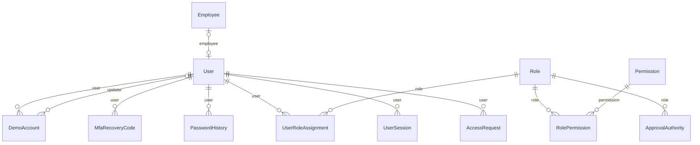
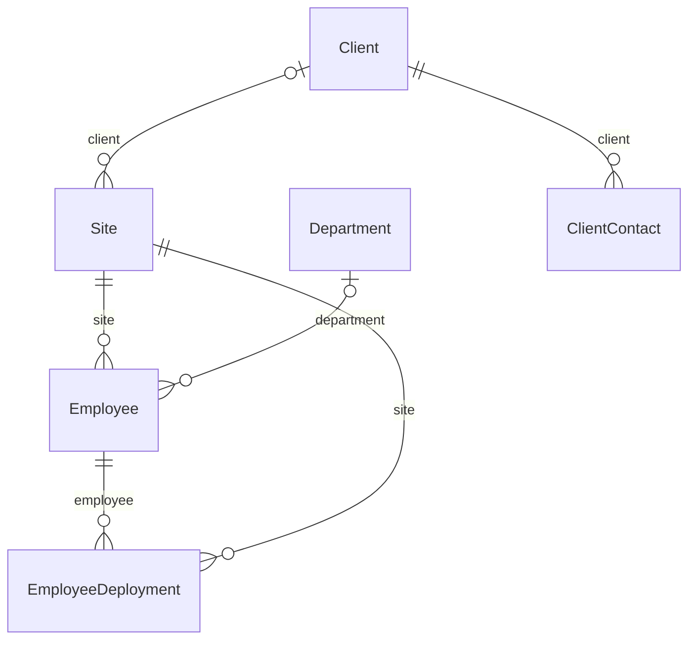
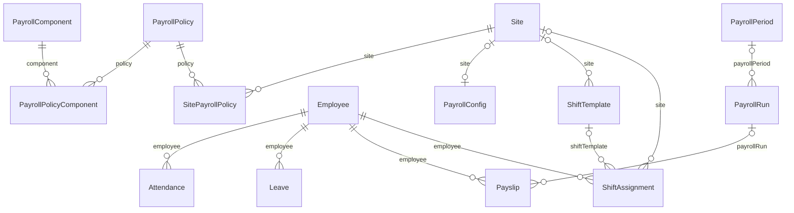
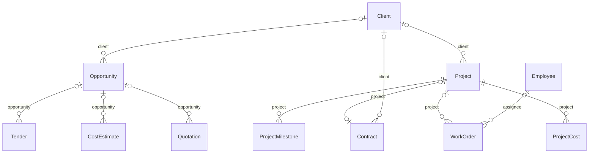
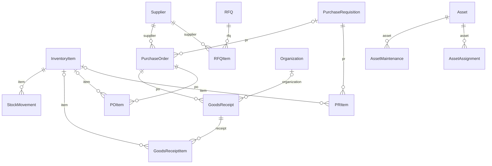
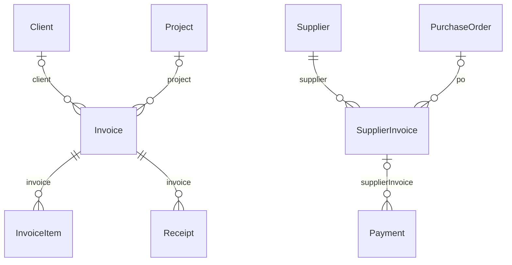
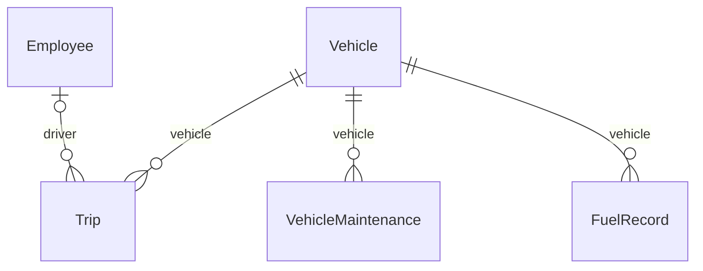
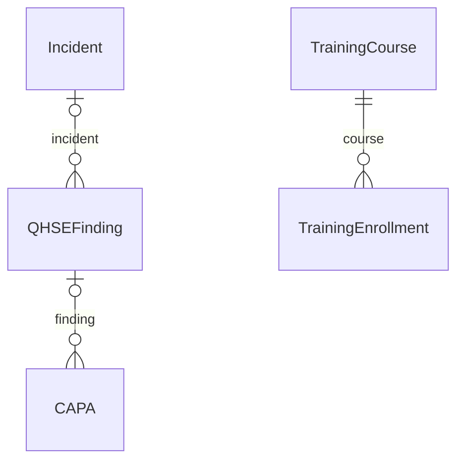
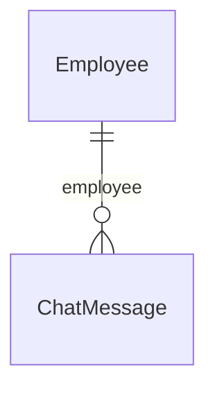

# SmartOP — โครงสร้างฐานข้อมูลเดิมทั้งหมด

วันที่ 21 พฤศจิกายน 2026 · สร้างจาก `prisma/schema.prisma` ใน working tree

ฐานเดิม: `07a6dff2ec021ea1c98da9819c88b6394b6f9f13`; รวมการเพิ่ม P3 ใน working tree ตาม migration `20261121000000_p3_inventory_foundation`

พบ **102 models** และ **133 explicit foreign-key relations** ใน source schema

เอกสารนี้เป็น data dictionary ของ schema ใน repository ไม่ใช่ผล introspect ฐานข้อมูล production จึงยังไม่ยืนยันว่า migration ทุกชุดถูก deploy หรือ schema จริงตรงกัน ไม่มีการอ่านข้อมูลพนักงาน/ธุรกรรมหรือ connection string

## วิธีอ่าน

- `?` = nullable สำหรับ scalar หรือ optional relation; `[]` = relation collection ไม่ใช่ column ใน MySQL
- `@id` = primary key; `@unique`/`@@unique` = unique; `@@index` = index ที่ประกาศใน source
- `@default(...)` และ `@updatedAt` แสดงตาม Prisma source; cuid/updatedAt อาจจัดการโดย Prisma ไม่ใช่ SQL default/trigger
- `@db.*` คือชนิด native ที่ระบุชัด หากไม่มี เอกสารนี้แสดง Prisma type โดยไม่เดา DDL จริง
- ฟิลด์ลงท้าย Id ที่ไม่มี `@relation(fields:...)` ไม่ถือว่ามี FK; ตรวจในหัวข้อ logical references
- ฟิลด์ status/role/type ที่เป็น String ไม่ได้เป็น database enum แม้ application จะใช้ค่าที่กำหนดไว้; P3 enums แสดงแยกด้านล่าง

## สรุปโมดูล

| โมดูล | จำนวน | Models |
| --- | ---: | --- |
| Identity & Access | 12 | User, DemoAccount, MfaRecoveryCode, PasswordHistory, Role, Permission, RolePermission, UserRoleAssignment, ApprovalAuthority, UserSession, AccessRequest, ApiKey |
| Organization / Employee / Site | 8 | Organization, Department, CostCenter, Employee, Site, Client, ClientContact, EmployeeDeployment |
| Attendance / Shift / Payroll | 12 | Attendance, Leave, ShiftTemplate, ShiftAssignment, PayrollPeriod, PayrollComponent, PayrollPolicy, PayrollPolicyComponent, SitePayrollPolicy, PayrollRun, PayrollConfig, Payslip |
| CRM / Project / Contract | 9 | Opportunity, Tender, CostEstimate, Quotation, Project, ProjectMilestone, Contract, WorkOrder, ProjectCost |
| Procurement / Inventory / Assets | 14 | Supplier, PurchaseRequisition, PRItem, RFQ, RFQItem, PurchaseOrder, POItem, GoodsReceipt, GoodsReceiptItem, InventoryItem, StockMovement, Asset, AssetAssignment, AssetMaintenance |
| P3 Inventory Foundation (new migration; not applied to existing DB) | 19 | MaterialCategory, UnitOfMeasure, Material, MaterialLegacyMapping, MaterialUnitConversion, MaterialPriceHistory, Warehouse, WarehouseLocation, InventoryBalance, InventoryOperation, InventoryMovement, MaterialRequisition, MaterialRequisitionLine, MaterialAcknowledgement, GoodsReceiptLine, StockTransfer, StockTransferLine, StockAdjustment, StockAdjustmentLine |
| Finance / Billing | 7 | Invoice, InvoiceItem, Receipt, SupplierInvoice, Payment, CashLedgerEntry, Budget |
| Fleet | 4 | Vehicle, Trip, VehicleMaintenance, FuelRecord |
| QHSE / Training | 8 | Incident, QHSEFinding, CAPA, Risk, PermitToWork, TrainingCourse, TrainingEnrollment, ComplianceRecord |
| Platform / Audit | 9 | AuditLog, ImportJob, Notification, WorkflowApproval, EventOutbox, AIActionProposal, Document, SystemAlert, ChatMessage |

## Enums ที่ประกาศใน schema

- **InventoryMovementType**: `PURCHASE_RECEIPT`, `ISSUE`, `RETURN`, `TRANSFER_IN`, `TRANSFER_OUT`, `ADJUSTMENT`, `PROJECT_CONSUMPTION`
- **MaterialRequisitionStatus**: `DRAFT`, `SUBMITTED`, `REVIEW`, `APPROVED`, `PARTIALLY_ISSUED`, `ISSUED`, `RECEIVED`, `REJECTED`, `CANCELLED`
- **InventoryDocumentStatus**: `DRAFT`, `SUBMITTED`, `APPROVED`, `POSTED`, `REJECTED`, `CANCELLED`

## Identity & Access

### User

| ฟิลด์ | Prisma type | ประเภท | Attributes / Default / Relation |
| --- | --- | --- | --- |
| `id` | `String` | Column | `@id @default(cuid())` |
| `email` | `String` | Column | `@unique` |
| `passwordHash` | `String?` | Column | — |
| `role` | `String` | Column | `@default("EMPLOYEE")` |
| `permissions` | `String?` | Column | `@db.Text` |
| `assignedSiteCode` | `String?` | Column | — |
| `type` | `String` | Column | `@default("INTERNAL")` |
| `displayName` | `String?` | Column | — |
| `phone` | `String?` | Column | — |
| `avatar` | `String?` | Column | — |
| `lineUserId` | `String?` | Column | `@unique` |
| `image` | `String?` | Column | — |
| `locale` | `String` | Column | `@default("th")` |
| `isActive` | `Boolean` | Column | `@default(true)` |
| `isLocked` | `Boolean` | Column | `@default(false)` |
| `lockedAt` | `DateTime?` | Column | — |
| `mfaEnabled` | `Boolean` | Column | `@default(false)` |
| `mfaSecret` | `String?` | Column | — |
| `activationPinHash` | `String?` | Column | — |
| `activationPinExpiresAt` | `DateTime?` | Column | — |
| `activationPinUsedAt` | `DateTime?` | Column | — |
| `activationPinAttempts` | `Int` | Column | `@default(0)` |
| `lastLoginAt` | `DateTime?` | Column | — |
| `lastLoginIp` | `String?` | Column | — |
| `mustChangePassword` | `Boolean` | Column | `@default(false)` |
| `authMethod` | `String` | Column | `@default("LOCAL")` |
| `passwordChangedAt` | `DateTime?` | Column | — |
| `passwordExpiresAt` | `DateTime?` | Column | — |
| `lastPasswordReminderAt` | `DateTime?` | Column | — |
| `employeeId` | `String?` | Column | `@unique` |
| `employee` | `Employee?` | Relation (ไม่ใช่ column) | `@relation(fields: [employeeId], references: [id])` |
| `authzVersion` | `Int` | Column | `@default(1)` |
| `createdAt` | `DateTime` | Column | `@default(now())` |
| `updatedAt` | `DateTime` | Column | `@updatedAt` |
| `deletedAt` | `DateTime?` | Column | — |
| `recoveryCodes` | `MfaRecoveryCode[]` | Relation (ไม่ใช่ column) | — |
| `roleAssignments` | `UserRoleAssignment[]` | Relation (ไม่ใช่ column) | — |
| `sessions` | `UserSession[]` | Relation (ไม่ใช่ column) | — |
| `accessRequests` | `AccessRequest[]` | Relation (ไม่ใช่ column) | — |
| `passwordHistory` | `PasswordHistory[]` | Relation (ไม่ใช่ column) | — |
| `demoAccounts` | `DemoAccount[]` | Relation (ไม่ใช่ column) | `@relation("DemoAccountUser")` |
| `updatedDemoAccounts` | `DemoAccount[]` | Relation (ไม่ใช่ column) | `@relation("DemoAccountUpdater")` |
| `inventoryOperations` | `InventoryOperation[]` | Relation (ไม่ใช่ column) | — |
| `createdMaterialRequisitions` | `MaterialRequisition[]` | Relation (ไม่ใช่ column) | `@relation("MaterialRequester")` |
| `approvedMaterialRequisitions` | `MaterialRequisition[]` | Relation (ไม่ใช่ column) | `@relation("MaterialApprover")` |
| `createdStockTransfers` | `StockTransfer[]` | Relation (ไม่ใช่ column) | `@relation("TransferCreator")` |
| `approvedStockTransfers` | `StockTransfer[]` | Relation (ไม่ใช่ column) | `@relation("TransferApprover")` |
| `createdStockAdjustments` | `StockAdjustment[]` | Relation (ไม่ใช่ column) | `@relation("AdjustmentCreator")` |
| `approvedStockAdjustments` | `StockAdjustment[]` | Relation (ไม่ใช่ column) | `@relation("AdjustmentApprover")` |
| `inventoryAcknowledgements` | `MaterialAcknowledgement[]` | Relation (ไม่ใช่ column) | — |

**Model constraints / indexes:**

- `@@index([email])`
- `@@index([isActive])`

### DemoAccount

| ฟิลด์ | Prisma type | ประเภท | Attributes / Default / Relation |
| --- | --- | --- | --- |
| `id` | `String` | Column | `@id @default(cuid())` |
| `demoRole` | `String` | Column | `@unique` |
| `userId` | `String` | Column | — |
| `user` | `User` | Relation (ไม่ใช่ column) | `@relation("DemoAccountUser", fields: [userId], references: [id], onDelete: Restrict)` |
| `isEnabled` | `Boolean` | Column | `@default(true)` |
| `label` | `String?` | Column | — |
| `sortOrder` | `Int` | Column | `@default(0)` |
| `updatedBy` | `String?` | Column | — |
| `updater` | `User?` | Relation (ไม่ใช่ column) | `@relation("DemoAccountUpdater", fields: [updatedBy], references: [id], onDelete: SetNull)` |
| `createdAt` | `DateTime` | Column | `@default(now())` |
| `updatedAt` | `DateTime` | Column | `@updatedAt` |

**Model constraints / indexes:**

- `@@index([userId])`
- `@@index([updatedBy])`

### MfaRecoveryCode

| ฟิลด์ | Prisma type | ประเภท | Attributes / Default / Relation |
| --- | --- | --- | --- |
| `id` | `String` | Column | `@id @default(cuid())` |
| `userId` | `String` | Column | — |
| `user` | `User` | Relation (ไม่ใช่ column) | `@relation(fields: [userId], references: [id], onDelete: Cascade)` |
| `codeHash` | `String` | Column | — |
| `usedAt` | `DateTime?` | Column | — |
| `createdAt` | `DateTime` | Column | `@default(now())` |

**Model constraints / indexes:**

- `@@index([userId, usedAt])`

### PasswordHistory

| ฟิลด์ | Prisma type | ประเภท | Attributes / Default / Relation |
| --- | --- | --- | --- |
| `id` | `String` | Column | `@id @default(cuid())` |
| `userId` | `String` | Column | — |
| `user` | `User` | Relation (ไม่ใช่ column) | `@relation(fields: [userId], references: [id], onDelete: Cascade)` |
| `passwordHash` | `String` | Column | — |
| `createdAt` | `DateTime` | Column | `@default(now())` |

**Model constraints / indexes:**

- `@@index([userId, createdAt])`

### Role

| ฟิลด์ | Prisma type | ประเภท | Attributes / Default / Relation |
| --- | --- | --- | --- |
| `id` | `String` | Column | `@id @default(cuid())` |
| `code` | `String` | Column | `@unique` |
| `nameTh` | `String` | Column | — |
| `nameEn` | `String` | Column | — |
| `description` | `String?` | Column | `@db.Text` |
| `level` | `Int` | Column | `@default(1)` |
| `departmentType` | `String?` | Column | — |
| `isSystem` | `Boolean` | Column | `@default(false)` |
| `isActive` | `Boolean` | Column | `@default(true)` |
| `createdAt` | `DateTime` | Column | `@default(now())` |
| `updatedAt` | `DateTime` | Column | `@updatedAt` |
| `permissions` | `RolePermission[]` | Relation (ไม่ใช่ column) | — |
| `userAssignments` | `UserRoleAssignment[]` | Relation (ไม่ใช่ column) | — |
| `authorities` | `ApprovalAuthority[]` | Relation (ไม่ใช่ column) | — |

**Model constraints / indexes:**

- `@@index([code])`
- `@@index([isActive])`
- `@@map("role")`

### Permission

| ฟิลด์ | Prisma type | ประเภท | Attributes / Default / Relation |
| --- | --- | --- | --- |
| `id` | `String` | Column | `@id @default(cuid())` |
| `code` | `String` | Column | `@unique` |
| `module` | `String` | Column | — |
| `action` | `String` | Column | — |
| `description` | `String?` | Column | `@db.Text` |
| `sensitivity` | `String` | Column | `@default("NORMAL")` |
| `isActive` | `Boolean` | Column | `@default(true)` |
| `createdAt` | `DateTime` | Column | `@default(now())` |
| `roles` | `RolePermission[]` | Relation (ไม่ใช่ column) | — |

**Model constraints / indexes:**

- `@@index([code])`
- `@@index([module])`

### RolePermission

| ฟิลด์ | Prisma type | ประเภท | Attributes / Default / Relation |
| --- | --- | --- | --- |
| `id` | `String` | Column | `@id @default(cuid())` |
| `roleId` | `String` | Column | — |
| `role` | `Role` | Relation (ไม่ใช่ column) | `@relation(fields: [roleId], references: [id], onDelete: Cascade)` |
| `permissionId` | `String` | Column | — |
| `permission` | `Permission` | Relation (ไม่ใช่ column) | `@relation(fields: [permissionId], references: [id], onDelete: Cascade)` |
| `createdAt` | `DateTime` | Column | `@default(now())` |

**Model constraints / indexes:**

- `@@unique([roleId, permissionId])`
- `@@index([roleId])`
- `@@index([permissionId])`
- `@@map("rolepermission")`

### UserRoleAssignment

| ฟิลด์ | Prisma type | ประเภท | Attributes / Default / Relation |
| --- | --- | --- | --- |
| `id` | `String` | Column | `@id @default(cuid())` |
| `userId` | `String` | Column | — |
| `user` | `User` | Relation (ไม่ใช่ column) | `@relation(fields: [userId], references: [id], onDelete: Cascade)` |
| `roleId` | `String` | Column | — |
| `role` | `Role` | Relation (ไม่ใช่ column) | `@relation(fields: [roleId], references: [id], onDelete: Cascade)` |
| `scopeType` | `String` | Column | `@default("GLOBAL")` |
| `scopeId` | `String?` | Column | — |
| `startAt` | `DateTime?` | Column | — |
| `endAt` | `DateTime?` | Column | — |
| `assignedBy` | `String?` | Column | — |
| `reason` | `String?` | Column | `@db.Text` |
| `status` | `String` | Column | `@default("ACTIVE")` |
| `createdAt` | `DateTime` | Column | `@default(now())` |
| `updatedAt` | `DateTime` | Column | `@updatedAt` |

**Model constraints / indexes:**

- `@@index([userId, status])`
- `@@index([roleId])`
- `@@index([scopeType, scopeId])`

### ApprovalAuthority

| ฟิลด์ | Prisma type | ประเภท | Attributes / Default / Relation |
| --- | --- | --- | --- |
| `id` | `String` | Column | `@id @default(cuid())` |
| `roleId` | `String` | Column | — |
| `role` | `Role` | Relation (ไม่ใช่ column) | `@relation(fields: [roleId], references: [id], onDelete: Cascade)` |
| `module` | `String` | Column | — |
| `action` | `String` | Column | — |
| `level` | `String` | Column | — |
| `minAmount` | `Decimal?` | Column | `@default(0) @db.Decimal(18, 2)` |
| `maxAmount` | `Decimal?` | Column | `@db.Decimal(18, 2)` |
| `isEnabled` | `Boolean` | Column | `@default(true)` |
| `createdAt` | `DateTime` | Column | `@default(now())` |

**Model constraints / indexes:**

- `@@index([roleId, module])`
- `@@map("approvalauthority")`

### UserSession

| ฟิลด์ | Prisma type | ประเภท | Attributes / Default / Relation |
| --- | --- | --- | --- |
| `id` | `String` | Column | `@id @default(cuid())` |
| `sessionId` | `String` | Column | `@unique` |
| `userId` | `String` | Column | — |
| `user` | `User` | Relation (ไม่ใช่ column) | `@relation(fields: [userId], references: [id], onDelete: Cascade)` |
| `tokenHash` | `String?` | Column | — |
| `deviceInfo` | `String?` | Column | — |
| `ipAddress` | `String?` | Column | — |
| `userAgent` | `String?` | Column | `@db.Text` |
| `status` | `String` | Column | `@default("ACTIVE")` |
| `authStrength` | `String` | Column | `@default("PASSWORD")` |
| `authzVersion` | `Int` | Column | `@default(1)` |
| `lastSeenAt` | `DateTime` | Column | `@default(now())` |
| `expiresAt` | `DateTime` | Column | — |
| `createdAt` | `DateTime` | Column | `@default(now())` |

**Model constraints / indexes:**

- `@@index([userId, status])`
- `@@index([sessionId])`

### AccessRequest

| ฟิลด์ | Prisma type | ประเภท | Attributes / Default / Relation |
| --- | --- | --- | --- |
| `id` | `String` | Column | `@id @default(cuid())` |
| `userId` | `String` | Column | — |
| `user` | `User` | Relation (ไม่ใช่ column) | `@relation(fields: [userId], references: [id], onDelete: Cascade)` |
| `targetRoleId` | `String?` | Column | — |
| `permissionCode` | `String?` | Column | — |
| `scopeType` | `String?` | Column | — |
| `scopeId` | `String?` | Column | — |
| `reason` | `String` | Column | `@db.Text` |
| `durationDays` | `Int?` | Column | `@default(30)` |
| `status` | `String` | Column | `@default("PENDING")` |
| `reviewedBy` | `String?` | Column | — |
| `reviewedAt` | `DateTime?` | Column | — |
| `reviewNote` | `String?` | Column | `@db.Text` |
| `createdAt` | `DateTime` | Column | `@default(now())` |
| `updatedAt` | `DateTime` | Column | `@updatedAt` |

**Model constraints / indexes:**

- `@@index([userId, status])`
- `@@map("accessrequest")`

### ApiKey

| ฟิลด์ | Prisma type | ประเภท | Attributes / Default / Relation |
| --- | --- | --- | --- |
| `id` | `String` | Column | `@id @default(cuid())` |
| `name` | `String` | Column | — |
| `keyHash` | `String` | Column | `@unique` |
| `type` | `String` | Column | `@default("SECRET")` |
| `scopes` | `Json` | Column | — |
| `allowedIps` | `Json` | Column | — |
| `tenantId` | `String?` | Column | — |
| `status` | `String` | Column | `@default("ACTIVE")` |
| `expiresAt` | `DateTime?` | Column | — |
| `lastUsedAt` | `DateTime?` | Column | — |
| `createdById` | `String` | Column | — |
| `createdAt` | `DateTime` | Column | `@default(now())` |
| `revokedAt` | `DateTime?` | Column | — |

**Model constraints / indexes:**

- `@@index([status, expiresAt])`
- `@@index([tenantId])`

## Organization / Employee / Site

### Organization

| ฟิลด์ | Prisma type | ประเภท | Attributes / Default / Relation |
| --- | --- | --- | --- |
| `id` | `String` | Column | `@id @default(cuid())` |
| `code` | `String` | Column | `@unique` |
| `name` | `String` | Column | — |
| `nameTh` | `String?` | Column | — |
| `taxId` | `String?` | Column | — |
| `address` | `String?` | Column | — |
| `phone` | `String?` | Column | — |
| `email` | `String?` | Column | — |
| `logo` | `String?` | Column | — |
| `isActive` | `Boolean` | Column | `@default(true)` |
| `createdAt` | `DateTime` | Column | `@default(now())` |
| `updatedAt` | `DateTime` | Column | `@updatedAt` |
| `materialCategories` | `MaterialCategory[]` | Relation (ไม่ใช่ column) | — |
| `materials` | `Material[]` | Relation (ไม่ใช่ column) | — |
| `warehouses` | `Warehouse[]` | Relation (ไม่ใช่ column) | — |
| `inventoryOperations` | `InventoryOperation[]` | Relation (ไม่ใช่ column) | — |
| `materialRequisitions` | `MaterialRequisition[]` | Relation (ไม่ใช่ column) | — |
| `stockTransfers` | `StockTransfer[]` | Relation (ไม่ใช่ column) | — |
| `stockAdjustments` | `StockAdjustment[]` | Relation (ไม่ใช่ column) | — |
| `materialReceipts` | `GoodsReceipt[]` | Relation (ไม่ใช่ column) | — |

**Model constraints / indexes:**

ไม่มี model-level constraint/index เพิ่มเติมใน source; ดู field-level attributes ด้านบน

### Department

| ฟิลด์ | Prisma type | ประเภท | Attributes / Default / Relation |
| --- | --- | --- | --- |
| `id` | `String` | Column | `@id @default(cuid())` |
| `code` | `String` | Column | `@unique` |
| `name` | `String` | Column | — |
| `nameTh` | `String?` | Column | — |
| `parentId` | `String?` | Column | — |
| `isActive` | `Boolean` | Column | `@default(true)` |
| `createdAt` | `DateTime` | Column | `@default(now())` |
| `updatedAt` | `DateTime` | Column | `@updatedAt` |
| `employees` | `Employee[]` | Relation (ไม่ใช่ column) | — |

**Model constraints / indexes:**

ไม่มี model-level constraint/index เพิ่มเติมใน source; ดู field-level attributes ด้านบน

### CostCenter

| ฟิลด์ | Prisma type | ประเภท | Attributes / Default / Relation |
| --- | --- | --- | --- |
| `id` | `String` | Column | `@id @default(cuid())` |
| `code` | `String` | Column | `@unique` |
| `name` | `String` | Column | — |
| `nameTh` | `String?` | Column | — |
| `isActive` | `Boolean` | Column | `@default(true)` |
| `createdAt` | `DateTime` | Column | `@default(now())` |
| `InventoryOperation` | `InventoryOperation[]` | Relation (ไม่ใช่ column) | — |

**Model constraints / indexes:**

ไม่มี model-level constraint/index เพิ่มเติมใน source; ดู field-level attributes ด้านบน

### Employee

| ฟิลด์ | Prisma type | ประเภท | Attributes / Default / Relation |
| --- | --- | --- | --- |
| `id` | `String` | Column | `@id @default(cuid())` |
| `code` | `String` | Column | `@unique` |
| `prefix` | `String?` | Column | — |
| `firstName` | `String` | Column | — |
| `lastName` | `String` | Column | — |
| `position` | `String` | Column | — |
| `siteId` | `String` | Column | — |
| `site` | `Site` | Relation (ไม่ใช่ column) | `@relation(fields: [siteId], references: [id])` |
| `startDate` | `DateTime?` | Column | — |
| `birthDate` | `DateTime?` | Column | — |
| `gender` | `String` | Column | `@default("MALE")` |
| `nationality` | `String` | Column | `@default("Thai")` |
| `idCardNo` | `String?` | Column | `@unique` |
| `phone` | `String?` | Column | — |
| `bankAccount` | `String?` | Column | — |
| `bankName` | `String?` | Column | — |
| `insurance` | `String?` | Column | — |
| `hospital` | `String?` | Column | — |
| `education` | `String?` | Column | — |
| `hometown` | `String?` | Column | — |
| `salaryType` | `String` | Column | `@default("MONTHLY")` |
| `baseSalary` | `Decimal` | Column | `@default(12000) @db.Decimal(18, 2)` |
| `dailyRate` | `Decimal` | Column | `@default(400) @db.Decimal(18, 2)` |
| `isActive` | `Boolean` | Column | `@default(true)` |
| `employmentStatus` | `String` | Column | `@default("ACTIVE")` |
| `preferredLanguage` | `String` | Column | `@default("th")` |
| `departmentId` | `String?` | Column | — |
| `department` | `Department?` | Relation (ไม่ใช่ column) | `@relation(fields: [departmentId], references: [id])` |
| `user` | `User?` | Relation (ไม่ใช่ column) | — |
| `attendances` | `Attendance[]` | Relation (ไม่ใช่ column) | — |
| `leaves` | `Leave[]` | Relation (ไม่ใช่ column) | — |
| `payslips` | `Payslip[]` | Relation (ไม่ใช่ column) | — |
| `chats` | `ChatMessage[]` | Relation (ไม่ใช่ column) | — |
| `shiftAssignments` | `ShiftAssignment[]` | Relation (ไม่ใช่ column) | — |
| `assignedWorkOrders` | `WorkOrder[]` | Relation (ไม่ใช่ column) | — |
| `drivenTrips` | `Trip[]` | Relation (ไม่ใช่ column) | `@relation("TripDriver")` |
| `deployments` | `EmployeeDeployment[]` | Relation (ไม่ใช่ column) | — |
| `createdAt` | `DateTime` | Column | `@default(now())` |
| `updatedAt` | `DateTime` | Column | `@updatedAt` |

**Model constraints / indexes:**

- `@@index([siteId])`
- `@@index([code])`
- `@@index([departmentId])`

### Site

| ฟิลด์ | Prisma type | ประเภท | Attributes / Default / Relation |
| --- | --- | --- | --- |
| `id` | `String` | Column | `@id @default(cuid())` |
| `code` | `String` | Column | `@unique` |
| `name` | `String` | Column | — |
| `shortName` | `String?` | Column | — |
| `clientId` | `String?` | Column | — |
| `client` | `Client?` | Relation (ไม่ใช่ column) | `@relation(fields: [clientId], references: [id])` |
| `status` | `String` | Column | `@default("ACTIVE")` |
| `location` | `String?` | Column | — |
| `estateName` | `String?` | Column | — |
| `contactName` | `String?` | Column | — |
| `contactEmail` | `String?` | Column | — |
| `contactPhone` | `String?` | Column | — |
| `lat` | `Float?` | Column | — |
| `lng` | `Float?` | Column | — |
| `radius` | `Int` | Column | `@default(200)` |
| `workStart` | `Float` | Column | `@default(7)` |
| `workEnd` | `Float` | Column | `@default(16)` |
| `otStart` | `Float?` | Column | `@default(16)` |
| `otEnd` | `Float?` | Column | `@default(17)` |
| `employees` | `Employee[]` | Relation (ไม่ใช่ column) | — |
| `shiftAssignments` | `ShiftAssignment[]` | Relation (ไม่ใช่ column) | — |
| `config` | `PayrollConfig?` | Relation (ไม่ใช่ column) | — |
| `shiftTemplates` | `ShiftTemplate[]` | Relation (ไม่ใช่ column) | — |
| `payrollPolicies` | `SitePayrollPolicy[]` | Relation (ไม่ใช่ column) | — |
| `deployments` | `EmployeeDeployment[]` | Relation (ไม่ใช่ column) | — |
| `inventoryOperations` | `InventoryOperation[]` | Relation (ไม่ใช่ column) | — |
| `materialRequisitions` | `MaterialRequisition[]` | Relation (ไม่ใช่ column) | — |
| `materialWarehouses` | `Warehouse[]` | Relation (ไม่ใช่ column) | — |
| `createdAt` | `DateTime` | Column | `@default(now())` |

**Model constraints / indexes:**

- `@@index([clientId])`

### Client

| ฟิลด์ | Prisma type | ประเภท | Attributes / Default / Relation |
| --- | --- | --- | --- |
| `id` | `String` | Column | `@id @default(cuid())` |
| `code` | `String` | Column | `@unique` |
| `name` | `String` | Column | — |
| `nameTh` | `String?` | Column | — |
| `taxId` | `String?` | Column | — |
| `address` | `String?` | Column | — |
| `contactName` | `String?` | Column | — |
| `contactPhone` | `String?` | Column | — |
| `contactEmail` | `String?` | Column | — |
| `industry` | `String?` | Column | — |
| `isActive` | `Boolean` | Column | `@default(true)` |
| `createdAt` | `DateTime` | Column | `@default(now())` |
| `updatedAt` | `DateTime` | Column | `@updatedAt` |
| `projects` | `Project[]` | Relation (ไม่ใช่ column) | — |
| `contracts` | `Contract[]` | Relation (ไม่ใช่ column) | — |
| `invoices` | `Invoice[]` | Relation (ไม่ใช่ column) | — |
| `opportunities` | `Opportunity[]` | Relation (ไม่ใช่ column) | — |
| `contacts` | `ClientContact[]` | Relation (ไม่ใช่ column) | — |
| `sites` | `Site[]` | Relation (ไม่ใช่ column) | — |

**Model constraints / indexes:**

ไม่มี model-level constraint/index เพิ่มเติมใน source; ดู field-level attributes ด้านบน

### ClientContact

| ฟิลด์ | Prisma type | ประเภท | Attributes / Default / Relation |
| --- | --- | --- | --- |
| `id` | `String` | Column | `@id @default(cuid())` |
| `clientId` | `String` | Column | — |
| `client` | `Client` | Relation (ไม่ใช่ column) | `@relation(fields: [clientId], references: [id], onDelete: Cascade)` |
| `name` | `String` | Column | — |
| `position` | `String?` | Column | — |
| `email` | `String?` | Column | — |
| `phone` | `String?` | Column | — |
| `createdAt` | `DateTime` | Column | `@default(now())` |
| `updatedAt` | `DateTime` | Column | `@updatedAt` |
| `inventoryOperations` | `InventoryOperation[]` | Relation (ไม่ใช่ column) | — |

**Model constraints / indexes:**

- `@@index([clientId])`

### EmployeeDeployment

| ฟิลด์ | Prisma type | ประเภท | Attributes / Default / Relation |
| --- | --- | --- | --- |
| `id` | `String` | Column | `@id @default(cuid())` |
| `employeeId` | `String` | Column | — |
| `employee` | `Employee` | Relation (ไม่ใช่ column) | `@relation(fields: [employeeId], references: [id])` |
| `siteId` | `String` | Column | — |
| `site` | `Site` | Relation (ไม่ใช่ column) | `@relation(fields: [siteId], references: [id])` |
| `effectiveDate` | `DateTime` | Column | — |
| `position` | `String` | Column | — |
| `supervisorId` | `String?` | Column | — |
| `documentRefs` | `Json?` | Column | — |
| `status` | `String` | Column | `@default("PENDING")` |
| `approvedById` | `String?` | Column | — |
| `approvedAt` | `DateTime?` | Column | — |
| `createdAt` | `DateTime` | Column | `@default(now())` |
| `updatedAt` | `DateTime` | Column | `@updatedAt` |

**Model constraints / indexes:**

- `@@unique([employeeId, siteId, effectiveDate])`
- `@@index([siteId, effectiveDate])`
- `@@index([status, effectiveDate])`

## Attendance / Shift / Payroll

### Attendance

| ฟิลด์ | Prisma type | ประเภท | Attributes / Default / Relation |
| --- | --- | --- | --- |
| `id` | `String` | Column | `@id @default(cuid())` |
| `employeeId` | `String` | Column | — |
| `employee` | `Employee` | Relation (ไม่ใช่ column) | `@relation(fields: [employeeId], references: [id], onDelete: Cascade)` |
| `localId` | `String?` | Column | `@unique` |
| `type` | `String` | Column | — |
| `timestamp` | `DateTime` | Column | `@default(now())` |
| `lat` | `Float` | Column | — |
| `lng` | `Float` | Column | — |
| `distance` | `Float` | Column | — |
| `accuracy` | `Float?` | Column | — |
| `isWithinGeofence` | `Boolean` | Column | `@default(false)` |
| `photoUrl` | `String?` | Column | — |
| `photoHash` | `String?` | Column | — |
| `deviceInfo` | `String?` | Column | — |
| `note` | `String?` | Column | — |
| `isApproved` | `Boolean` | Column | `@default(false)` |
| `approvalStatus` | `String` | Column | `@default("PENDING")` |
| `approvedBy` | `String?` | Column | — |
| `approvedAt` | `DateTime?` | Column | — |
| `createdAt` | `DateTime` | Column | `@default(now())` |

**Model constraints / indexes:**

- `@@index([employeeId, timestamp])`
- `@@index([timestamp])`
- `@@index([approvalStatus, timestamp])`
- `@@index([localId])`

### Leave

| ฟิลด์ | Prisma type | ประเภท | Attributes / Default / Relation |
| --- | --- | --- | --- |
| `id` | `String` | Column | `@id @default(cuid())` |
| `employeeId` | `String` | Column | — |
| `employee` | `Employee` | Relation (ไม่ใช่ column) | `@relation(fields: [employeeId], references: [id], onDelete: Cascade)` |
| `type` | `String` | Column | — |
| `startDate` | `DateTime` | Column | — |
| `endDate` | `DateTime` | Column | — |
| `reason` | `String?` | Column | — |
| `status` | `String` | Column | `@default("PENDING")` |
| `approvedBy` | `String?` | Column | — |
| `approvedAt` | `DateTime?` | Column | — |
| `createdAt` | `DateTime` | Column | `@default(now())` |

**Model constraints / indexes:**

- `@@index([employeeId, status])`

### ShiftTemplate

| ฟิลด์ | Prisma type | ประเภท | Attributes / Default / Relation |
| --- | --- | --- | --- |
| `id` | `String` | Column | `@id @default(cuid())` |
| `code` | `String` | Column | `@unique` |
| `name` | `String` | Column | — |
| `siteId` | `String?` | Column | — |
| `site` | `Site?` | Relation (ไม่ใช่ column) | `@relation(fields: [siteId], references: [id])` |
| `positionType` | `String?` | Column | — |
| `type` | `String` | Column | `@default("DAY")` |
| `startTime` | `String` | Column | — |
| `endTime` | `String` | Column | — |
| `otStartTime` | `String?` | Column | — |
| `otEndTime` | `String?` | Column | — |
| `crossMidnight` | `Boolean` | Column | `@default(false)` |
| `breakMinutes` | `Int` | Column | `@default(60)` |
| `isActive` | `Boolean` | Column | `@default(true)` |
| `createdAt` | `DateTime` | Column | `@default(now())` |
| `assignments` | `ShiftAssignment[]` | Relation (ไม่ใช่ column) | — |

**Model constraints / indexes:**

- `@@index([siteId, isActive])`

### ShiftAssignment

| ฟิลด์ | Prisma type | ประเภท | Attributes / Default / Relation |
| --- | --- | --- | --- |
| `id` | `String` | Column | `@id @default(cuid())` |
| `employeeId` | `String` | Column | — |
| `employee` | `Employee` | Relation (ไม่ใช่ column) | `@relation(fields: [employeeId], references: [id], onDelete: Cascade)` |
| `siteId` | `String?` | Column | — |
| `site` | `Site?` | Relation (ไม่ใช่ column) | `@relation(fields: [siteId], references: [id])` |
| `shiftTemplateId` | `String?` | Column | — |
| `shiftTemplate` | `ShiftTemplate?` | Relation (ไม่ใช่ column) | `@relation(fields: [shiftTemplateId], references: [id])` |
| `date` | `DateTime` | Column | — |
| `startTime` | `String?` | Column | — |
| `endTime` | `String?` | Column | — |
| `shiftType` | `String` | Column | `@default("DAY") // "DAY", "OT", "OFF", "LEAVE", "RELIEF"` |
| `workHours` | `Float` | Column | `@default(8)` |
| `otHours` | `Float` | Column | `@default(0)` |
| `isRelief` | `Boolean` | Column | `@default(false)` |
| `homeSiteId` | `String?` | Column | — |
| `note` | `String?` | Column | — |
| `isPublished` | `Boolean` | Column | `@default(false)` |
| `createdAt` | `DateTime` | Column | `@default(now())` |
| `updatedAt` | `DateTime` | Column | `@updatedAt` |

**Model constraints / indexes:**

- `@@unique([employeeId, date])`
- `@@index([date])`
- `@@index([siteId, date])`

### PayrollPeriod

| ฟิลด์ | Prisma type | ประเภท | Attributes / Default / Relation |
| --- | --- | --- | --- |
| `id` | `String` | Column | `@id @default(cuid())` |
| `name` | `String` | Column | — |
| `startDate` | `DateTime` | Column | — |
| `endDate` | `DateTime` | Column | — |
| `month` | `Int` | Column | — |
| `year` | `Int` | Column | — |
| `status` | `String` | Column | `@default("DRAFT")` |
| `createdAt` | `DateTime` | Column | `@default(now())` |
| `updatedAt` | `DateTime` | Column | `@updatedAt` |
| `payrollRuns` | `PayrollRun[]` | Relation (ไม่ใช่ column) | — |

**Model constraints / indexes:**

- `@@unique([startDate, endDate])`
- `@@index([year, month])`

### PayrollComponent

| ฟิลด์ | Prisma type | ประเภท | Attributes / Default / Relation |
| --- | --- | --- | --- |
| `id` | `String` | Column | `@id @default(cuid())` |
| `code` | `String` | Column | `@unique` |
| `name` | `String` | Column | — |
| `type` | `String` | Column | — |
| `calculationType` | `String` | Column | — |
| `rate` | `Decimal?` | Column | `@db.Decimal(18, 4)` |
| `multiplier` | `Decimal?` | Column | `@db.Decimal(10, 4)` |
| `taxable` | `Boolean` | Column | `@default(false)` |
| `socialSecurityBase` | `Boolean` | Column | `@default(false)` |
| `isActive` | `Boolean` | Column | `@default(true)` |
| `createdAt` | `DateTime` | Column | `@default(now())` |
| `updatedAt` | `DateTime` | Column | `@updatedAt` |
| `policies` | `PayrollPolicyComponent[]` | Relation (ไม่ใช่ column) | — |

**Model constraints / indexes:**

ไม่มี model-level constraint/index เพิ่มเติมใน source; ดู field-level attributes ด้านบน

### PayrollPolicy

| ฟิลด์ | Prisma type | ประเภท | Attributes / Default / Relation |
| --- | --- | --- | --- |
| `id` | `String` | Column | `@id @default(cuid())` |
| `code` | `String` | Column | `@unique` |
| `name` | `String` | Column | — |
| `status` | `String` | Column | `@default("DRAFT")` |
| `effectiveFrom` | `DateTime?` | Column | — |
| `effectiveTo` | `DateTime?` | Column | — |
| `createdAt` | `DateTime` | Column | `@default(now())` |
| `updatedAt` | `DateTime` | Column | `@updatedAt` |
| `components` | `PayrollPolicyComponent[]` | Relation (ไม่ใช่ column) | — |
| `sites` | `SitePayrollPolicy[]` | Relation (ไม่ใช่ column) | — |

**Model constraints / indexes:**

ไม่มี model-level constraint/index เพิ่มเติมใน source; ดู field-level attributes ด้านบน

### PayrollPolicyComponent

| ฟิลด์ | Prisma type | ประเภท | Attributes / Default / Relation |
| --- | --- | --- | --- |
| `id` | `String` | Column | `@id @default(cuid())` |
| `policyId` | `String` | Column | — |
| `policy` | `PayrollPolicy` | Relation (ไม่ใช่ column) | `@relation(fields: [policyId], references: [id], onDelete: Cascade)` |
| `componentId` | `String` | Column | — |
| `component` | `PayrollComponent` | Relation (ไม่ใช่ column) | `@relation(fields: [componentId], references: [id])` |
| `config` | `Json?` | Column | — |
| `isActive` | `Boolean` | Column | `@default(true)` |

**Model constraints / indexes:**

- `@@unique([policyId, componentId])`

### SitePayrollPolicy

| ฟิลด์ | Prisma type | ประเภท | Attributes / Default / Relation |
| --- | --- | --- | --- |
| `id` | `String` | Column | `@id @default(cuid())` |
| `siteId` | `String` | Column | — |
| `site` | `Site` | Relation (ไม่ใช่ column) | `@relation(fields: [siteId], references: [id])` |
| `policyId` | `String` | Column | — |
| `policy` | `PayrollPolicy` | Relation (ไม่ใช่ column) | `@relation(fields: [policyId], references: [id])` |
| `startDate` | `DateTime` | Column | — |
| `endDate` | `DateTime?` | Column | — |

**Model constraints / indexes:**

- `@@unique([siteId, policyId, startDate])`
- `@@index([siteId, startDate])`

### PayrollRun

| ฟิลด์ | Prisma type | ประเภท | Attributes / Default / Relation |
| --- | --- | --- | --- |
| `id` | `String` | Column | `@id @default(cuid())` |
| `period` | `String` | Column | — |
| `siteId` | `String?` | Column | — |
| `status` | `String` | Column | `@default("DRAFT")` |
| `totalAmount` | `Decimal` | Column | `@default(0) @db.Decimal(18, 2)` |
| `createdById` | `String?` | Column | — |
| `approvedById` | `String?` | Column | — |
| `approvedAt` | `DateTime?` | Column | — |
| `paidAt` | `DateTime?` | Column | — |
| `notes` | `String?` | Column | — |
| `createdAt` | `DateTime` | Column | `@default(now())` |
| `updatedAt` | `DateTime` | Column | `@updatedAt` |
| `payslips` | `Payslip[]` | Relation (ไม่ใช่ column) | — |
| `payrollPeriodId` | `String?` | Column | — |
| `payrollPeriod` | `PayrollPeriod?` | Relation (ไม่ใช่ column) | `@relation(fields: [payrollPeriodId], references: [id])` |

**Model constraints / indexes:**

- `@@unique([period, siteId])`
- `@@index([payrollPeriodId])`

### PayrollConfig

| ฟิลด์ | Prisma type | ประเภท | Attributes / Default / Relation |
| --- | --- | --- | --- |
| `id` | `String` | Column | `@id @default(cuid())` |
| `siteId` | `String?` | Column | `@unique` |
| `site` | `Site?` | Relation (ไม่ใช่ column) | `@relation(fields: [siteId], references: [id])` |
| `otRate` | `Decimal` | Column | `@default(75) @db.Decimal(18, 2)` |
| `travelAllowance` | `Decimal` | Column | `@default(0) @db.Decimal(18, 2)` |
| `diligenceAmount` | `Decimal` | Column | `@default(1000) @db.Decimal(18, 2)` |
| `diligenceMaxLate` | `Int` | Column | `@default(3)` |
| `workingDaysPerMonth` | `Int` | Column | `@default(26)` |
| `workingHoursPerDay` | `Int` | Column | `@default(8)` |
| `effectiveFrom` | `DateTime` | Column | `@default(now())` |
| `effectiveTo` | `DateTime?` | Column | — |

**Model constraints / indexes:**

ไม่มี model-level constraint/index เพิ่มเติมใน source; ดู field-level attributes ด้านบน

### Payslip

| ฟิลด์ | Prisma type | ประเภท | Attributes / Default / Relation |
| --- | --- | --- | --- |
| `id` | `String` | Column | `@id @default(cuid())` |
| `employeeId` | `String` | Column | — |
| `employee` | `Employee` | Relation (ไม่ใช่ column) | `@relation(fields: [employeeId], references: [id], onDelete: Cascade)` |
| `payrollRunId` | `String?` | Column | — |
| `payrollRun` | `PayrollRun?` | Relation (ไม่ใช่ column) | `@relation(fields: [payrollRunId], references: [id])` |
| `period` | `String` | Column | `// "2026-09"` |
| `baseSalary` | `Decimal` | Column | `@db.Decimal(18, 2)` |
| `dailyRate` | `Decimal?` | Column | `@default(0) @db.Decimal(18, 2)` |
| `workedDays` | `Int?` | Column | `@default(0)` |
| `dailyAmount` | `Decimal?` | Column | `@default(0) @db.Decimal(18, 2)` |
| `otHours` | `Float` | Column | `@default(0)` |
| `otAmount` | `Decimal` | Column | `@default(0) @db.Decimal(18, 2)` |
| `ot1Hours` | `Float?` | Column | `@default(0)` |
| `ot1Amount` | `Decimal?` | Column | `@default(0) @db.Decimal(18, 2)` |
| `ot15Hours` | `Float?` | Column | `@default(0)` |
| `ot15Amount` | `Decimal?` | Column | `@default(0) @db.Decimal(18, 2)` |
| `ot2Hours` | `Float?` | Column | `@default(0)` |
| `ot2Amount` | `Decimal?` | Column | `@default(0) @db.Decimal(18, 2)` |
| `ot3Hours` | `Float?` | Column | `@default(0)` |
| `ot3Amount` | `Decimal?` | Column | `@default(0) @db.Decimal(18, 2)` |
| `travelAllow` | `Decimal` | Column | `@default(0) @db.Decimal(18, 2)` |
| `diligence` | `Decimal` | Column | `@default(0) @db.Decimal(18, 2)` |
| `mealAllow` | `Decimal?` | Column | `@default(0) @db.Decimal(18, 2)` |
| `otMealAllow` | `Decimal?` | Column | `@default(0) @db.Decimal(18, 2)` |
| `heatAllow` | `Decimal?` | Column | `@default(0) @db.Decimal(18, 2)` |
| `dishwashAllow` | `Decimal?` | Column | `@default(0) @db.Decimal(18, 2)` |
| `skillAllow` | `Decimal?` | Column | `@default(0) @db.Decimal(18, 2)` |
| `incentive` | `Decimal?` | Column | `@default(0) @db.Decimal(18, 2)` |
| `shiftAllow` | `Decimal?` | Column | `@default(0) @db.Decimal(18, 2)` |
| `phoneAllow` | `Decimal?` | Column | `@default(0) @db.Decimal(18, 2)` |
| `positionAllow` | `Decimal?` | Column | `@default(0) @db.Decimal(18, 2)` |
| `housingAllow` | `Decimal?` | Column | `@default(0) @db.Decimal(18, 2)` |
| `coordAllow` | `Decimal?` | Column | `@default(0) @db.Decimal(18, 2)` |
| `holidayPay` | `Decimal?` | Column | `@default(0) @db.Decimal(18, 2)` |
| `leavePay` | `Decimal?` | Column | `@default(0) @db.Decimal(18, 2)` |
| `otherIncome` | `Decimal` | Column | `@default(0) @db.Decimal(18, 2)` |
| `grossIncome` | `Decimal?` | Column | `@default(0) @db.Decimal(18, 2)` |
| `tax` | `Decimal` | Column | `@default(0) @db.Decimal(18, 2)` |
| `socialSec` | `Decimal` | Column | `@default(0) @db.Decimal(18, 2)` |
| `welfareDeduct` | `Decimal?` | Column | `@default(0) @db.Decimal(18, 2)` |
| `otherDeduct` | `Decimal` | Column | `@default(0) @db.Decimal(18, 2)` |
| `totalDeduct` | `Decimal?` | Column | `@default(0) @db.Decimal(18, 2)` |
| `netPay` | `Decimal` | Column | `@db.Decimal(18, 2)` |
| `pdfUrl` | `String?` | Column | — |
| `itemizedJson` | `String?` | Column | — |
| `createdAt` | `DateTime` | Column | `@default(now())` |

**Model constraints / indexes:**

- `@@unique([employeeId, period])`
- `@@index([period])`
- `@@index([payrollRunId])`

## CRM / Project / Contract

### Opportunity

| ฟิลด์ | Prisma type | ประเภท | Attributes / Default / Relation |
| --- | --- | --- | --- |
| `id` | `String` | Column | `@id @default(cuid())` |
| `clientId` | `String?` | Column | — |
| `client` | `Client?` | Relation (ไม่ใช่ column) | `@relation(fields: [clientId], references: [id])` |
| `title` | `String` | Column | — |
| `description` | `String?` | Column | — |
| `stage` | `String` | Column | `@default("LEAD")` |
| `estimatedValue` | `Decimal?` | Column | `@db.Decimal(18, 2)` |
| `probability` | `Int?` | Column | `@default(50)` |
| `expectedClose` | `DateTime?` | Column | — |
| `assignedTo` | `String?` | Column | — |
| `lostReason` | `String?` | Column | — |
| `projectId` | `String?` | Column | `@unique` |
| `createdAt` | `DateTime` | Column | `@default(now())` |
| `updatedAt` | `DateTime` | Column | `@updatedAt` |
| `tenders` | `Tender[]` | Relation (ไม่ใช่ column) | — |
| `quotations` | `Quotation[]` | Relation (ไม่ใช่ column) | — |
| `estimates` | `CostEstimate[]` | Relation (ไม่ใช่ column) | — |

**Model constraints / indexes:**

- `@@index([stage])`

### Tender

| ฟิลด์ | Prisma type | ประเภท | Attributes / Default / Relation |
| --- | --- | --- | --- |
| `id` | `String` | Column | `@id @default(cuid())` |
| `opportunityId` | `String?` | Column | — |
| `opportunity` | `Opportunity?` | Relation (ไม่ใช่ column) | `@relation(fields: [opportunityId], references: [id])` |
| `refNo` | `String?` | Column | `@unique` |
| `title` | `String` | Column | — |
| `issueDate` | `DateTime?` | Column | — |
| `dueDate` | `DateTime?` | Column | — |
| `budget` | `Decimal?` | Column | `@db.Decimal(18, 2)` |
| `status` | `String` | Column | `@default("OPEN")` |
| `createdAt` | `DateTime` | Column | `@default(now())` |
| `updatedAt` | `DateTime` | Column | `@updatedAt` |

**Model constraints / indexes:**

ไม่มี model-level constraint/index เพิ่มเติมใน source; ดู field-level attributes ด้านบน

### CostEstimate

| ฟิลด์ | Prisma type | ประเภท | Attributes / Default / Relation |
| --- | --- | --- | --- |
| `id` | `String` | Column | `@id @default(cuid())` |
| `opportunityId` | `String?` | Column | — |
| `opportunity` | `Opportunity?` | Relation (ไม่ใช่ column) | `@relation(fields: [opportunityId], references: [id])` |
| `version` | `Int` | Column | `@default(1)` |
| `name` | `String` | Column | — |
| `laborCost` | `Decimal` | Column | `@default(0) @db.Decimal(18, 2)` |
| `materialCost` | `Decimal` | Column | `@default(0) @db.Decimal(18, 2)` |
| `fleetCost` | `Decimal` | Column | `@default(0) @db.Decimal(18, 2)` |
| `overhead` | `Decimal` | Column | `@default(0) @db.Decimal(18, 2)` |
| `margin` | `Decimal` | Column | `@default(0) @db.Decimal(18, 2)` |
| `totalCost` | `Decimal` | Column | `@default(0) @db.Decimal(18, 2)` |
| `sellPrice` | `Decimal` | Column | `@default(0) @db.Decimal(18, 2)` |
| `isApproved` | `Boolean` | Column | `@default(false)` |
| `createdAt` | `DateTime` | Column | `@default(now())` |

**Model constraints / indexes:**

ไม่มี model-level constraint/index เพิ่มเติมใน source; ดู field-level attributes ด้านบน

### Quotation

| ฟิลด์ | Prisma type | ประเภท | Attributes / Default / Relation |
| --- | --- | --- | --- |
| `id` | `String` | Column | `@id @default(cuid())` |
| `opportunityId` | `String?` | Column | — |
| `opportunity` | `Opportunity?` | Relation (ไม่ใช่ column) | `@relation(fields: [opportunityId], references: [id])` |
| `refNo` | `String?` | Column | `@unique` |
| `version` | `Int` | Column | `@default(1)` |
| `title` | `String` | Column | — |
| `totalAmount` | `Decimal` | Column | `@db.Decimal(18, 2)` |
| `currency` | `String` | Column | `@default("THB")` |
| `validUntil` | `DateTime?` | Column | — |
| `status` | `String` | Column | `@default("DRAFT")` |
| `createdAt` | `DateTime` | Column | `@default(now())` |
| `updatedAt` | `DateTime` | Column | `@updatedAt` |

**Model constraints / indexes:**

ไม่มี model-level constraint/index เพิ่มเติมใน source; ดู field-level attributes ด้านบน

### Project

| ฟิลด์ | Prisma type | ประเภท | Attributes / Default / Relation |
| --- | --- | --- | --- |
| `id` | `String` | Column | `@id @default(cuid())` |
| `code` | `String` | Column | `@unique` |
| `name` | `String` | Column | — |
| `nameTh` | `String?` | Column | — |
| `clientId` | `String?` | Column | — |
| `client` | `Client?` | Relation (ไม่ใช่ column) | `@relation(fields: [clientId], references: [id])` |
| `status` | `String` | Column | `@default("PLANNING")` |
| `managerId` | `String?` | Column | — |
| `startDate` | `DateTime?` | Column | — |
| `endDate` | `DateTime?` | Column | — |
| `completedAt` | `DateTime?` | Column | — |
| `description` | `String?` | Column | — |
| `budgetAmount` | `Decimal` | Column | `@default(0) @db.Decimal(18, 2)` |
| `actualCost` | `Decimal` | Column | `@default(0) @db.Decimal(18, 2)` |
| `committedCost` | `Decimal` | Column | `@default(0) @db.Decimal(18, 2)` |
| `forecastCost` | `Decimal` | Column | `@default(0) @db.Decimal(18, 2)` |
| `revenueAmount` | `Decimal` | Column | `@default(0) @db.Decimal(18, 2)` |
| `margin` | `Decimal` | Column | `@default(0) @db.Decimal(18, 2)` |
| `createdAt` | `DateTime` | Column | `@default(now())` |
| `updatedAt` | `DateTime` | Column | `@updatedAt` |
| `deletedAt` | `DateTime?` | Column | — |
| `contract` | `Contract?` | Relation (ไม่ใช่ column) | — |
| `milestones` | `ProjectMilestone[]` | Relation (ไม่ใช่ column) | — |
| `workOrders` | `WorkOrder[]` | Relation (ไม่ใช่ column) | — |
| `costs` | `ProjectCost[]` | Relation (ไม่ใช่ column) | — |
| `invoices` | `Invoice[]` | Relation (ไม่ใช่ column) | — |
| `inventoryOperations` | `InventoryOperation[]` | Relation (ไม่ใช่ column) | — |
| `materialRequisitions` | `MaterialRequisition[]` | Relation (ไม่ใช่ column) | — |

**Model constraints / indexes:**

- `@@index([status])`
- `@@index([clientId])`

### ProjectMilestone

| ฟิลด์ | Prisma type | ประเภท | Attributes / Default / Relation |
| --- | --- | --- | --- |
| `id` | `String` | Column | `@id @default(cuid())` |
| `projectId` | `String` | Column | — |
| `project` | `Project` | Relation (ไม่ใช่ column) | `@relation(fields: [projectId], references: [id], onDelete: Cascade)` |
| `title` | `String` | Column | — |
| `description` | `String?` | Column | — |
| `dueDate` | `DateTime` | Column | — |
| `completedAt` | `DateTime?` | Column | — |
| `amount` | `Decimal?` | Column | `@db.Decimal(18, 2)` |
| `status` | `String` | Column | `@default("PENDING")` |
| `createdAt` | `DateTime` | Column | `@default(now())` |

**Model constraints / indexes:**

- `@@index([projectId])`

### Contract

| ฟิลด์ | Prisma type | ประเภท | Attributes / Default / Relation |
| --- | --- | --- | --- |
| `id` | `String` | Column | `@id @default(cuid())` |
| `projectId` | `String?` | Column | `@unique` |
| `project` | `Project?` | Relation (ไม่ใช่ column) | `@relation(fields: [projectId], references: [id])` |
| `clientId` | `String?` | Column | — |
| `client` | `Client?` | Relation (ไม่ใช่ column) | `@relation(fields: [clientId], references: [id])` |
| `refNo` | `String?` | Column | `@unique` |
| `type` | `String` | Column | `@default("FIXED_PRICE")` |
| `status` | `String` | Column | `@default("DRAFT")` |
| `title` | `String` | Column | — |
| `value` | `Decimal` | Column | `@db.Decimal(18, 2)` |
| `currency` | `String` | Column | `@default("THB")` |
| `startDate` | `DateTime?` | Column | — |
| `endDate` | `DateTime?` | Column | — |
| `signedAt` | `DateTime?` | Column | — |
| `version` | `Int` | Column | `@default(1)` |
| `documentUrl` | `String?` | Column | — |
| `notes` | `String?` | Column | — |
| `createdAt` | `DateTime` | Column | `@default(now())` |
| `updatedAt` | `DateTime` | Column | `@updatedAt` |

**Model constraints / indexes:**

ไม่มี model-level constraint/index เพิ่มเติมใน source; ดู field-level attributes ด้านบน

### WorkOrder

| ฟิลด์ | Prisma type | ประเภท | Attributes / Default / Relation |
| --- | --- | --- | --- |
| `id` | `String` | Column | `@id @default(cuid())` |
| `projectId` | `String?` | Column | — |
| `project` | `Project?` | Relation (ไม่ใช่ column) | `@relation(fields: [projectId], references: [id])` |
| `assigneeId` | `String?` | Column | — |
| `assignee` | `Employee?` | Relation (ไม่ใช่ column) | `@relation(fields: [assigneeId], references: [id])` |
| `refNo` | `String?` | Column | `@unique` |
| `title` | `String` | Column | — |
| `description` | `String?` | Column | — |
| `type` | `String` | Column | `@default("GENERAL")` |
| `status` | `String` | Column | `@default("OPEN")` |
| `priority` | `String` | Column | `@default("MEDIUM")` |
| `scheduledAt` | `DateTime?` | Column | — |
| `startedAt` | `DateTime?` | Column | — |
| `completedAt` | `DateTime?` | Column | — |
| `dueAt` | `DateTime?` | Column | — |
| `estimatedHrs` | `Float?` | Column | — |
| `actualHrs` | `Float?` | Column | — |
| `laborCost` | `Decimal?` | Column | `@db.Decimal(18, 2)` |
| `materialCost` | `Decimal?` | Column | `@db.Decimal(18, 2)` |
| `notes` | `String?` | Column | — |
| `createdAt` | `DateTime` | Column | `@default(now())` |
| `updatedAt` | `DateTime` | Column | `@updatedAt` |

**Model constraints / indexes:**

- `@@index([projectId, status])`

### ProjectCost

| ฟิลด์ | Prisma type | ประเภท | Attributes / Default / Relation |
| --- | --- | --- | --- |
| `id` | `String` | Column | `@id @default(cuid())` |
| `projectId` | `String` | Column | — |
| `project` | `Project` | Relation (ไม่ใช่ column) | `@relation(fields: [projectId], references: [id])` |
| `type` | `String` | Column | — |
| `sourceId` | `String?` | Column | — |
| `sourceType` | `String?` | Column | — |
| `description` | `String` | Column | — |
| `amount` | `Decimal` | Column | `@db.Decimal(18, 2)` |
| `date` | `DateTime` | Column | — |
| `createdAt` | `DateTime` | Column | `@default(now())` |

**Model constraints / indexes:**

- `@@index([projectId, type])`

## Procurement / Inventory / Assets

### Supplier

| ฟิลด์ | Prisma type | ประเภท | Attributes / Default / Relation |
| --- | --- | --- | --- |
| `id` | `String` | Column | `@id @default(cuid())` |
| `code` | `String` | Column | `@unique` |
| `name` | `String` | Column | — |
| `nameTh` | `String?` | Column | — |
| `taxId` | `String?` | Column | — |
| `address` | `String?` | Column | — |
| `contactName` | `String?` | Column | — |
| `contactPhone` | `String?` | Column | — |
| `contactEmail` | `String?` | Column | — |
| `isActive` | `Boolean` | Column | `@default(true)` |
| `isBlacklisted` | `Boolean` | Column | `@default(false)` |
| `createdAt` | `DateTime` | Column | `@default(now())` |
| `updatedAt` | `DateTime` | Column | `@updatedAt` |
| `purchaseOrders` | `PurchaseOrder[]` | Relation (ไม่ใช่ column) | — |
| `supplierInvoices` | `SupplierInvoice[]` | Relation (ไม่ใช่ column) | — |
| `rfqItems` | `RFQItem[]` | Relation (ไม่ใช่ column) | — |
| `materialPrices` | `MaterialPriceHistory[]` | Relation (ไม่ใช่ column) | — |

**Model constraints / indexes:**

ไม่มี model-level constraint/index เพิ่มเติมใน source; ดู field-level attributes ด้านบน

### PurchaseRequisition

| ฟิลด์ | Prisma type | ประเภท | Attributes / Default / Relation |
| --- | --- | --- | --- |
| `id` | `String` | Column | `@id @default(cuid())` |
| `refNo` | `String` | Column | `@unique` |
| `requesterId` | `String?` | Column | — |
| `projectId` | `String?` | Column | — |
| `siteId` | `String?` | Column | — |
| `urgency` | `String` | Column | `@default("NORMAL")` |
| `status` | `String` | Column | `@default("DRAFT")` |
| `notes` | `String?` | Column | — |
| `createdAt` | `DateTime` | Column | `@default(now())` |
| `updatedAt` | `DateTime` | Column | `@updatedAt` |
| `items` | `PRItem[]` | Relation (ไม่ใช่ column) | — |
| `purchaseOrders` | `PurchaseOrder[]` | Relation (ไม่ใช่ column) | — |

**Model constraints / indexes:**

ไม่มี model-level constraint/index เพิ่มเติมใน source; ดู field-level attributes ด้านบน

### PRItem

| ฟิลด์ | Prisma type | ประเภท | Attributes / Default / Relation |
| --- | --- | --- | --- |
| `id` | `String` | Column | `@id @default(cuid())` |
| `prId` | `String` | Column | — |
| `pr` | `PurchaseRequisition` | Relation (ไม่ใช่ column) | `@relation(fields: [prId], references: [id], onDelete: Cascade)` |
| `itemId` | `String?` | Column | — |
| `item` | `InventoryItem?` | Relation (ไม่ใช่ column) | `@relation(fields: [itemId], references: [id])` |
| `description` | `String` | Column | — |
| `quantity` | `Float` | Column | — |
| `unit` | `String` | Column | — |
| `estimatedPrice` | `Decimal?` | Column | `@db.Decimal(18, 2)` |
| `createdAt` | `DateTime` | Column | `@default(now())` |

**Model constraints / indexes:**

- `@@index([prId])`

### RFQ

| ฟิลด์ | Prisma type | ประเภท | Attributes / Default / Relation |
| --- | --- | --- | --- |
| `id` | `String` | Column | `@id @default(cuid())` |
| `refNo` | `String` | Column | `@unique` |
| `prId` | `String?` | Column | — |
| `title` | `String` | Column | — |
| `dueDate` | `DateTime?` | Column | — |
| `status` | `String` | Column | `@default("OPEN")` |
| `notes` | `String?` | Column | — |
| `createdAt` | `DateTime` | Column | `@default(now())` |
| `items` | `RFQItem[]` | Relation (ไม่ใช่ column) | — |

**Model constraints / indexes:**

ไม่มี model-level constraint/index เพิ่มเติมใน source; ดู field-level attributes ด้านบน

### RFQItem

| ฟิลด์ | Prisma type | ประเภท | Attributes / Default / Relation |
| --- | --- | --- | --- |
| `id` | `String` | Column | `@id @default(cuid())` |
| `rfqId` | `String` | Column | — |
| `rfq` | `RFQ` | Relation (ไม่ใช่ column) | `@relation(fields: [rfqId], references: [id], onDelete: Cascade)` |
| `supplierId` | `String` | Column | — |
| `supplier` | `Supplier` | Relation (ไม่ใช่ column) | `@relation(fields: [supplierId], references: [id])` |
| `description` | `String` | Column | — |
| `quantity` | `Float` | Column | — |
| `unit` | `String` | Column | — |
| `quotedPrice` | `Decimal?` | Column | `@db.Decimal(18, 2)` |
| `selected` | `Boolean` | Column | `@default(false)` |
| `notes` | `String?` | Column | — |
| `createdAt` | `DateTime` | Column | `@default(now())` |

**Model constraints / indexes:**

- `@@index([rfqId])`

### PurchaseOrder

| ฟิลด์ | Prisma type | ประเภท | Attributes / Default / Relation |
| --- | --- | --- | --- |
| `id` | `String` | Column | `@id @default(cuid())` |
| `refNo` | `String` | Column | `@unique` |
| `prId` | `String?` | Column | — |
| `pr` | `PurchaseRequisition?` | Relation (ไม่ใช่ column) | `@relation(fields: [prId], references: [id])` |
| `supplierId` | `String` | Column | — |
| `supplier` | `Supplier` | Relation (ไม่ใช่ column) | `@relation(fields: [supplierId], references: [id])` |
| `projectId` | `String?` | Column | — |
| `status` | `String` | Column | `@default("DRAFT")` |
| `totalAmount` | `Decimal` | Column | `@db.Decimal(18, 2)` |
| `currency` | `String` | Column | `@default("THB")` |
| `deliveryDate` | `DateTime?` | Column | — |
| `approvedById` | `String?` | Column | — |
| `approvedAt` | `DateTime?` | Column | — |
| `notes` | `String?` | Column | — |
| `createdAt` | `DateTime` | Column | `@default(now())` |
| `updatedAt` | `DateTime` | Column | `@updatedAt` |
| `items` | `POItem[]` | Relation (ไม่ใช่ column) | — |
| `goodsReceipts` | `GoodsReceipt[]` | Relation (ไม่ใช่ column) | — |
| `supplierInvoices` | `SupplierInvoice[]` | Relation (ไม่ใช่ column) | — |

**Model constraints / indexes:**

ไม่มี model-level constraint/index เพิ่มเติมใน source; ดู field-level attributes ด้านบน

### POItem

| ฟิลด์ | Prisma type | ประเภท | Attributes / Default / Relation |
| --- | --- | --- | --- |
| `id` | `String` | Column | `@id @default(cuid())` |
| `poId` | `String` | Column | — |
| `po` | `PurchaseOrder` | Relation (ไม่ใช่ column) | `@relation(fields: [poId], references: [id], onDelete: Cascade)` |
| `itemId` | `String?` | Column | — |
| `item` | `InventoryItem?` | Relation (ไม่ใช่ column) | `@relation(fields: [itemId], references: [id])` |
| `description` | `String` | Column | — |
| `quantity` | `Float` | Column | — |
| `unit` | `String` | Column | — |
| `unitPrice` | `Decimal` | Column | `@db.Decimal(18, 2)` |
| `totalPrice` | `Decimal` | Column | `@db.Decimal(18, 2)` |
| `receivedQty` | `Float` | Column | `@default(0)` |
| `materialReceiptLines` | `GoodsReceiptLine[]` | Relation (ไม่ใช่ column) | — |

**Model constraints / indexes:**

- `@@index([poId])`

### GoodsReceipt

| ฟิลด์ | Prisma type | ประเภท | Attributes / Default / Relation |
| --- | --- | --- | --- |
| `id` | `String` | Column | `@id @default(cuid())` |
| `poId` | `String` | Column | — |
| `po` | `PurchaseOrder` | Relation (ไม่ใช่ column) | `@relation(fields: [poId], references: [id])` |
| `refNo` | `String` | Column | `@unique` |
| `receivedAt` | `DateTime` | Column | `@default(now())` |
| `receivedById` | `String?` | Column | — |
| `notes` | `String?` | Column | — |
| `createdAt` | `DateTime` | Column | `@default(now())` |
| `items` | `GoodsReceiptItem[]` | Relation (ไม่ใช่ column) | — |
| `organizationId` | `String?` | Column | — |
| `organization` | `Organization?` | Relation (ไม่ใช่ column) | `@relation(fields: [organizationId], references: [id], onDelete: Restrict)` |
| `inventoryStatus` | `InventoryDocumentStatus` | Column | `@default(DRAFT)` |
| `inventoryVersion` | `Int` | Column | `@default(0)` |
| `materialLines` | `GoodsReceiptLine[]` | Relation (ไม่ใช่ column) | — |

**Model constraints / indexes:**

- `@@unique([organizationId, id])`
- `@@index([poId])`
- `@@index([organizationId, inventoryStatus])`

### GoodsReceiptItem

| ฟิลด์ | Prisma type | ประเภท | Attributes / Default / Relation |
| --- | --- | --- | --- |
| `id` | `String` | Column | `@id @default(cuid())` |
| `receiptId` | `String` | Column | — |
| `receipt` | `GoodsReceipt` | Relation (ไม่ใช่ column) | `@relation(fields: [receiptId], references: [id], onDelete: Cascade)` |
| `itemId` | `String?` | Column | — |
| `item` | `InventoryItem?` | Relation (ไม่ใช่ column) | `@relation(fields: [itemId], references: [id])` |
| `description` | `String` | Column | — |
| `quantity` | `Float` | Column | — |
| `unit` | `String` | Column | — |
| `condition` | `String` | Column | `@default("GOOD")` |
| `notes` | `String?` | Column | — |

**Model constraints / indexes:**

- `@@index([receiptId])`

### InventoryItem

| ฟิลด์ | Prisma type | ประเภท | Attributes / Default / Relation |
| --- | --- | --- | --- |
| `id` | `String` | Column | `@id @default(cuid())` |
| `code` | `String` | Column | `@unique` |
| `name` | `String` | Column | — |
| `nameTh` | `String?` | Column | — |
| `category` | `String?` | Column | — |
| `unit` | `String` | Column | — |
| `siteId` | `String?` | Column | — |
| `reorderPoint` | `Float?` | Column | — |
| `maxStock` | `Float?` | Column | — |
| `unitCost` | `Decimal` | Column | `@default(0) @db.Decimal(18, 2)` |
| `isActive` | `Boolean` | Column | `@default(true)` |
| `allowNegative` | `Boolean` | Column | `@default(false)` |
| `stockBalance` | `Float` | Column | `@default(0)` |
| `createdAt` | `DateTime` | Column | `@default(now())` |
| `updatedAt` | `DateTime` | Column | `@updatedAt` |
| `movements` | `StockMovement[]` | Relation (ไม่ใช่ column) | — |
| `prItems` | `PRItem[]` | Relation (ไม่ใช่ column) | — |
| `poItems` | `POItem[]` | Relation (ไม่ใช่ column) | — |
| `receiptItems` | `GoodsReceiptItem[]` | Relation (ไม่ใช่ column) | — |
| `materialMappings` | `MaterialLegacyMapping[]` | Relation (ไม่ใช่ column) | — |

**Model constraints / indexes:**

- `@@index([category])`

### StockMovement

| ฟิลด์ | Prisma type | ประเภท | Attributes / Default / Relation |
| --- | --- | --- | --- |
| `id` | `String` | Column | `@id @default(cuid())` |
| `itemId` | `String` | Column | — |
| `item` | `InventoryItem` | Relation (ไม่ใช่ column) | `@relation(fields: [itemId], references: [id])` |
| `type` | `String` | Column | — |
| `quantity` | `Float` | Column | — |
| `unitCost` | `Decimal?` | Column | `@db.Decimal(18, 2)` |
| `totalCost` | `Decimal?` | Column | `@db.Decimal(18, 2)` |
| `balanceAfter` | `Float` | Column | — |
| `sourceId` | `String?` | Column | — |
| `sourceType` | `String?` | Column | — |
| `notes` | `String?` | Column | — |
| `createdById` | `String?` | Column | — |
| `createdAt` | `DateTime` | Column | `@default(now())` |

**Model constraints / indexes:**

- `@@index([itemId, createdAt])`

### Asset

| ฟิลด์ | Prisma type | ประเภท | Attributes / Default / Relation |
| --- | --- | --- | --- |
| `id` | `String` | Column | `@id @default(cuid())` |
| `code` | `String` | Column | `@unique` |
| `name` | `String` | Column | — |
| `category` | `String` | Column | — |
| `serialNo` | `String?` | Column | — |
| `brand` | `String?` | Column | — |
| `model` | `String?` | Column | — |
| `purchaseDate` | `DateTime?` | Column | — |
| `purchaseCost` | `Decimal?` | Column | `@db.Decimal(18, 2)` |
| `currentValue` | `Decimal?` | Column | `@db.Decimal(18, 2)` |
| `depreciationRate` | `Float?` | Column | — |
| `assignedToId` | `String?` | Column | — |
| `status` | `String` | Column | `@default("ACTIVE")` |
| `photoUrl` | `String?` | Column | — |
| `isActive` | `Boolean` | Column | `@default(true)` |
| `createdAt` | `DateTime` | Column | `@default(now())` |
| `updatedAt` | `DateTime` | Column | `@updatedAt` |
| `maintenances` | `AssetMaintenance[]` | Relation (ไม่ใช่ column) | — |
| `assignments` | `AssetAssignment[]` | Relation (ไม่ใช่ column) | — |

**Model constraints / indexes:**

ไม่มี model-level constraint/index เพิ่มเติมใน source; ดู field-level attributes ด้านบน

### AssetAssignment

| ฟิลด์ | Prisma type | ประเภท | Attributes / Default / Relation |
| --- | --- | --- | --- |
| `id` | `String` | Column | `@id @default(cuid())` |
| `assetId` | `String` | Column | — |
| `asset` | `Asset` | Relation (ไม่ใช่ column) | `@relation(fields: [assetId], references: [id])` |
| `employeeId` | `String?` | Column | — |
| `siteId` | `String?` | Column | — |
| `projectId` | `String?` | Column | — |
| `assignedAt` | `DateTime` | Column | `@default(now())` |
| `returnedAt` | `DateTime?` | Column | — |
| `condition` | `String` | Column | `@default("GOOD")` |
| `notes` | `String?` | Column | — |
| `createdAt` | `DateTime` | Column | `@default(now())` |

**Model constraints / indexes:**

- `@@index([assetId])`

### AssetMaintenance

| ฟิลด์ | Prisma type | ประเภท | Attributes / Default / Relation |
| --- | --- | --- | --- |
| `id` | `String` | Column | `@id @default(cuid())` |
| `assetId` | `String` | Column | — |
| `asset` | `Asset` | Relation (ไม่ใช่ column) | `@relation(fields: [assetId], references: [id])` |
| `type` | `String` | Column | — |
| `description` | `String` | Column | — |
| `scheduledAt` | `DateTime?` | Column | — |
| `completedAt` | `DateTime?` | Column | — |
| `cost` | `Decimal?` | Column | `@db.Decimal(18, 2)` |
| `notes` | `String?` | Column | — |
| `createdAt` | `DateTime` | Column | `@default(now())` |

**Model constraints / indexes:**

- `@@index([assetId])`

## P3 Inventory Foundation (new migration; not applied to existing DB)

### MaterialCategory

| ฟิลด์ | Prisma type | ประเภท | Attributes / Default / Relation |
| --- | --- | --- | --- |
| `id` | `String` | Column | `@id @default(cuid())` |
| `organizationId` | `String` | Column | — |
| `organization` | `Organization` | Relation (ไม่ใช่ column) | `@relation(fields: [organizationId], references: [id], onDelete: Restrict)` |
| `code` | `String` | Column | — |
| `nameTh` | `String` | Column | — |
| `isActive` | `Boolean` | Column | `@default(true)` |
| `createdAt` | `DateTime` | Column | `@default(now())` |
| `updatedAt` | `DateTime` | Column | `@updatedAt` |
| `materials` | `Material[]` | Relation (ไม่ใช่ column) | — |

**Model constraints / indexes:**

- `@@unique([organizationId, code])`
- `@@unique([organizationId, id])`

### UnitOfMeasure

| ฟิลด์ | Prisma type | ประเภท | Attributes / Default / Relation |
| --- | --- | --- | --- |
| `id` | `String` | Column | `@id @default(cuid())` |
| `code` | `String` | Column | `@unique` |
| `nameTh` | `String` | Column | — |
| `decimalPlaces` | `Int` | Column | `@default(0)` |
| `isActive` | `Boolean` | Column | `@default(true)` |
| `createdAt` | `DateTime` | Column | `@default(now())` |
| `updatedAt` | `DateTime` | Column | `@updatedAt` |
| `materials` | `Material[]` | Relation (ไม่ใช่ column) | — |
| `conversionsFrom` | `MaterialUnitConversion[]` | Relation (ไม่ใช่ column) | `@relation("MaterialUnitFrom")` |
| `conversionsTo` | `MaterialUnitConversion[]` | Relation (ไม่ใช่ column) | `@relation("MaterialUnitTo")` |
| `requisitionLines` | `MaterialRequisitionLine[]` | Relation (ไม่ใช่ column) | — |

**Model constraints / indexes:**

ไม่มี model-level constraint/index เพิ่มเติมใน source; ดู field-level attributes ด้านบน

### Material

| ฟิลด์ | Prisma type | ประเภท | Attributes / Default / Relation |
| --- | --- | --- | --- |
| `id` | `String` | Column | `@id @default(cuid())` |
| `organizationId` | `String` | Column | — |
| `organization` | `Organization` | Relation (ไม่ใช่ column) | `@relation(fields: [organizationId], references: [id], onDelete: Restrict)` |
| `code` | `String` | Column | `@unique` |
| `nameTh` | `String` | Column | — |
| `categoryId` | `String` | Column | — |
| `category` | `MaterialCategory` | Relation (ไม่ใช่ column) | `@relation(fields: [organizationId, categoryId], references: [organizationId, id], onDelete: Restrict)` |
| `baseUnitId` | `String` | Column | — |
| `baseUnit` | `UnitOfMeasure` | Relation (ไม่ใช่ column) | `@relation(fields: [baseUnitId], references: [id], onDelete: Restrict)` |
| `reorderPoint` | `Decimal` | Column | `@default(0) @db.Decimal(18, 6)` |
| `isStockItem` | `Boolean` | Column | `@default(true)` |
| `isActive` | `Boolean` | Column | `@default(true)` |
| `createdAt` | `DateTime` | Column | `@default(now())` |
| `updatedAt` | `DateTime` | Column | `@updatedAt` |
| `priceHistory` | `MaterialPriceHistory[]` | Relation (ไม่ใช่ column) | — |
| `conversions` | `MaterialUnitConversion[]` | Relation (ไม่ใช่ column) | — |
| `legacyMappings` | `MaterialLegacyMapping[]` | Relation (ไม่ใช่ column) | — |
| `balances` | `InventoryBalance[]` | Relation (ไม่ใช่ column) | — |
| `movements` | `InventoryMovement[]` | Relation (ไม่ใช่ column) | — |
| `requisitionLines` | `MaterialRequisitionLine[]` | Relation (ไม่ใช่ column) | — |
| `receiptLines` | `GoodsReceiptLine[]` | Relation (ไม่ใช่ column) | — |
| `transferLines` | `StockTransferLine[]` | Relation (ไม่ใช่ column) | — |
| `adjustmentLines` | `StockAdjustmentLine[]` | Relation (ไม่ใช่ column) | — |

**Model constraints / indexes:**

- `@@unique([organizationId, id])`
- `@@index([organizationId, categoryId, isActive])`

### MaterialLegacyMapping

| ฟิลด์ | Prisma type | ประเภท | Attributes / Default / Relation |
| --- | --- | --- | --- |
| `id` | `String` | Column | `@id @default(cuid())` |
| `materialId` | `String` | Column | — |
| `material` | `Material` | Relation (ไม่ใช่ column) | `@relation(fields: [materialId], references: [id], onDelete: Restrict)` |
| `legacyItemId` | `String` | Column | — |
| `legacyItem` | `InventoryItem` | Relation (ไม่ใช่ column) | `@relation(fields: [legacyItemId], references: [id], onDelete: Restrict)` |
| `variantKey` | `String` | Column | — |
| `reason` | `String` | Column | `@db.Text` |
| `createdAt` | `DateTime` | Column | `@default(now())` |

**Model constraints / indexes:**

- `@@unique([legacyItemId, variantKey])`
- `@@index([materialId])`

### MaterialUnitConversion

| ฟิลด์ | Prisma type | ประเภท | Attributes / Default / Relation |
| --- | --- | --- | --- |
| `id` | `String` | Column | `@id @default(cuid())` |
| `materialId` | `String` | Column | — |
| `material` | `Material` | Relation (ไม่ใช่ column) | `@relation(fields: [materialId], references: [id], onDelete: Restrict)` |
| `fromUnitId` | `String` | Column | — |
| `fromUnit` | `UnitOfMeasure` | Relation (ไม่ใช่ column) | `@relation("MaterialUnitFrom", fields: [fromUnitId], references: [id], onDelete: Restrict)` |
| `toUnitId` | `String` | Column | — |
| `toUnit` | `UnitOfMeasure` | Relation (ไม่ใช่ column) | `@relation("MaterialUnitTo", fields: [toUnitId], references: [id], onDelete: Restrict)` |
| `factor` | `Decimal` | Column | `@db.Decimal(18, 6)` |
| `effectiveFrom` | `DateTime` | Column | — |
| `effectiveTo` | `DateTime?` | Column | — |

**Model constraints / indexes:**

- `@@unique([materialId, fromUnitId, toUnitId, effectiveFrom])`

### MaterialPriceHistory

| ฟิลด์ | Prisma type | ประเภท | Attributes / Default / Relation |
| --- | --- | --- | --- |
| `id` | `String` | Column | `@id @default(cuid())` |
| `materialId` | `String` | Column | — |
| `material` | `Material` | Relation (ไม่ใช่ column) | `@relation(fields: [materialId], references: [id], onDelete: Restrict)` |
| `supplierId` | `String?` | Column | — |
| `supplier` | `Supplier?` | Relation (ไม่ใช่ column) | `@relation(fields: [supplierId], references: [id], onDelete: Restrict)` |
| `currency` | `String` | Column | `@default("THB") @db.Char(3)` |
| `unitPrice` | `Decimal` | Column | `@db.Decimal(18, 6)` |
| `taxRate` | `Decimal` | Column | `@default(0) @db.Decimal(10, 6)` |
| `effectiveFrom` | `DateTime` | Column | — |
| `effectiveTo` | `DateTime?` | Column | — |
| `createdAt` | `DateTime` | Column | `@default(now())` |

**Model constraints / indexes:**

- `@@index([materialId, effectiveFrom])`
- `@@index([supplierId])`

### Warehouse

| ฟิลด์ | Prisma type | ประเภท | Attributes / Default / Relation |
| --- | --- | --- | --- |
| `id` | `String` | Column | `@id @default(cuid())` |
| `organizationId` | `String` | Column | — |
| `organization` | `Organization` | Relation (ไม่ใช่ column) | `@relation(fields: [organizationId], references: [id], onDelete: Restrict)` |
| `code` | `String` | Column | — |
| `nameTh` | `String` | Column | — |
| `siteId` | `String?` | Column | — |
| `site` | `Site?` | Relation (ไม่ใช่ column) | `@relation(fields: [siteId], references: [id], onDelete: Restrict)` |
| `isActive` | `Boolean` | Column | `@default(true)` |
| `createdAt` | `DateTime` | Column | `@default(now())` |
| `updatedAt` | `DateTime` | Column | `@updatedAt` |
| `locations` | `WarehouseLocation[]` | Relation (ไม่ใช่ column) | — |
| `outboundTransfers` | `StockTransfer[]` | Relation (ไม่ใช่ column) | `@relation("TransferFrom")` |
| `inboundTransfers` | `StockTransfer[]` | Relation (ไม่ใช่ column) | `@relation("TransferTo")` |
| `adjustments` | `StockAdjustment[]` | Relation (ไม่ใช่ column) | — |

**Model constraints / indexes:**

- `@@unique([organizationId, code])`
- `@@unique([organizationId, id])`
- `@@index([siteId])`

### WarehouseLocation

| ฟิลด์ | Prisma type | ประเภท | Attributes / Default / Relation |
| --- | --- | --- | --- |
| `id` | `String` | Column | `@id @default(cuid())` |
| `organizationId` | `String` | Column | — |
| `warehouseId` | `String` | Column | — |
| `warehouse` | `Warehouse` | Relation (ไม่ใช่ column) | `@relation(fields: [organizationId, warehouseId], references: [organizationId, id], onDelete: Restrict)` |
| `code` | `String` | Column | — |
| `nameTh` | `String` | Column | — |
| `isActive` | `Boolean` | Column | `@default(true)` |
| `createdAt` | `DateTime` | Column | `@default(now())` |
| `updatedAt` | `DateTime` | Column | `@updatedAt` |
| `balances` | `InventoryBalance[]` | Relation (ไม่ใช่ column) | — |
| `movements` | `InventoryMovement[]` | Relation (ไม่ใช่ column) | — |
| `receiptLines` | `GoodsReceiptLine[]` | Relation (ไม่ใช่ column) | — |
| `transferFromLines` | `StockTransferLine[]` | Relation (ไม่ใช่ column) | `@relation("TransferLocationFrom")` |
| `transferToLines` | `StockTransferLine[]` | Relation (ไม่ใช่ column) | `@relation("TransferLocationTo")` |
| `adjustmentLines` | `StockAdjustmentLine[]` | Relation (ไม่ใช่ column) | — |

**Model constraints / indexes:**

- `@@unique([warehouseId, code])`
- `@@unique([organizationId, id])`
- `@@unique([organizationId, warehouseId, id])`

### InventoryBalance

| ฟิลด์ | Prisma type | ประเภท | Attributes / Default / Relation |
| --- | --- | --- | --- |
| `id` | `String` | Column | `@id @default(cuid())` |
| `organizationId` | `String` | Column | — |
| `materialId` | `String` | Column | — |
| `material` | `Material` | Relation (ไม่ใช่ column) | `@relation(fields: [organizationId, materialId], references: [organizationId, id], onDelete: Restrict)` |
| `locationId` | `String` | Column | — |
| `location` | `WarehouseLocation` | Relation (ไม่ใช่ column) | `@relation(fields: [organizationId, locationId], references: [organizationId, id], onDelete: Restrict)` |
| `quantity` | `Decimal` | Column | `@default(0) @db.Decimal(18, 6)` |
| `carryingValue` | `Decimal` | Column | `@default(0) @db.Decimal(24, 6)` |
| `version` | `Int` | Column | `@default(0)` |
| `updatedAt` | `DateTime` | Column | `@updatedAt` |

**Model constraints / indexes:**

- `@@unique([materialId, locationId])`
- `@@index([organizationId, locationId])`

### InventoryOperation

| ฟิลด์ | Prisma type | ประเภท | Attributes / Default / Relation |
| --- | --- | --- | --- |
| `id` | `String` | Column | `@id @default(cuid())` |
| `organizationId` | `String` | Column | — |
| `organization` | `Organization` | Relation (ไม่ใช่ column) | `@relation(fields: [organizationId], references: [id], onDelete: Restrict)` |
| `requestKey` | `String` | Column | — |
| `requestHash` | `String` | Column | `@db.Char(64)` |
| `sourceType` | `String` | Column | — |
| `sourceId` | `String` | Column | — |
| `actorId` | `String` | Column | — |
| `actor` | `User` | Relation (ไม่ใช่ column) | `@relation(fields: [actorId], references: [id], onDelete: Restrict)` |
| `siteId` | `String?` | Column | — |
| `site` | `Site?` | Relation (ไม่ใช่ column) | `@relation(fields: [siteId], references: [id], onDelete: Restrict)` |
| `projectId` | `String?` | Column | — |
| `project` | `Project?` | Relation (ไม่ใช่ column) | `@relation(fields: [projectId], references: [id], onDelete: Restrict)` |
| `costCenterId` | `String?` | Column | — |
| `costCenter` | `CostCenter?` | Relation (ไม่ใช่ column) | `@relation(fields: [costCenterId], references: [id], onDelete: Restrict)` |
| `reason` | `String` | Column | `@db.Text` |
| `createdAt` | `DateTime` | Column | `@default(now())` |
| `movements` | `InventoryMovement[]` | Relation (ไม่ใช่ column) | — |
| `ClientContact` | `ClientContact?` | Relation (ไม่ใช่ column) | `@relation(fields: [clientContactId], references: [id])` |
| `clientContactId` | `String?` | Column | — |

**Model constraints / indexes:**

- `@@unique([organizationId, requestKey])`
- `@@unique([organizationId, id])`
- `@@index([sourceType, sourceId])`
- `@@index([siteId, createdAt])`
- `@@index([projectId, createdAt])`
- `@@index([actorId])`
- `@@index([costCenterId])`

### InventoryMovement

| ฟิลด์ | Prisma type | ประเภท | Attributes / Default / Relation |
| --- | --- | --- | --- |
| `id` | `String` | Column | `@id @default(cuid())` |
| `organizationId` | `String` | Column | — |
| `operationId` | `String` | Column | — |
| `operation` | `InventoryOperation` | Relation (ไม่ใช่ column) | `@relation(fields: [organizationId, operationId], references: [organizationId, id], onDelete: Restrict)` |
| `lineKey` | `String` | Column | — |
| `materialId` | `String` | Column | — |
| `material` | `Material` | Relation (ไม่ใช่ column) | `@relation(fields: [organizationId, materialId], references: [organizationId, id], onDelete: Restrict)` |
| `locationId` | `String` | Column | — |
| `location` | `WarehouseLocation` | Relation (ไม่ใช่ column) | `@relation(fields: [organizationId, locationId], references: [organizationId, id], onDelete: Restrict)` |
| `type` | `InventoryMovementType` | Column | — |
| `quantityDelta` | `Decimal` | Column | `@db.Decimal(18, 6)` |
| `valueDelta` | `Decimal` | Column | `@db.Decimal(24, 6)` |
| `unitCostSnapshot` | `Decimal` | Column | `@db.Decimal(18, 6)` |
| `balanceAfter` | `Decimal` | Column | `@db.Decimal(18, 6)` |
| `valueAfter` | `Decimal` | Column | `@db.Decimal(24, 6)` |
| `balanceVersion` | `Int` | Column | — |
| `requisitionLineId` | `String?` | Column | — |
| `requisitionLine` | `MaterialRequisitionLine?` | Relation (ไม่ใช่ column) | `@relation(fields: [organizationId, materialId, requisitionLineId], references: [organizationId, materialId, id], onDelete: Restrict)` |
| `receiptLineId` | `String?` | Column | — |
| `receiptLine` | `GoodsReceiptLine?` | Relation (ไม่ใช่ column) | `@relation(fields: [organizationId, materialId, locationId, receiptLineId], references: [organizationId, materialId, locationId, id], onDelete: Restrict)` |
| `transferLineId` | `String?` | Column | — |
| `transferLine` | `StockTransferLine?` | Relation (ไม่ใช่ column) | `@relation(fields: [organizationId, materialId, transferLineId], references: [organizationId, materialId, id], onDelete: Restrict)` |
| `adjustmentLineId` | `String?` | Column | — |
| `adjustmentLine` | `StockAdjustmentLine?` | Relation (ไม่ใช่ column) | `@relation(fields: [organizationId, materialId, locationId, adjustmentLineId], references: [organizationId, materialId, locationId, id], onDelete: Restrict)` |
| `returnOfId` | `String?` | Column | — |
| `returnOf` | `InventoryMovement?` | Relation (ไม่ใช่ column) | `@relation("MovementReturn", fields: [organizationId, materialId, returnOfId], references: [organizationId, materialId, id], onDelete: Restrict)` |
| `returns` | `InventoryMovement[]` | Relation (ไม่ใช่ column) | `@relation("MovementReturn")` |
| `createdAt` | `DateTime` | Column | `@default(now())` |
| `acknowledgements` | `MaterialAcknowledgement[]` | Relation (ไม่ใช่ column) | — |

**Model constraints / indexes:**

- `@@unique([operationId, lineKey])`
- `@@unique([materialId, locationId, balanceVersion])`
- `@@unique([organizationId, materialId, id])`
- `@@unique([organizationId, id])`
- `@@index([organizationId, materialId, locationId, createdAt, id], map: "InventoryMovement_ledger_idx")`
- `@@index([requisitionLineId])`
- `@@index([receiptLineId])`
- `@@index([transferLineId])`
- `@@index([adjustmentLineId])`
- `@@index([returnOfId])`

### MaterialRequisition

| ฟิลด์ | Prisma type | ประเภท | Attributes / Default / Relation |
| --- | --- | --- | --- |
| `id` | `String` | Column | `@id @default(cuid())` |
| `organizationId` | `String` | Column | — |
| `organization` | `Organization` | Relation (ไม่ใช่ column) | `@relation(fields: [organizationId], references: [id], onDelete: Restrict)` |
| `refNo` | `String` | Column | — |
| `siteId` | `String` | Column | — |
| `site` | `Site` | Relation (ไม่ใช่ column) | `@relation(fields: [siteId], references: [id], onDelete: Restrict)` |
| `projectId` | `String?` | Column | — |
| `project` | `Project?` | Relation (ไม่ใช่ column) | `@relation(fields: [projectId], references: [id], onDelete: Restrict)` |
| `requestedDate` | `DateTime` | Column | `@db.Date` |
| `periodStart` | `DateTime?` | Column | `@db.Date` |
| `periodEnd` | `DateTime?` | Column | `@db.Date` |
| `status` | `MaterialRequisitionStatus` | Column | `@default(DRAFT)` |
| `requestedById` | `String` | Column | — |
| `requestedBy` | `User` | Relation (ไม่ใช่ column) | `@relation("MaterialRequester", fields: [requestedById], references: [id], onDelete: Restrict)` |
| `finalApprovedById` | `String?` | Column | — |
| `finalApprovedBy` | `User?` | Relation (ไม่ใช่ column) | `@relation("MaterialApprover", fields: [finalApprovedById], references: [id], onDelete: Restrict)` |
| `finalApprovedAt` | `DateTime?` | Column | — |
| `notes` | `String?` | Column | `@db.Text` |
| `version` | `Int` | Column | `@default(0)` |
| `createdAt` | `DateTime` | Column | `@default(now())` |
| `updatedAt` | `DateTime` | Column | `@updatedAt` |
| `lines` | `MaterialRequisitionLine[]` | Relation (ไม่ใช่ column) | — |

**Model constraints / indexes:**

- `@@unique([organizationId, refNo])`
- `@@unique([organizationId, id])`
- `@@index([siteId, status, requestedDate])`
- `@@index([requestedById])`
- `@@index([finalApprovedById])`
- `@@index([projectId])`

### MaterialRequisitionLine

| ฟิลด์ | Prisma type | ประเภท | Attributes / Default / Relation |
| --- | --- | --- | --- |
| `id` | `String` | Column | `@id @default(cuid())` |
| `organizationId` | `String` | Column | — |
| `requisitionId` | `String` | Column | — |
| `requisition` | `MaterialRequisition` | Relation (ไม่ใช่ column) | `@relation(fields: [organizationId, requisitionId], references: [organizationId, id], onDelete: Restrict)` |
| `lineNo` | `Int` | Column | — |
| `materialId` | `String` | Column | — |
| `material` | `Material` | Relation (ไม่ใช่ column) | `@relation(fields: [organizationId, materialId], references: [organizationId, id], onDelete: Restrict)` |
| `unitId` | `String` | Column | — |
| `unit` | `UnitOfMeasure` | Relation (ไม่ใช่ column) | `@relation(fields: [unitId], references: [id], onDelete: Restrict)` |
| `conversionFactor` | `Decimal` | Column | `@default(1) @db.Decimal(18, 6)` |
| `requestedQty` | `Decimal` | Column | `@db.Decimal(18, 6)` |
| `approvedQty` | `Decimal` | Column | `@default(0) @db.Decimal(18, 6)` |
| `issuedQty` | `Decimal` | Column | `@default(0) @db.Decimal(18, 6)` |
| `receivedQty` | `Decimal` | Column | `@default(0) @db.Decimal(18, 6)` |
| `notes` | `String?` | Column | `@db.Text` |
| `movements` | `InventoryMovement[]` | Relation (ไม่ใช่ column) | — |

**Model constraints / indexes:**

- `@@unique([requisitionId, lineNo])`
- `@@unique([organizationId, materialId, id])`
- `@@index([unitId])`

### MaterialAcknowledgement

| ฟิลด์ | Prisma type | ประเภท | Attributes / Default / Relation |
| --- | --- | --- | --- |
| `id` | `String` | Column | `@id @default(cuid())` |
| `organizationId` | `String` | Column | — |
| `movementId` | `String` | Column | — |
| `movement` | `InventoryMovement` | Relation (ไม่ใช่ column) | `@relation(fields: [organizationId, movementId], references: [organizationId, id], onDelete: Restrict)` |
| `requestKey` | `String` | Column | — |
| `quantity` | `Decimal` | Column | `@db.Decimal(18, 6)` |
| `receivedById` | `String` | Column | — |
| `receivedBy` | `User` | Relation (ไม่ใช่ column) | `@relation(fields: [receivedById], references: [id], onDelete: Restrict)` |
| `receivedAt` | `DateTime` | Column | `@default(now())` |
| `notes` | `String?` | Column | `@db.Text` |

**Model constraints / indexes:**

- `@@unique([organizationId, requestKey])`
- `@@index([movementId])`
- `@@index([receivedById])`

### GoodsReceiptLine

| ฟิลด์ | Prisma type | ประเภท | Attributes / Default / Relation |
| --- | --- | --- | --- |
| `id` | `String` | Column | `@id @default(cuid())` |
| `organizationId` | `String` | Column | — |
| `receiptId` | `String` | Column | — |
| `receipt` | `GoodsReceipt` | Relation (ไม่ใช่ column) | `@relation(fields: [organizationId, receiptId], references: [organizationId, id], onDelete: Restrict)` |
| `lineNo` | `Int` | Column | — |
| `poLineId` | `String` | Column | — |
| `poLine` | `POItem` | Relation (ไม่ใช่ column) | `@relation(fields: [poLineId], references: [id], onDelete: Restrict)` |
| `materialId` | `String` | Column | — |
| `material` | `Material` | Relation (ไม่ใช่ column) | `@relation(fields: [organizationId, materialId], references: [organizationId, id], onDelete: Restrict)` |
| `locationId` | `String` | Column | — |
| `location` | `WarehouseLocation` | Relation (ไม่ใช่ column) | `@relation(fields: [organizationId, locationId], references: [organizationId, id], onDelete: Restrict)` |
| `acceptedQty` | `Decimal` | Column | `@db.Decimal(18, 6)` |
| `rejectedQty` | `Decimal` | Column | `@default(0) @db.Decimal(18, 6)` |
| `unitCostSnapshot` | `Decimal` | Column | `@db.Decimal(18, 6)` |
| `currency` | `String` | Column | `@default("THB") @db.Char(3)` |
| `movements` | `InventoryMovement[]` | Relation (ไม่ใช่ column) | — |

**Model constraints / indexes:**

- `@@unique([receiptId, lineNo])`
- `@@unique([organizationId, materialId, locationId, id], map: "GoodsReceiptLine_scope_key")`
- `@@index([poLineId])`

### StockTransfer

| ฟิลด์ | Prisma type | ประเภท | Attributes / Default / Relation |
| --- | --- | --- | --- |
| `id` | `String` | Column | `@id @default(cuid())` |
| `organizationId` | `String` | Column | — |
| `organization` | `Organization` | Relation (ไม่ใช่ column) | `@relation(fields: [organizationId], references: [id], onDelete: Restrict)` |
| `refNo` | `String` | Column | — |
| `fromWarehouseId` | `String` | Column | — |
| `fromWarehouse` | `Warehouse` | Relation (ไม่ใช่ column) | `@relation("TransferFrom", fields: [organizationId, fromWarehouseId], references: [organizationId, id], onDelete: Restrict)` |
| `toWarehouseId` | `String` | Column | — |
| `toWarehouse` | `Warehouse` | Relation (ไม่ใช่ column) | `@relation("TransferTo", fields: [organizationId, toWarehouseId], references: [organizationId, id], onDelete: Restrict)` |
| `status` | `InventoryDocumentStatus` | Column | `@default(DRAFT)` |
| `createdById` | `String` | Column | — |
| `createdBy` | `User` | Relation (ไม่ใช่ column) | `@relation("TransferCreator", fields: [createdById], references: [id], onDelete: Restrict)` |
| `approvedById` | `String?` | Column | — |
| `approvedBy` | `User?` | Relation (ไม่ใช่ column) | `@relation("TransferApprover", fields: [approvedById], references: [id], onDelete: Restrict)` |
| `approvedAt` | `DateTime?` | Column | — |
| `postedAt` | `DateTime?` | Column | — |
| `reason` | `String` | Column | `@db.Text` |
| `version` | `Int` | Column | `@default(0)` |
| `createdAt` | `DateTime` | Column | `@default(now())` |
| `updatedAt` | `DateTime` | Column | `@updatedAt` |
| `lines` | `StockTransferLine[]` | Relation (ไม่ใช่ column) | — |

**Model constraints / indexes:**

- `@@unique([organizationId, refNo])`
- `@@unique([organizationId, fromWarehouseId, toWarehouseId, id], map: "StockTransfer_scope_key")`
- `@@index([createdById])`
- `@@index([approvedById])`
- `@@index([organizationId, status, createdAt])`

### StockTransferLine

| ฟิลด์ | Prisma type | ประเภท | Attributes / Default / Relation |
| --- | --- | --- | --- |
| `id` | `String` | Column | `@id @default(cuid())` |
| `organizationId` | `String` | Column | — |
| `transferId` | `String` | Column | — |
| `fromWarehouseId` | `String` | Column | — |
| `toWarehouseId` | `String` | Column | — |
| `transfer` | `StockTransfer` | Relation (ไม่ใช่ column) | `@relation(fields: [organizationId, fromWarehouseId, toWarehouseId, transferId], references: [organizationId, fromWarehouseId, toWarehouseId, id], onDelete: Restrict)` |
| `lineNo` | `Int` | Column | — |
| `materialId` | `String` | Column | — |
| `material` | `Material` | Relation (ไม่ใช่ column) | `@relation(fields: [organizationId, materialId], references: [organizationId, id], onDelete: Restrict)` |
| `fromLocationId` | `String` | Column | — |
| `fromLocation` | `WarehouseLocation` | Relation (ไม่ใช่ column) | `@relation("TransferLocationFrom", fields: [organizationId, fromWarehouseId, fromLocationId], references: [organizationId, warehouseId, id], onDelete: Restrict)` |
| `toLocationId` | `String` | Column | — |
| `toLocation` | `WarehouseLocation` | Relation (ไม่ใช่ column) | `@relation("TransferLocationTo", fields: [organizationId, toWarehouseId, toLocationId], references: [organizationId, warehouseId, id], onDelete: Restrict)` |
| `quantity` | `Decimal` | Column | `@db.Decimal(18, 6)` |
| `unitCostSnapshot` | `Decimal?` | Column | `@db.Decimal(18, 6)` |
| `movements` | `InventoryMovement[]` | Relation (ไม่ใช่ column) | — |

**Model constraints / indexes:**

- `@@unique([transferId, lineNo])`
- `@@unique([organizationId, materialId, id])`

### StockAdjustment

| ฟิลด์ | Prisma type | ประเภท | Attributes / Default / Relation |
| --- | --- | --- | --- |
| `id` | `String` | Column | `@id @default(cuid())` |
| `organizationId` | `String` | Column | — |
| `organization` | `Organization` | Relation (ไม่ใช่ column) | `@relation(fields: [organizationId], references: [id], onDelete: Restrict)` |
| `refNo` | `String` | Column | — |
| `warehouseId` | `String` | Column | — |
| `warehouse` | `Warehouse` | Relation (ไม่ใช่ column) | `@relation(fields: [organizationId, warehouseId], references: [organizationId, id], onDelete: Restrict)` |
| `status` | `InventoryDocumentStatus` | Column | `@default(DRAFT)` |
| `reason` | `String` | Column | `@db.Text` |
| `isOpening` | `Boolean` | Column | `@default(false)` |
| `createdById` | `String` | Column | — |
| `createdBy` | `User` | Relation (ไม่ใช่ column) | `@relation("AdjustmentCreator", fields: [createdById], references: [id], onDelete: Restrict)` |
| `approvedById` | `String?` | Column | — |
| `approvedBy` | `User?` | Relation (ไม่ใช่ column) | `@relation("AdjustmentApprover", fields: [approvedById], references: [id], onDelete: Restrict)` |
| `approvedAt` | `DateTime?` | Column | — |
| `postedAt` | `DateTime?` | Column | — |
| `version` | `Int` | Column | `@default(0)` |
| `createdAt` | `DateTime` | Column | `@default(now())` |
| `updatedAt` | `DateTime` | Column | `@updatedAt` |
| `lines` | `StockAdjustmentLine[]` | Relation (ไม่ใช่ column) | — |

**Model constraints / indexes:**

- `@@unique([organizationId, refNo])`
- `@@unique([organizationId, warehouseId, id])`
- `@@index([createdById])`
- `@@index([approvedById])`
- `@@index([organizationId, status, createdAt])`

### StockAdjustmentLine

| ฟิลด์ | Prisma type | ประเภท | Attributes / Default / Relation |
| --- | --- | --- | --- |
| `id` | `String` | Column | `@id @default(cuid())` |
| `organizationId` | `String` | Column | — |
| `adjustmentId` | `String` | Column | — |
| `warehouseId` | `String` | Column | — |
| `adjustment` | `StockAdjustment` | Relation (ไม่ใช่ column) | `@relation(fields: [organizationId, warehouseId, adjustmentId], references: [organizationId, warehouseId, id], onDelete: Restrict)` |
| `lineNo` | `Int` | Column | — |
| `materialId` | `String` | Column | — |
| `material` | `Material` | Relation (ไม่ใช่ column) | `@relation(fields: [organizationId, materialId], references: [organizationId, id], onDelete: Restrict)` |
| `locationId` | `String` | Column | — |
| `location` | `WarehouseLocation` | Relation (ไม่ใช่ column) | `@relation(fields: [organizationId, warehouseId, locationId], references: [organizationId, warehouseId, id], onDelete: Restrict)` |
| `countedQty` | `Decimal` | Column | `@db.Decimal(18, 6)` |
| `expectedQtySnapshot` | `Decimal` | Column | `@db.Decimal(18, 6)` |
| `expectedBalanceVersion` | `Int` | Column | — |
| `quantityDelta` | `Decimal` | Column | `@db.Decimal(18, 6)` |
| `valueDelta` | `Decimal` | Column | `@db.Decimal(24, 6)` |
| `movements` | `InventoryMovement[]` | Relation (ไม่ใช่ column) | — |

**Model constraints / indexes:**

- `@@unique([adjustmentId, lineNo])`
- `@@unique([adjustmentId, materialId, locationId], map: "StockAdjustmentLine_item_key")`
- `@@unique([organizationId, materialId, locationId, id], map: "StockAdjustmentLine_scope_key")`

## Finance / Billing

### Invoice

| ฟิลด์ | Prisma type | ประเภท | Attributes / Default / Relation |
| --- | --- | --- | --- |
| `id` | `String` | Column | `@id @default(cuid())` |
| `refNo` | `String` | Column | `@unique` |
| `clientId` | `String?` | Column | — |
| `client` | `Client?` | Relation (ไม่ใช่ column) | `@relation(fields: [clientId], references: [id])` |
| `projectId` | `String?` | Column | — |
| `project` | `Project?` | Relation (ไม่ใช่ column) | `@relation(fields: [projectId], references: [id])` |
| `status` | `String` | Column | `@default("DRAFT")` |
| `issueDate` | `DateTime` | Column | `@default(now())` |
| `dueDate` | `DateTime?` | Column | — |
| `currency` | `String` | Column | `@default("THB")` |
| `subtotal` | `Decimal` | Column | `@db.Decimal(18, 2)` |
| `taxAmount` | `Decimal` | Column | `@default(0) @db.Decimal(18, 2)` |
| `totalAmount` | `Decimal` | Column | `@db.Decimal(18, 2)` |
| `paidAmount` | `Decimal` | Column | `@default(0) @db.Decimal(18, 2)` |
| `notes` | `String?` | Column | — |
| `pdfUrl` | `String?` | Column | — |
| `createdAt` | `DateTime` | Column | `@default(now())` |
| `updatedAt` | `DateTime` | Column | `@updatedAt` |
| `items` | `InvoiceItem[]` | Relation (ไม่ใช่ column) | — |
| `receipts` | `Receipt[]` | Relation (ไม่ใช่ column) | — |

**Model constraints / indexes:**

- `@@index([clientId, status])`
- `@@index([dueDate])`

### InvoiceItem

| ฟิลด์ | Prisma type | ประเภท | Attributes / Default / Relation |
| --- | --- | --- | --- |
| `id` | `String` | Column | `@id @default(cuid())` |
| `invoiceId` | `String` | Column | — |
| `invoice` | `Invoice` | Relation (ไม่ใช่ column) | `@relation(fields: [invoiceId], references: [id], onDelete: Cascade)` |
| `description` | `String` | Column | — |
| `quantity` | `Float` | Column | — |
| `unit` | `String?` | Column | — |
| `unitPrice` | `Decimal` | Column | `@db.Decimal(18, 2)` |
| `totalPrice` | `Decimal` | Column | `@db.Decimal(18, 2)` |
| `taxRate` | `Float` | Column | `@default(0)` |

**Model constraints / indexes:**

- `@@index([invoiceId])`

### Receipt

| ฟิลด์ | Prisma type | ประเภท | Attributes / Default / Relation |
| --- | --- | --- | --- |
| `id` | `String` | Column | `@id @default(cuid())` |
| `refNo` | `String` | Column | `@unique` |
| `invoiceId` | `String` | Column | — |
| `invoice` | `Invoice` | Relation (ไม่ใช่ column) | `@relation(fields: [invoiceId], references: [id])` |
| `amount` | `Decimal` | Column | `@db.Decimal(18, 2)` |
| `method` | `String` | Column | `@default("BANK_TRANSFER")` |
| `receivedAt` | `DateTime` | Column | — |
| `bankRefNo` | `String?` | Column | — |
| `notes` | `String?` | Column | — |
| `createdById` | `String?` | Column | — |
| `createdAt` | `DateTime` | Column | `@default(now())` |

**Model constraints / indexes:**

- `@@index([invoiceId])`

### SupplierInvoice

| ฟิลด์ | Prisma type | ประเภท | Attributes / Default / Relation |
| --- | --- | --- | --- |
| `id` | `String` | Column | `@id @default(cuid())` |
| `refNo` | `String` | Column | `@unique` |
| `supplierId` | `String` | Column | — |
| `supplier` | `Supplier` | Relation (ไม่ใช่ column) | `@relation(fields: [supplierId], references: [id])` |
| `poId` | `String?` | Column | — |
| `po` | `PurchaseOrder?` | Relation (ไม่ใช่ column) | `@relation(fields: [poId], references: [id])` |
| `status` | `String` | Column | `@default("DRAFT")` |
| `invoiceDate` | `DateTime` | Column | — |
| `dueDate` | `DateTime?` | Column | — |
| `totalAmount` | `Decimal` | Column | `@db.Decimal(18, 2)` |
| `taxAmount` | `Decimal` | Column | `@default(0) @db.Decimal(18, 2)` |
| `paidAmount` | `Decimal` | Column | `@default(0) @db.Decimal(18, 2)` |
| `poMatched` | `Boolean` | Column | `@default(false)` |
| `grMatched` | `Boolean` | Column | `@default(false)` |
| `isVerified` | `Boolean` | Column | `@default(false)` |
| `notes` | `String?` | Column | — |
| `documentUrl` | `String?` | Column | — |
| `createdAt` | `DateTime` | Column | `@default(now())` |
| `updatedAt` | `DateTime` | Column | `@updatedAt` |
| `payments` | `Payment[]` | Relation (ไม่ใช่ column) | — |

**Model constraints / indexes:**

- `@@index([supplierId, status])`

### Payment

| ฟิลด์ | Prisma type | ประเภท | Attributes / Default / Relation |
| --- | --- | --- | --- |
| `id` | `String` | Column | `@id @default(cuid())` |
| `refNo` | `String` | Column | `@unique` |
| `supplierInvoiceId` | `String?` | Column | — |
| `supplierInvoice` | `SupplierInvoice?` | Relation (ไม่ใช่ column) | `@relation(fields: [supplierInvoiceId], references: [id])` |
| `amount` | `Decimal` | Column | `@db.Decimal(18, 2)` |
| `currency` | `String` | Column | `@default("THB")` |
| `method` | `String` | Column | `@default("BANK_TRANSFER")` |
| `scheduledAt` | `DateTime?` | Column | — |
| `paidAt` | `DateTime?` | Column | — |
| `bankRefNo` | `String?` | Column | — |
| `status` | `String` | Column | `@default("PENDING")` |
| `requestedById` | `String?` | Column | — |
| `approvedById` | `String?` | Column | — |
| `approvedAt` | `DateTime?` | Column | — |
| `notes` | `String?` | Column | — |
| `createdAt` | `DateTime` | Column | `@default(now())` |
| `updatedAt` | `DateTime` | Column | `@updatedAt` |

**Model constraints / indexes:**

- `@@index([status])`

### CashLedgerEntry

| ฟิลด์ | Prisma type | ประเภท | Attributes / Default / Relation |
| --- | --- | --- | --- |
| `id` | `String` | Column | `@id @default(cuid())` |
| `entryDate` | `DateTime` | Column | — |
| `type` | `String` | Column | — |
| `direction` | `String` | Column | — |
| `amount` | `Decimal` | Column | `@db.Decimal(18, 2)` |
| `balance` | `Decimal` | Column | `@db.Decimal(18, 2)` |
| `currency` | `String` | Column | `@default("THB")` |
| `description` | `String` | Column | — |
| `sourceId` | `String?` | Column | — |
| `sourceType` | `String?` | Column | — |
| `bankAccount` | `String?` | Column | — |
| `bankRefNo` | `String?` | Column | — |
| `isReconciled` | `Boolean` | Column | `@default(false)` |
| `reconciledAt` | `DateTime?` | Column | — |
| `createdById` | `String?` | Column | — |
| `createdAt` | `DateTime` | Column | `@default(now())` |

**Model constraints / indexes:**

- `@@index([entryDate])`

### Budget

| ฟิลด์ | Prisma type | ประเภท | Attributes / Default / Relation |
| --- | --- | --- | --- |
| `id` | `String` | Column | `@id @default(cuid())` |
| `projectId` | `String?` | Column | — |
| `siteId` | `String?` | Column | — |
| `costCenterId` | `String?` | Column | — |
| `period` | `String` | Column | — |
| `category` | `String` | Column | — |
| `budgetAmount` | `Decimal` | Column | `@db.Decimal(18, 2)` |
| `actualAmount` | `Decimal` | Column | `@default(0) @db.Decimal(18, 2)` |
| `committed` | `Decimal` | Column | `@default(0) @db.Decimal(18, 2)` |
| `forecast` | `Decimal` | Column | `@default(0) @db.Decimal(18, 2)` |
| `available` | `Decimal` | Column | `@default(0) @db.Decimal(18, 2)` |
| `controlMode` | `String` | Column | `@default("WARNING")` |
| `createdAt` | `DateTime` | Column | `@default(now())` |
| `updatedAt` | `DateTime` | Column | `@updatedAt` |

**Model constraints / indexes:**

- `@@unique([projectId, period, category])`
- `@@index([period])`

## Fleet

### Vehicle

| ฟิลด์ | Prisma type | ประเภท | Attributes / Default / Relation |
| --- | --- | --- | --- |
| `id` | `String` | Column | `@id @default(cuid())` |
| `code` | `String` | Column | `@unique` |
| `plateNo` | `String` | Column | `@unique` |
| `type` | `String` | Column | — |
| `brand` | `String?` | Column | — |
| `model` | `String?` | Column | — |
| `year` | `Int?` | Column | — |
| `color` | `String?` | Column | — |
| `status` | `String` | Column | `@default("AVAILABLE")` |
| `odometer` | `Float` | Column | `@default(0)` |
| `fuelType` | `String` | Column | `@default("DIESEL")` |
| `insuranceExp` | `DateTime?` | Column | — |
| `inspectionExp` | `DateTime?` | Column | — |
| `isActive` | `Boolean` | Column | `@default(true)` |
| `createdAt` | `DateTime` | Column | `@default(now())` |
| `updatedAt` | `DateTime` | Column | `@updatedAt` |
| `trips` | `Trip[]` | Relation (ไม่ใช่ column) | — |
| `maintenances` | `VehicleMaintenance[]` | Relation (ไม่ใช่ column) | — |
| `fuelRecords` | `FuelRecord[]` | Relation (ไม่ใช่ column) | — |

**Model constraints / indexes:**

- `@@index([status])`

### Trip

| ฟิลด์ | Prisma type | ประเภท | Attributes / Default / Relation |
| --- | --- | --- | --- |
| `id` | `String` | Column | `@id @default(cuid())` |
| `vehicleId` | `String` | Column | — |
| `vehicle` | `Vehicle` | Relation (ไม่ใช่ column) | `@relation(fields: [vehicleId], references: [id])` |
| `driverId` | `String?` | Column | — |
| `driver` | `Employee?` | Relation (ไม่ใช่ column) | `@relation("TripDriver", fields: [driverId], references: [id])` |
| `projectId` | `String?` | Column | — |
| `refNo` | `String?` | Column | `@unique` |
| `purpose` | `String` | Column | — |
| `origin` | `String?` | Column | — |
| `destination` | `String?` | Column | — |
| `scheduledAt` | `DateTime?` | Column | — |
| `startedAt` | `DateTime?` | Column | — |
| `completedAt` | `DateTime?` | Column | — |
| `status` | `String` | Column | `@default("PLANNED")` |
| `odometerStart` | `Float?` | Column | — |
| `odometerEnd` | `Float?` | Column | — |
| `distanceKm` | `Float?` | Column | — |
| `fuelUsed` | `Float?` | Column | — |
| `fuelCost` | `Decimal?` | Column | `@db.Decimal(18, 2)` |
| `tollCost` | `Decimal?` | Column | `@db.Decimal(18, 2)` |
| `totalCost` | `Decimal?` | Column | `@db.Decimal(18, 2)` |
| `notes` | `String?` | Column | — |
| `createdAt` | `DateTime` | Column | `@default(now())` |
| `updatedAt` | `DateTime` | Column | `@updatedAt` |

**Model constraints / indexes:**

- `@@index([vehicleId, status])`

### VehicleMaintenance

| ฟิลด์ | Prisma type | ประเภท | Attributes / Default / Relation |
| --- | --- | --- | --- |
| `id` | `String` | Column | `@id @default(cuid())` |
| `vehicleId` | `String` | Column | — |
| `vehicle` | `Vehicle` | Relation (ไม่ใช่ column) | `@relation(fields: [vehicleId], references: [id])` |
| `type` | `String` | Column | — |
| `description` | `String` | Column | — |
| `scheduledAt` | `DateTime?` | Column | — |
| `completedAt` | `DateTime?` | Column | — |
| `cost` | `Decimal?` | Column | `@db.Decimal(18, 2)` |
| `odometer` | `Float?` | Column | — |
| `vendor` | `String?` | Column | — |
| `notes` | `String?` | Column | — |
| `createdAt` | `DateTime` | Column | `@default(now())` |
| `updatedAt` | `DateTime` | Column | `@updatedAt` |

**Model constraints / indexes:**

- `@@index([vehicleId])`

### FuelRecord

| ฟิลด์ | Prisma type | ประเภท | Attributes / Default / Relation |
| --- | --- | --- | --- |
| `id` | `String` | Column | `@id @default(cuid())` |
| `vehicleId` | `String` | Column | — |
| `vehicle` | `Vehicle` | Relation (ไม่ใช่ column) | `@relation(fields: [vehicleId], references: [id])` |
| `tripId` | `String?` | Column | — |
| `date` | `DateTime` | Column | — |
| `liters` | `Float` | Column | — |
| `pricePerLiter` | `Decimal` | Column | `@db.Decimal(18, 2)` |
| `totalCost` | `Decimal` | Column | `@db.Decimal(18, 2)` |
| `odometer` | `Float?` | Column | — |
| `station` | `String?` | Column | — |
| `createdAt` | `DateTime` | Column | `@default(now())` |

**Model constraints / indexes:**

- `@@index([vehicleId, date])`

## QHSE / Training

### Incident

| ฟิลด์ | Prisma type | ประเภท | Attributes / Default / Relation |
| --- | --- | --- | --- |
| `id` | `String` | Column | `@id @default(cuid())` |
| `refNo` | `String` | Column | `@unique` |
| `siteId` | `String?` | Column | — |
| `projectId` | `String?` | Column | — |
| `reportedById` | `String?` | Column | — |
| `title` | `String` | Column | — |
| `description` | `String` | Column | — |
| `type` | `String` | Column | — |
| `severity` | `String` | Column | — |
| `status` | `String` | Column | `@default("OPEN")` |
| `occurredAt` | `DateTime` | Column | — |
| `location` | `String?` | Column | — |
| `injuryType` | `String?` | Column | — |
| `affectedPerson` | `String?` | Column | — |
| `photoUrls` | `String?` | Column | — |
| `createdAt` | `DateTime` | Column | `@default(now())` |
| `updatedAt` | `DateTime` | Column | `@updatedAt` |
| `findings` | `QHSEFinding[]` | Relation (ไม่ใช่ column) | — |

**Model constraints / indexes:**

ไม่มี model-level constraint/index เพิ่มเติมใน source; ดู field-level attributes ด้านบน

### QHSEFinding

| ฟิลด์ | Prisma type | ประเภท | Attributes / Default / Relation |
| --- | --- | --- | --- |
| `id` | `String` | Column | `@id @default(cuid())` |
| `incidentId` | `String?` | Column | — |
| `incident` | `Incident?` | Relation (ไม่ใช่ column) | `@relation(fields: [incidentId], references: [id])` |
| `siteId` | `String?` | Column | — |
| `description` | `String` | Column | — |
| `rootCause` | `String?` | Column | — |
| `actionRequired` | `String?` | Column | — |
| `dueDate` | `DateTime?` | Column | — |
| `status` | `String` | Column | `@default("OPEN")` |
| `closedAt` | `DateTime?` | Column | — |
| `createdAt` | `DateTime` | Column | `@default(now())` |
| `updatedAt` | `DateTime` | Column | `@updatedAt` |
| `capas` | `CAPA[]` | Relation (ไม่ใช่ column) | — |

**Model constraints / indexes:**

- `@@index([incidentId])`

### CAPA

| ฟิลด์ | Prisma type | ประเภท | Attributes / Default / Relation |
| --- | --- | --- | --- |
| `id` | `String` | Column | `@id @default(cuid())` |
| `findingId` | `String?` | Column | — |
| `finding` | `QHSEFinding?` | Relation (ไม่ใช่ column) | `@relation(fields: [findingId], references: [id])` |
| `refNo` | `String` | Column | `@unique` |
| `title` | `String` | Column | — |
| `description` | `String` | Column | — |
| `type` | `String` | Column | `@default("CORRECTIVE")` |
| `status` | `String` | Column | `@default("OPEN")` |
| `assignedToId` | `String?` | Column | — |
| `dueDate` | `DateTime` | Column | — |
| `completedAt` | `DateTime?` | Column | — |
| `verifiedAt` | `DateTime?` | Column | — |
| `verifiedById` | `String?` | Column | — |
| `evidenceUrls` | `String?` | Column | — |
| `createdAt` | `DateTime` | Column | `@default(now())` |
| `updatedAt` | `DateTime` | Column | `@updatedAt` |

**Model constraints / indexes:**

- `@@index([status])`

### Risk

| ฟิลด์ | Prisma type | ประเภท | Attributes / Default / Relation |
| --- | --- | --- | --- |
| `id` | `String` | Column | `@id @default(cuid())` |
| `projectId` | `String?` | Column | — |
| `siteId` | `String?` | Column | — |
| `title` | `String` | Column | — |
| `description` | `String` | Column | — |
| `category` | `String` | Column | — |
| `likelihood` | `Int` | Column | — |
| `impact` | `Int` | Column | — |
| `riskScore` | `Int` | Column | — |
| `level` | `String` | Column | — |
| `owner` | `String?` | Column | — |
| `mitigation` | `String?` | Column | — |
| `status` | `String` | Column | `@default("OPEN")` |
| `reviewDate` | `DateTime?` | Column | — |
| `createdAt` | `DateTime` | Column | `@default(now())` |
| `updatedAt` | `DateTime` | Column | `@updatedAt` |

**Model constraints / indexes:**

ไม่มี model-level constraint/index เพิ่มเติมใน source; ดู field-level attributes ด้านบน

### PermitToWork

| ฟิลด์ | Prisma type | ประเภท | Attributes / Default / Relation |
| --- | --- | --- | --- |
| `id` | `String` | Column | `@id @default(cuid())` |
| `refNo` | `String` | Column | `@unique` |
| `siteId` | `String?` | Column | — |
| `projectId` | `String?` | Column | — |
| `type` | `String` | Column | — |
| `title` | `String` | Column | — |
| `description` | `String?` | Column | — |
| `contractor` | `String?` | Column | — |
| `location` | `String?` | Column | — |
| `startAt` | `DateTime` | Column | — |
| `endAt` | `DateTime` | Column | — |
| `status` | `String` | Column | `@default("PENDING")` |
| `approvedById` | `String?` | Column | — |
| `approvedAt` | `DateTime?` | Column | — |
| `closedAt` | `DateTime?` | Column | — |
| `createdAt` | `DateTime` | Column | `@default(now())` |
| `updatedAt` | `DateTime` | Column | `@updatedAt` |

**Model constraints / indexes:**

- `@@index([siteId, status])`

### TrainingCourse

| ฟิลด์ | Prisma type | ประเภท | Attributes / Default / Relation |
| --- | --- | --- | --- |
| `id` | `String` | Column | `@id @default(cuid())` |
| `title` | `String` | Column | — |
| `description` | `String?` | Column | — |
| `hours` | `Int` | Column | `@default(1)` |
| `isActive` | `Boolean` | Column | `@default(true)` |
| `createdAt` | `DateTime` | Column | `@default(now())` |
| `updatedAt` | `DateTime` | Column | `@updatedAt` |
| `enrollments` | `TrainingEnrollment[]` | Relation (ไม่ใช่ column) | — |

**Model constraints / indexes:**

ไม่มี model-level constraint/index เพิ่มเติมใน source; ดู field-level attributes ด้านบน

### TrainingEnrollment

| ฟิลด์ | Prisma type | ประเภท | Attributes / Default / Relation |
| --- | --- | --- | --- |
| `id` | `String` | Column | `@id @default(cuid())` |
| `courseId` | `String` | Column | — |
| `course` | `TrainingCourse` | Relation (ไม่ใช่ column) | `@relation(fields: [courseId], references: [id], onDelete: Cascade)` |
| `employeeId` | `String` | Column | — |
| `status` | `String` | Column | `@default("ASSIGNED")` |
| `assignedAt` | `DateTime` | Column | `@default(now())` |
| `completedAt` | `DateTime?` | Column | — |
| `certificateUrl` | `String?` | Column | — |

**Model constraints / indexes:**

- `@@unique([courseId, employeeId])`
- `@@index([employeeId, status])`

### ComplianceRecord

| ฟิลด์ | Prisma type | ประเภท | Attributes / Default / Relation |
| --- | --- | --- | --- |
| `id` | `String` | Column | `@id @default(cuid())` |
| `title` | `String` | Column | — |
| `category` | `String` | Column | — |
| `status` | `String` | Column | `@default("OPEN")` |
| `ownerId` | `String?` | Column | — |
| `dueDate` | `DateTime?` | Column | — |
| `evidenceUrl` | `String?` | Column | — |
| `notes` | `String?` | Column | — |
| `createdAt` | `DateTime` | Column | `@default(now())` |
| `updatedAt` | `DateTime` | Column | `@updatedAt` |

**Model constraints / indexes:**

- `@@index([status, dueDate])`

## Platform / Audit

### AuditLog

| ฟิลด์ | Prisma type | ประเภท | Attributes / Default / Relation |
| --- | --- | --- | --- |
| `id` | `String` | Column | `@id @default(cuid())` |
| `userId` | `String?` | Column | — |
| `action` | `String` | Column | — |
| `entity` | `String` | Column | — |
| `entityId` | `String?` | Column | — |
| `metadata` | `String?` | Column | — |
| `ipAddress` | `String?` | Column | — |
| `createdAt` | `DateTime` | Column | `@default(now())` |

**Model constraints / indexes:**

- `@@index([userId, createdAt])`
- `@@index([entity, entityId])`

### ImportJob

| ฟิลด์ | Prisma type | ประเภท | Attributes / Default / Relation |
| --- | --- | --- | --- |
| `id` | `String` | Column | `@id @default(cuid())` |
| `fileName` | `String` | Column | — |
| `fileHash` | `String` | Column | — |
| `importType` | `String` | Column | — |
| `status` | `String` | Column | `@default("UPLOADED")` |
| `uploadedById` | `String` | Column | — |
| `totalRows` | `Int` | Column | `@default(0)` |
| `validRows` | `Int` | Column | `@default(0)` |
| `invalidRows` | `Int` | Column | `@default(0)` |
| `createdRows` | `Int` | Column | `@default(0)` |
| `updatedRows` | `Int` | Column | `@default(0)` |
| `skippedRows` | `Int` | Column | `@default(0)` |
| `errorRows` | `Int` | Column | `@default(0)` |
| `mapping` | `Json?` | Column | — |
| `report` | `Json?` | Column | — |
| `createdAt` | `DateTime` | Column | `@default(now())` |
| `completedAt` | `DateTime?` | Column | — |

**Model constraints / indexes:**

- `@@unique([fileHash, importType])`
- `@@index([uploadedById, createdAt])`
- `@@index([status, createdAt])`

### Notification

| ฟิลด์ | Prisma type | ประเภท | Attributes / Default / Relation |
| --- | --- | --- | --- |
| `id` | `String` | Column | `@id @default(cuid())` |
| `userId` | `String` | Column | — |
| `title` | `String` | Column | — |
| `body` | `String` | Column | — |
| `isRead` | `Boolean` | Column | `@default(false)` |
| `readAt` | `DateTime?` | Column | — |
| `actionUrl` | `String?` | Column | — |
| `metadata` | `String?` | Column | — |
| `createdAt` | `DateTime` | Column | `@default(now())` |

**Model constraints / indexes:**

- `@@index([userId, isRead])`

### WorkflowApproval

| ฟิลด์ | Prisma type | ประเภท | Attributes / Default / Relation |
| --- | --- | --- | --- |
| `id` | `String` | Column | `@id @default(cuid())` |
| `entityType` | `String` | Column | — |
| `entityId` | `String` | Column | — |
| `step` | `Int` | Column | `@default(1)` |
| `approverId` | `String` | Column | — |
| `status` | `String` | Column | `@default("PENDING")` |
| `approvedAt` | `DateTime?` | Column | — |
| `rejectedAt` | `DateTime?` | Column | — |
| `reason` | `String?` | Column | — |
| `createdAt` | `DateTime` | Column | `@default(now())` |

**Model constraints / indexes:**

- `@@index([entityType, entityId])`
- `@@index([approverId, status])`

### EventOutbox

| ฟิลด์ | Prisma type | ประเภท | Attributes / Default / Relation |
| --- | --- | --- | --- |
| `id` | `String` | Column | `@id @default(cuid())` |
| `eventId` | `String` | Column | `@unique` |
| `eventType` | `String` | Column | — |
| `version` | `String` | Column | `@default("1.0")` |
| `correlationId` | `String?` | Column | — |
| `payload` | `String` | Column | — |
| `status` | `String` | Column | `@default("PENDING")` |
| `attempts` | `Int` | Column | `@default(0)` |
| `lastError` | `String?` | Column | — |
| `processedAt` | `DateTime?` | Column | — |
| `createdAt` | `DateTime` | Column | `@default(now())` |

**Model constraints / indexes:**

- `@@index([status, createdAt])`

### AIActionProposal

| ฟิลด์ | Prisma type | ประเภท | Attributes / Default / Relation |
| --- | --- | --- | --- |
| `id` | `String` | Column | `@id @default(cuid())` |
| `requestedById` | `String` | Column | — |
| `tool` | `String` | Column | — |
| `riskClass` | `String` | Column | — |
| `status` | `String` | Column | `@default("DRAFT")` |
| `inputPayload` | `String` | Column | — |
| `draftPayload` | `String?` | Column | — |
| `validationErrors` | `String?` | Column | — |
| `reviewedById` | `String?` | Column | — |
| `reviewedAt` | `DateTime?` | Column | — |
| `executedAt` | `DateTime?` | Column | — |
| `rejectedAt` | `DateTime?` | Column | — |
| `rejectedReason` | `String?` | Column | — |
| `correlationId` | `String?` | Column | — |
| `auditTrail` | `String?` | Column | — |
| `createdAt` | `DateTime` | Column | `@default(now())` |
| `updatedAt` | `DateTime` | Column | `@updatedAt` |

**Model constraints / indexes:**

- `@@index([status])`
- `@@index([requestedById])`

### Document

| ฟิลด์ | Prisma type | ประเภท | Attributes / Default / Relation |
| --- | --- | --- | --- |
| `id` | `String` | Column | `@id @default(cuid())` |
| `title` | `String` | Column | — |
| `type` | `String` | Column | — |
| `version` | `Int` | Column | `@default(1)` |
| `entityType` | `String?` | Column | — |
| `entityId` | `String?` | Column | — |
| `fileUrl` | `String` | Column | — |
| `fileHash` | `String?` | Column | — |
| `fileSize` | `Int?` | Column | — |
| `mimeType` | `String?` | Column | — |
| `isApproved` | `Boolean` | Column | `@default(false)` |
| `approvedById` | `String?` | Column | — |
| `approvedAt` | `DateTime?` | Column | — |
| `isLatest` | `Boolean` | Column | `@default(true)` |
| `uploadedById` | `String?` | Column | — |
| `createdAt` | `DateTime` | Column | `@default(now())` |
| `updatedAt` | `DateTime` | Column | `@updatedAt` |

**Model constraints / indexes:**

- `@@index([entityType, entityId])`

### SystemAlert

| ฟิลด์ | Prisma type | ประเภท | Attributes / Default / Relation |
| --- | --- | --- | --- |
| `id` | `String` | Column | `@id @default(cuid())` |
| `severity` | `String` | Column | — |
| `type` | `String` | Column | — |
| `title` | `String` | Column | — |
| `message` | `String` | Column | — |
| `status` | `String` | Column | `@default("OPEN")` |
| `sourceType` | `String?` | Column | — |
| `sourceId` | `String?` | Column | — |
| `resolvedById` | `String?` | Column | — |
| `resolvedAt` | `DateTime?` | Column | — |
| `resolution` | `String?` | Column | — |
| `createdAt` | `DateTime` | Column | `@default(now())` |

**Model constraints / indexes:**

- `@@index([status, severity, createdAt])`

### ChatMessage

| ฟิลด์ | Prisma type | ประเภท | Attributes / Default / Relation |
| --- | --- | --- | --- |
| `id` | `String` | Column | `@id @default(cuid())` |
| `employeeId` | `String` | Column | — |
| `employee` | `Employee` | Relation (ไม่ใช่ column) | `@relation(fields: [employeeId], references: [id], onDelete: Cascade)` |
| `role` | `String` | Column | — |
| `content` | `String` | Column | — |
| `attachments` | `String?` | Column | — |
| `createdAt` | `DateTime` | Column | `@default(now())` |

**Model constraints / indexes:**

- `@@index([employeeId, createdAt])`

## Foreign keys ที่ประกาศชัดเจน

| ต้นทาง | Relation | FK columns | ปลายทาง | onDelete ใน source |
| --- | --- | --- | --- | --- |
| PayrollPolicyComponent | policy | `policyId` | PayrollPolicy.id | Cascade |
| PayrollPolicyComponent | component | `componentId` | PayrollComponent.id | not explicit |
| SitePayrollPolicy | site | `siteId` | Site.id | not explicit |
| SitePayrollPolicy | policy | `policyId` | PayrollPolicy.id | not explicit |
| Employee | site | `siteId` | Site.id | not explicit |
| Employee | department | `departmentId` | Department.id | not explicit |
| Site | client | `clientId` | Client.id | not explicit |
| Attendance | employee | `employeeId` | Employee.id | Cascade |
| Leave | employee | `employeeId` | Employee.id | Cascade |
| Payslip | employee | `employeeId` | Employee.id | Cascade |
| Payslip | payrollRun | `payrollRunId` | PayrollRun.id | not explicit |
| PayrollConfig | site | `siteId` | Site.id | not explicit |
| ChatMessage | employee | `employeeId` | Employee.id | Cascade |
| User | employee | `employeeId` | Employee.id | not explicit |
| DemoAccount | user | `userId` | User.id | Restrict |
| DemoAccount | updater | `updatedBy` | User.id | SetNull |
| MfaRecoveryCode | user | `userId` | User.id | Cascade |
| PasswordHistory | user | `userId` | User.id | Cascade |
| RolePermission | role | `roleId` | Role.id | Cascade |
| RolePermission | permission | `permissionId` | Permission.id | Cascade |
| UserRoleAssignment | user | `userId` | User.id | Cascade |
| UserRoleAssignment | role | `roleId` | Role.id | Cascade |
| ApprovalAuthority | role | `roleId` | Role.id | Cascade |
| UserSession | user | `userId` | User.id | Cascade |
| AccessRequest | user | `userId` | User.id | Cascade |
| ShiftTemplate | site | `siteId` | Site.id | not explicit |
| ShiftAssignment | employee | `employeeId` | Employee.id | Cascade |
| ShiftAssignment | site | `siteId` | Site.id | not explicit |
| ShiftAssignment | shiftTemplate | `shiftTemplateId` | ShiftTemplate.id | not explicit |
| PayrollRun | payrollPeriod | `payrollPeriodId` | PayrollPeriod.id | not explicit |
| ClientContact | client | `clientId` | Client.id | Cascade |
| EmployeeDeployment | employee | `employeeId` | Employee.id | not explicit |
| EmployeeDeployment | site | `siteId` | Site.id | not explicit |
| Opportunity | client | `clientId` | Client.id | not explicit |
| Tender | opportunity | `opportunityId` | Opportunity.id | not explicit |
| CostEstimate | opportunity | `opportunityId` | Opportunity.id | not explicit |
| Quotation | opportunity | `opportunityId` | Opportunity.id | not explicit |
| Project | client | `clientId` | Client.id | not explicit |
| ProjectMilestone | project | `projectId` | Project.id | Cascade |
| Contract | project | `projectId` | Project.id | not explicit |
| Contract | client | `clientId` | Client.id | not explicit |
| WorkOrder | project | `projectId` | Project.id | not explicit |
| WorkOrder | assignee | `assigneeId` | Employee.id | not explicit |
| ProjectCost | project | `projectId` | Project.id | not explicit |
| Trip | vehicle | `vehicleId` | Vehicle.id | not explicit |
| Trip | driver | `driverId` | Employee.id | not explicit |
| VehicleMaintenance | vehicle | `vehicleId` | Vehicle.id | not explicit |
| FuelRecord | vehicle | `vehicleId` | Vehicle.id | not explicit |
| PRItem | pr | `prId` | PurchaseRequisition.id | Cascade |
| PRItem | item | `itemId` | InventoryItem.id | not explicit |
| RFQItem | rfq | `rfqId` | RFQ.id | Cascade |
| RFQItem | supplier | `supplierId` | Supplier.id | not explicit |
| PurchaseOrder | pr | `prId` | PurchaseRequisition.id | not explicit |
| PurchaseOrder | supplier | `supplierId` | Supplier.id | not explicit |
| POItem | po | `poId` | PurchaseOrder.id | Cascade |
| POItem | item | `itemId` | InventoryItem.id | not explicit |
| GoodsReceipt | po | `poId` | PurchaseOrder.id | not explicit |
| GoodsReceipt | organization | `organizationId` | Organization.id | Restrict |
| GoodsReceiptItem | receipt | `receiptId` | GoodsReceipt.id | Cascade |
| GoodsReceiptItem | item | `itemId` | InventoryItem.id | not explicit |
| StockMovement | item | `itemId` | InventoryItem.id | not explicit |
| AssetAssignment | asset | `assetId` | Asset.id | not explicit |
| AssetMaintenance | asset | `assetId` | Asset.id | not explicit |
| QHSEFinding | incident | `incidentId` | Incident.id | not explicit |
| CAPA | finding | `findingId` | QHSEFinding.id | not explicit |
| Invoice | client | `clientId` | Client.id | not explicit |
| Invoice | project | `projectId` | Project.id | not explicit |
| InvoiceItem | invoice | `invoiceId` | Invoice.id | Cascade |
| Receipt | invoice | `invoiceId` | Invoice.id | not explicit |
| SupplierInvoice | supplier | `supplierId` | Supplier.id | not explicit |
| SupplierInvoice | po | `poId` | PurchaseOrder.id | not explicit |
| Payment | supplierInvoice | `supplierInvoiceId` | SupplierInvoice.id | not explicit |
| TrainingEnrollment | course | `courseId` | TrainingCourse.id | Cascade |
| MaterialCategory | organization | `organizationId` | Organization.id | Restrict |
| Material | organization | `organizationId` | Organization.id | Restrict |
| Material | category | `organizationId, categoryId` | MaterialCategory.organizationId, id | Restrict |
| Material | baseUnit | `baseUnitId` | UnitOfMeasure.id | Restrict |
| MaterialLegacyMapping | material | `materialId` | Material.id | Restrict |
| MaterialLegacyMapping | legacyItem | `legacyItemId` | InventoryItem.id | Restrict |
| MaterialUnitConversion | material | `materialId` | Material.id | Restrict |
| MaterialUnitConversion | fromUnit | `fromUnitId` | UnitOfMeasure.id | Restrict |
| MaterialUnitConversion | toUnit | `toUnitId` | UnitOfMeasure.id | Restrict |
| MaterialPriceHistory | material | `materialId` | Material.id | Restrict |
| MaterialPriceHistory | supplier | `supplierId` | Supplier.id | Restrict |
| Warehouse | organization | `organizationId` | Organization.id | Restrict |
| Warehouse | site | `siteId` | Site.id | Restrict |
| WarehouseLocation | warehouse | `organizationId, warehouseId` | Warehouse.organizationId, id | Restrict |
| InventoryBalance | material | `organizationId, materialId` | Material.organizationId, id | Restrict |
| InventoryBalance | location | `organizationId, locationId` | WarehouseLocation.organizationId, id | Restrict |
| InventoryOperation | organization | `organizationId` | Organization.id | Restrict |
| InventoryOperation | actor | `actorId` | User.id | Restrict |
| InventoryOperation | site | `siteId` | Site.id | Restrict |
| InventoryOperation | project | `projectId` | Project.id | Restrict |
| InventoryOperation | costCenter | `costCenterId` | CostCenter.id | Restrict |
| InventoryOperation | ClientContact | `clientContactId` | ClientContact.id | not explicit |
| InventoryMovement | operation | `organizationId, operationId` | InventoryOperation.organizationId, id | Restrict |
| InventoryMovement | material | `organizationId, materialId` | Material.organizationId, id | Restrict |
| InventoryMovement | location | `organizationId, locationId` | WarehouseLocation.organizationId, id | Restrict |
| InventoryMovement | requisitionLine | `organizationId, materialId, requisitionLineId` | MaterialRequisitionLine.organizationId, materialId, id | Restrict |
| InventoryMovement | receiptLine | `organizationId, materialId, locationId, receiptLineId` | GoodsReceiptLine.organizationId, materialId, locationId, id | Restrict |
| InventoryMovement | transferLine | `organizationId, materialId, transferLineId` | StockTransferLine.organizationId, materialId, id | Restrict |
| InventoryMovement | adjustmentLine | `organizationId, materialId, locationId, adjustmentLineId` | StockAdjustmentLine.organizationId, materialId, locationId, id | Restrict |
| InventoryMovement | returnOf | `organizationId, materialId, returnOfId` | InventoryMovement.organizationId, materialId, id | Restrict |
| MaterialRequisition | organization | `organizationId` | Organization.id | Restrict |
| MaterialRequisition | site | `siteId` | Site.id | Restrict |
| MaterialRequisition | project | `projectId` | Project.id | Restrict |
| MaterialRequisition | requestedBy | `requestedById` | User.id | Restrict |
| MaterialRequisition | finalApprovedBy | `finalApprovedById` | User.id | Restrict |
| MaterialRequisitionLine | requisition | `organizationId, requisitionId` | MaterialRequisition.organizationId, id | Restrict |
| MaterialRequisitionLine | material | `organizationId, materialId` | Material.organizationId, id | Restrict |
| MaterialRequisitionLine | unit | `unitId` | UnitOfMeasure.id | Restrict |
| MaterialAcknowledgement | movement | `organizationId, movementId` | InventoryMovement.organizationId, id | Restrict |
| MaterialAcknowledgement | receivedBy | `receivedById` | User.id | Restrict |
| GoodsReceiptLine | receipt | `organizationId, receiptId` | GoodsReceipt.organizationId, id | Restrict |
| GoodsReceiptLine | poLine | `poLineId` | POItem.id | Restrict |
| GoodsReceiptLine | material | `organizationId, materialId` | Material.organizationId, id | Restrict |
| GoodsReceiptLine | location | `organizationId, locationId` | WarehouseLocation.organizationId, id | Restrict |
| StockTransfer | organization | `organizationId` | Organization.id | Restrict |
| StockTransfer | fromWarehouse | `organizationId, fromWarehouseId` | Warehouse.organizationId, id | Restrict |
| StockTransfer | toWarehouse | `organizationId, toWarehouseId` | Warehouse.organizationId, id | Restrict |
| StockTransfer | createdBy | `createdById` | User.id | Restrict |
| StockTransfer | approvedBy | `approvedById` | User.id | Restrict |
| StockTransferLine | transfer | `organizationId, fromWarehouseId, toWarehouseId, transferId` | StockTransfer.organizationId, fromWarehouseId, toWarehouseId, id | Restrict |
| StockTransferLine | material | `organizationId, materialId` | Material.organizationId, id | Restrict |
| StockTransferLine | fromLocation | `organizationId, fromWarehouseId, fromLocationId` | WarehouseLocation.organizationId, warehouseId, id | Restrict |
| StockTransferLine | toLocation | `organizationId, toWarehouseId, toLocationId` | WarehouseLocation.organizationId, warehouseId, id | Restrict |
| StockAdjustment | organization | `organizationId` | Organization.id | Restrict |
| StockAdjustment | warehouse | `organizationId, warehouseId` | Warehouse.organizationId, id | Restrict |
| StockAdjustment | createdBy | `createdById` | User.id | Restrict |
| StockAdjustment | approvedBy | `approvedById` | User.id | Restrict |
| StockAdjustmentLine | adjustment | `organizationId, warehouseId, adjustmentId` | StockAdjustment.organizationId, warehouseId, id | Restrict |
| StockAdjustmentLine | material | `organizationId, materialId` | Material.organizationId, id | Restrict |
| StockAdjustmentLine | location | `organizationId, warehouseId, locationId` | WarehouseLocation.organizationId, warehouseId, id | Restrict |

## ER diagram แยกโมดูล

แสดง explicit FK เท่านั้น; cardinality คำนวณจาก nullable และ unique ของ FK ใน source ไม่แสดง generic sourceType/sourceId หรือ join แบบ application-only

### Identity & Access

### Organization / Employee / Site

### Attendance / Shift / Payroll

### CRM / Project / Contract

### Procurement / Inventory / Assets

### P3 Inventory Foundation (new migration; not applied to existing DB)

```mermaid
erDiagram
    Organization ||--o{ MaterialCategory : "organization"
    Organization ||--o{ Material : "organization"
    MaterialCategory ||--o{ Material : "category"
    UnitOfMeasure ||--o{ Material : "baseUnit"
    Material ||--o{ MaterialLegacyMapping : "material"
    InventoryItem ||--o{ MaterialLegacyMapping : "legacyItem"
    Material ||--o{ MaterialUnitConversion : "material"
    UnitOfMeasure ||--o{ MaterialUnitConversion : "fromUnit"
    UnitOfMeasure ||--o{ MaterialUnitConversion : "toUnit"
    Material ||--o{ MaterialPriceHistory : "material"
    Supplier |o--o{ MaterialPriceHistory : "supplier"
    Organization ||--o{ Warehouse : "organization"
    Site |o--o{ Warehouse : "site"
    Warehouse ||--o{ WarehouseLocation : "warehouse"
    Material ||--o{ InventoryBalance : "material"
    WarehouseLocation ||--o{ InventoryBalance : "location"
    Organization ||--o{ InventoryOperation : "organization"
    User ||--o{ InventoryOperation : "actor"
    Site |o--o{ InventoryOperation : "site"
    Project |o--o{ InventoryOperation : "project"
    CostCenter |o--o{ InventoryOperation : "costCenter"
    ClientContact |o--o{ InventoryOperation : "ClientContact"
    InventoryOperation ||--o{ InventoryMovement : "operation"
    Material ||--o{ InventoryMovement : "material"
    WarehouseLocation ||--o{ InventoryMovement : "location"
    MaterialRequisitionLine |o--o{ InventoryMovement : "requisitionLine"
    GoodsReceiptLine |o--o{ InventoryMovement : "receiptLine"
    StockTransferLine |o--o{ InventoryMovement : "transferLine"
    StockAdjustmentLine |o--o{ InventoryMovement : "adjustmentLine"
    InventoryMovement |o--o{ InventoryMovement : "returnOf"
    Organization ||--o{ MaterialRequisition : "organization"
    Site ||--o{ MaterialRequisition : "site"
    Project |o--o{ MaterialRequisition : "project"
    User ||--o{ MaterialRequisition : "requestedBy"
    User |o--o{ MaterialRequisition : "finalApprovedBy"
    MaterialRequisition ||--o{ MaterialRequisitionLine : "requisition"
    Material ||--o{ MaterialRequisitionLine : "material"
    UnitOfMeasure ||--o{ MaterialRequisitionLine : "unit"
    InventoryMovement ||--o{ MaterialAcknowledgement : "movement"
    User ||--o{ MaterialAcknowledgement : "receivedBy"
    GoodsReceipt ||--o{ GoodsReceiptLine : "receipt"
    POItem ||--o{ GoodsReceiptLine : "poLine"
    Material ||--o{ GoodsReceiptLine : "material"
    WarehouseLocation ||--o{ GoodsReceiptLine : "location"
    Organization ||--o{ StockTransfer : "organization"
    Warehouse ||--o{ StockTransfer : "fromWarehouse"
    Warehouse ||--o{ StockTransfer : "toWarehouse"
    User ||--o{ StockTransfer : "createdBy"
    User |o--o{ StockTransfer : "approvedBy"
    StockTransfer ||--o{ StockTransferLine : "transfer"
    Material ||--o{ StockTransferLine : "material"
    WarehouseLocation ||--o{ StockTransferLine : "fromLocation"
    WarehouseLocation ||--o{ StockTransferLine : "toLocation"
    Organization ||--o{ StockAdjustment : "organization"
    Warehouse ||--o{ StockAdjustment : "warehouse"
    User ||--o{ StockAdjustment : "createdBy"
    User |o--o{ StockAdjustment : "approvedBy"
    StockAdjustment ||--o{ StockAdjustmentLine : "adjustment"
    Material ||--o{ StockAdjustmentLine : "material"
    WarehouseLocation ||--o{ StockAdjustmentLine : "location"
```

### Finance / Billing

### Fleet

### QHSE / Training

### Platform / Audit

## Logical references ที่ยังไม่มี FK ประกาศใน field นี้

รายการนี้เป็นเพียง heuristic จากชื่อ field ไม่ใช่การยืนยัน target table ต้องออกแบบและตรวจ orphan data ก่อนเพิ่ม FK

| Model | Field | Attributes |
| --- | --- | --- |
| Attendance | `localId` | `@unique` |
| User | `lineUserId` | `@unique` |
| UserRoleAssignment | `scopeId` | — |
| UserSession | `sessionId` | `@unique` |
| AccessRequest | `targetRoleId` | — |
| AccessRequest | `scopeId` | — |
| AuditLog | `userId` | — |
| AuditLog | `entityId` | — |
| ImportJob | `uploadedById` | — |
| Organization | `taxId` | — |
| Department | `parentId` | — |
| ShiftAssignment | `homeSiteId` | — |
| PayrollRun | `siteId` | — |
| PayrollRun | `createdById` | — |
| PayrollRun | `approvedById` | — |
| Client | `taxId` | — |
| EmployeeDeployment | `supervisorId` | — |
| EmployeeDeployment | `approvedById` | — |
| Opportunity | `projectId` | `@unique` |
| Project | `managerId` | — |
| ProjectCost | `sourceId` | — |
| Trip | `projectId` | — |
| FuelRecord | `tripId` | — |
| Supplier | `taxId` | — |
| PurchaseRequisition | `requesterId` | — |
| PurchaseRequisition | `projectId` | — |
| PurchaseRequisition | `siteId` | — |
| RFQ | `prId` | — |
| PurchaseOrder | `projectId` | — |
| PurchaseOrder | `approvedById` | — |
| GoodsReceipt | `receivedById` | — |
| InventoryItem | `siteId` | — |
| StockMovement | `sourceId` | — |
| StockMovement | `createdById` | — |
| Asset | `assignedToId` | — |
| AssetAssignment | `employeeId` | — |
| AssetAssignment | `siteId` | — |
| AssetAssignment | `projectId` | — |
| Incident | `siteId` | — |
| Incident | `projectId` | — |
| Incident | `reportedById` | — |
| QHSEFinding | `siteId` | — |
| CAPA | `assignedToId` | — |
| CAPA | `verifiedById` | — |
| Risk | `projectId` | — |
| Risk | `siteId` | — |
| PermitToWork | `siteId` | — |
| PermitToWork | `projectId` | — |
| PermitToWork | `approvedById` | — |
| Receipt | `createdById` | — |
| Payment | `requestedById` | — |
| Payment | `approvedById` | — |
| CashLedgerEntry | `sourceId` | — |
| CashLedgerEntry | `createdById` | — |
| Budget | `projectId` | — |
| Budget | `siteId` | — |
| Budget | `costCenterId` | — |
| Notification | `userId` | — |
| WorkflowApproval | `entityId` | — |
| WorkflowApproval | `approverId` | — |
| EventOutbox | `eventId` | `@unique` |
| EventOutbox | `correlationId` | — |
| AIActionProposal | `requestedById` | — |
| AIActionProposal | `reviewedById` | — |
| AIActionProposal | `correlationId` | — |
| Document | `entityId` | — |
| Document | `approvedById` | — |
| Document | `uploadedById` | — |
| ApiKey | `tenantId` | — |
| ApiKey | `createdById` | — |
| TrainingEnrollment | `employeeId` | — |
| ComplianceRecord | `ownerId` | — |
| SystemAlert | `sourceId` | — |
| SystemAlert | `resolvedById` | — |
| InventoryOperation | `sourceId` | — |

## ข้อควรระวังจาก schema เดิม

- InventoryItem/StockMovement เดิมยังอยู่และใช้ Float quantities; P3 เพิ่ม Material/InventoryMovement แยก ไม่ได้ย้ายยอดหรือเปิด write path ใหม่อัตโนมัติ
- InvoiceItem ใช้ Float สำหรับ quantity/taxRate และ Receipt ผูก invoiceId เดียว; multi-invoice allocation ต้องออกแบบเพิ่ม
- User.role และ User.permissions เดิมอยู่ร่วมกับ normalized RBAC; ต้องมี migration compatibility ก่อนถอน fallback
- ไม่มี ChartOfAccount/AccountingPeriod/JournalEntry/JournalEntryLine/GeneralLedger ใน schema ฉบับนี้
- Generic references ใน WorkflowApproval, Document, EventOutbox หรือ source fields ต้องตรวจ referential integrity ใน service หากไม่มี FK
- อย่าใช้ data dictionary นี้สร้าง DB ใหม่ครอบ production; ใช้ reviewed Prisma migrations ตาม roadmap

- P3 migration มี CHECK constraints และ append-only triggers นอก Prisma schema; ตรวจ SQL และ runbook เพิ่มเติมก่อน deploy

## เอกสารที่ใช้ต่อ

- [แบบฐานข้อมูลเป้าหมายและส่วนเพิ่ม](SMARTOP_DATABASE_TARGET.md)
- [สถาปัตยกรรมโครงการ](SMARTOP_PROJECT_ARCHITECTURE.md)
- [แผนพัฒนาขึ้น production](SMARTOP_PRODUCTION_ROADMAP.md)
