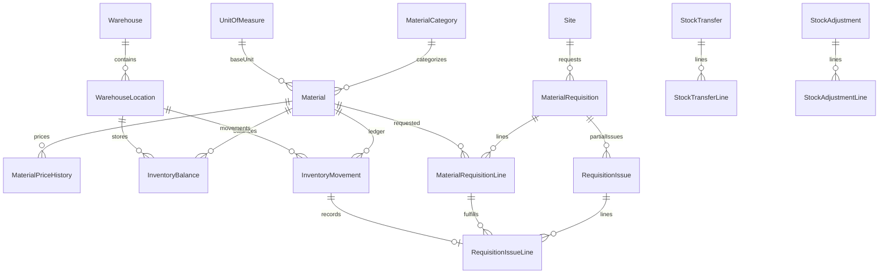

# SmartOP — แบบฐานข้อมูลเป้าหมายสำหรับ Production

วันที่ 21 พฤศจิกายน 2026 · สถานะ: logical design proposal ไม่ใช่ migration ที่พร้อม deploy

ขอบเขตใหม่ 22 พ.ย.2026 มี [ERP integration data model](SMARTOP_ERP_INTEGRATION_DATA_MODEL.md) เพิ่มรายละเอียดบริษัท/สาขา ภาษีนำส่ง จัดซื้อ/จ้าง คำสั่งซื้อ ตรวจรับ วางบิล และธนาคาร เอกสารนี้เป็น target baseline เดิม; physical schema ปัจจุบันยังตรวจจาก Prisma/data dictionary เท่านั้น

โครงสร้างเดิมครบทุก field อยู่ใน [Data dictionary](SMARTOP_DATABASE_CURRENT.md) เอกสารนี้แสดงเฉพาะส่วนเพิ่ม/ส่วนที่ต้องขยายเพื่อไม่สับสนว่ามีอยู่แล้ว ต้องยืนยัน business rules และมาตรฐานเดิมก่อน implement schema ใช้ Client เป็น Customer ของระบบ และ GoodsReceipt เดิมต่อไป ไม่สร้างข้อมูลหลักซ้ำ

อัปเดตงาน database-first: เพิ่ม P3 storage foundation 19 models และ 3 enums ใน schema/migration แล้ว แต่ยังไม่ได้ apply กับฐานข้อมูลเดิม ตารางในเอกสารนี้ที่ไม่ตรง schema ล่าสุดยังเป็นเป้าหมายระยะถัดไป เช่น workflow services, RequisitionIssue และ budget; implementation ใช้ InventoryOperation/InventoryMovement ร่วมกับ MaterialAcknowledgement เพื่อเก็บ partial issue/receive ดู [runbook P3](SMARTOP_P3_DATABASE_RUNBOOK.md) สำหรับขอบเขตและผลทดสอบจริง

## 1. มาตรฐานคอลัมน์ร่วมที่เสนอ

- entity ใหม่ใช้ `id String @id @default(cuid())`; createdAt/updatedAt สำหรับ master/draft; immutable ledgers ใช้ createdAt และ reversal reference แทนการแก้ย้อนหลัง
- scoped aggregate มี organizationId และ FK ตาม ownership จริง; siteId/projectId/costCenterId เป็น allocation ไม่ใช้แทน organization boundary
- รหัสเอกสาร/SKU เป็น String รักษาเลขศูนย์นำหน้า; uniqueness ต่อ organization สำหรับเอกสาร ยกเว้น SKU policy กำหนด global
- เงิน Decimal(18,2), quantity/unitCost Decimal(18,6), rate Decimal(10,6) เป็นค่าเสนอ ต้องประเมิน maximum และ rounding ก่อนล็อก schema; ไม่ใช้ Float คำนวณเงิน
- FK fields ต้องชนิด/nullable ตรงกัน; master ที่มีการอ้าง ledger ใช้ Restrict/soft deactivate; draft children ลบได้ตาม aggregate policy; historical ledger ห้าม cascade delete
- status ใช้ constrained transition ใน service และ enum/constraint ตาม migration compatibility; timestamps UTC และ document/business dates แยกจากเวลาบันทึก
- mutable aggregate มี version Int สำหรับ optimistic concurrency; posting/issue ใช้ transactional concurrency guard เพิ่มเติม

## 2. Identity / security (P0)

| ตาราง/ส่วนเพิ่ม | ฟิลด์หลักที่เสนอ | Constraints / หมายเหตุ |
| --- | --- | --- |
| AccountActionToken | id, userId, purpose ACTIVATION/RESET, tokenHash, expiresAt, usedAt?, createdAt | unique tokenHash; index userId/purpose/expiresAt; consume ครั้งเดียวใน transaction; TTL 24h/30m ตาม purpose |
| User (ขยาย) | authMethod LOCAL_EMAIL/LOCAL_SITE/SERVICE, organizationId ตาม policy, password timestamps เดิม | backfill LOCAL ตามบัญชีจริง; ไม่ทำให้ employee login เสีย |
| PasswordHistory (เดิม) | userId, passwordHash, createdAt | index userId/createdAt; ตรวจรหัสปัจจุบันและ 12 ล่าสุดตาม policy; ไม่มี plaintext |
| UserRoleAssignment (ขยายตามที่ขาด) | organizationId, typed scope identifiers หรือ validated resource scope reference, validity/status | ห้าม scopeId ลอยที่ไม่ตรวจ resource; organization-bound assignment |
| SecurityAuditEvent / AuditLog evolution | sequence, actorId?, action, resourceType/id, requestId, safeMetadata, createdAt, previousHash?, signature? | persisted canonical fields; monotonic append ordering หากใช้ hash chain; audit denial/login failure รองรับ actor ไม่ทราบ |
| IdempotencyRecord | organizationId, actorId, operation, key, requestHash, status, resourceId?, responseCode?, expiresAt | unique organization/actor/operation/key; duplicate payload mismatch เป็น conflict |

UserSession เดิมเป็น authoritative server record; ไม่สร้าง session store ซ้ำเพียงเพราะมี Redis ใน compose

## 3. Employee / customer / site (P1)

| ตาราง/ส่วนเพิ่ม | ฟิลด์หลักที่เสนอ | Relations / uniqueness |
| --- | --- | --- |
| EmployeeAssignment | employeeId, siteId, projectId?, departmentId?, positionId?, startDate, endDate?, status | FK masters; index employeeId/startDate และ siteId/status; ตรวจช่วงเวลาทับซ้อนตาม policy |
| Position | organizationId, code, nameTh, isActive | unique organizationId/code |
| EmployeeIdentity | employeeId, identityType, encryptedNumber, lookupDigest?, expiryDate? | protected fields; uniqueness ตาม identity policy ไม่เปิดข้อมูลเต็มใน API |
| EmployeeContact | employeeId, type, valueEncrypted, isPrimary | field-level permission |
| EmployeeBankAccount | employeeId, bankCode, accountEncrypted, maskedSuffix, effectiveFrom/to | ไม่เก็บ plaintext ใน logs/import reports |
| EmployeeBenefit | employeeId, benefitType, providerId?, effectiveFrom/to, protectedDetails | HR permission |
| EmployeeDocument | employeeId, documentId, documentType, expiresAt? | เชื่อม Document/storage เดิม |
| MasterAlias | organizationId, entityType, canonicalId, sourceSystem, sourceValue, normalizedValue | unique organization/entityType/sourceSystem/normalizedValue; service validate target |
| Client/Site/ClientContact (เดิม) | ขยาย lifecycle, organizationId และ FK ที่ขาด | ใช้ Client เดิม ไม่เพิ่ม Customer คู่ขนาน |
| ShiftTemplate/EmployeeDeployment (เดิม) | effective dates, position/workgroup, approval/version ตามที่ขาด | ทดสอบ cross-midnight และ temporal assignment |

แยก Employee sensitive tables ทีละขั้นด้วย backfill และ access control ไม่ย้าย field เดิมทิ้งพร้อมกัน

## 4. Attendance / payroll (P2)

| ตาราง/ส่วนเพิ่ม | ฟิลด์หลักที่เสนอ | กฎหลัก |
| --- | --- | --- |
| AttendanceCorrection | attendanceId?, employeeId, requestedTimes, reason, status, requestedById, reviewedById?, version | audit original/new values แบบจำกัด PII; ผู้อนุมัติแยกผู้ร้องตาม authority |
| PayrollRunEmployee | runId, employeeId, assignmentSnapshot, gross, deductions, net, status | unique runId/employeeId; snapshot inputs ที่ใช้คำนวณ |
| PayrollResultLine | runEmployeeId, componentId, ruleVersion, quantity, rate, amount, inputSnapshot | Decimal; traceable calculation |
| EmployeePayrollOverride | employeeId, componentId, value/config, effectiveFrom/to, approvedById | ไม่ทับ policy ย้อนหลัง |
| PayrollRun/Period/Payslip (เดิม) | preparer/reviewer/approver/finalizedAt/publishedAt, version, snapshotHash | finalize แล้ว immutable; payslip เห็นเฉพาะ published และเจ้าของ/สิทธิ์ที่อนุมัติ |

สูตร payroll/OT และภาษีต้องมี rule matrix ที่บริษัทอนุมัติ ไม่อนุมานจากชื่อ column เพียงอย่างเดียว

## 5. Warehouse / materials (P3)

ทุกตารางด้านล่างเป็นเป้าหมายเพิ่ม ยกเว้น GoodsReceipt ที่ขยายของเดิม; legacy InventoryItem/StockMovement คงอ่านได้ระหว่าง migration

| ตาราง | ฟิลด์หลักที่เสนอ | FK / unique / index |
| --- | --- | --- |
| MaterialCategory | id, organizationId, code, nameTh, isActive | unique organization/code |
| UnitOfMeasure | id, code, nameTh, decimalPlaces, isActive | unique code |
| Material | id, organizationId, code, nameTh, categoryId, baseUnitId, reorderPoint, isStockItem, isActive, legacyItemId? | unique code ตาม SKU policy; unique legacyItemId สำหรับ one-to-one bridge เท่านั้น; ถ้า legacy มีหลาย variants ให้ใช้ mapping table |
| MaterialLegacyMapping | legacyItemId?, importSourceRowId?, materialId, mappingReason, approvedById | เก็บ one-to-many variant mapping อย่าง explicit; ห้ามเดา code blank |
| MaterialUnitConversion | materialId, fromUnitId, toUnitId, factor, effectiveFrom/to | factor > 0; ห้ามเปลี่ยน posted quantity ย้อนหลัง; transaction เก็บ conversion snapshot |
| MaterialPriceHistory | materialId, supplierId?, currency, unitPrice, taxRate, effectiveFrom/to, approvedById? | index material/effectiveFrom; ตรวจ overlap ของ price context |
| Warehouse | id, organizationId, code, nameTh, siteId?, isActive | unique organization/code |
| WarehouseLocation | id, warehouseId, code, nameTh, locationType, isActive | unique warehouse/code |
| InventoryBalance | id, materialId, locationId, quantity, carryingValue, version, updatedAt | unique material/location; FK material/location; average derived from carryingValue/quantity |
| InventoryMovement | id, organizationId, materialId, locationId, type, quantityDelta, valueDelta, unitCostSnapshot, balanceAfter, valueAfter, sourceType/id/lineId, siteId?, projectId?, costCenterId?, operationId, reversalOfId?, actorId, createdAt | index material/location/createdAt/id; unique operationId/lineKey; append-only; source registry validated |
| MaterialRequisition | id, organizationId, refNo, siteId, projectId?, costCenterId?, requestedDate, periodStart/end?, status, requestedById, finalApprovedById?, finalApprovedAt?, version | unique organization/refNo; index site/status/date |
| MaterialRequisitionLine | id, requisitionId, materialId, requestedQty, approvedQty, issuedQty, receivedQty, unitId, notes? | FK requisition/material/unit; quantities nonnegative and monotonic under workflow rules |
| RequisitionIssue | id, requisitionId, issuedById, issuedAt, operationId | supports partial issues; unique operationId |
| RequisitionIssueLine | id, issueId, requisitionLineId, locationId, quantity, movementId | unique movementId; issue qty ไม่เกิน approved outstanding |
| RequisitionAcknowledgement | id, issueId, receivedById, receivedAt, notes? | อนุมัติผู้รับตาม site; partial receipt ใช้ acknowledgement lines หากบริษัทต้องการ |
| StockTransfer | id, organizationId, refNo, fromWarehouseId, toWarehouseId, status, requestedById, approvedById?, version | unique organization/refNo; ต้นทาง/ปลายทางต่างกัน |
| StockTransferLine | id, transferId, materialId, fromLocationId, toLocationId, quantity, costSnapshot | paired out/in movements; atomic direct transfer หรือ approved in-transit model |
| StockAdjustment | id, organizationId, refNo, warehouseId, reason, status, createdById, approvedById?, approvedAt?, version | creator != approver; ไม่แก้ balance ตรง |
| StockAdjustmentLine | id, adjustmentId, materialId, locationId, countedQty, expectedQtySnapshot, quantityDelta, valueDelta | ledger posting หลัง approval; stale snapshot ต้องตรวจ version |
| GoodsReceipt (เดิม ขยาย) | organizationId, status, version, receivedById ที่มี FK, postedAt?, operationId? | คง PO relation เดิม; non-PO opening receipt ใช้ approved separate source type ไม่ปลด PO required แบบไร้ control |
| GoodsReceiptItem (เดิม ขยาย) | materialId?, locationId?, poLineId?, acceptedQty, rejectedQty, unitCostSnapshot, postedMovementId? | additive columns; Decimal quantities; duplicate receipt/over-receipt checks |
| SiteMaterialBudget | siteId, periodStart/end, categoryId?, amount, currency, approvedById | เป็นแผนเสริม ไม่บังคับเพิ่มพร้อม ledger slice แรก |

Movement types: PURCHASE_RECEIPT, ISSUE, RETURN, TRANSFER_IN, TRANSFER_OUT, ADJUSTMENT, PROJECT_CONSUMPTION ควรมี OPENING ที่ระบุ policy ชัด หรือใช้ approved adjustment reason สำหรับ opening ห้ามปลอมเป็น purchase ที่ไม่มีหลักฐาน

สถานะใบเบิก: DRAFT → SUBMITTED → REVIEW → APPROVED → PARTIALLY_ISSUED → ISSUED → RECEIVED; REJECTED/CANCELLED ตาม transition matrix การอนุมัติไม่เปลี่ยน physical stock การรับยืนยันไม่ตัด stock ซ้ำ

## 6. Procurement (P4)

| ตาราง/ส่วนเพิ่ม | ฟิลด์หลัก | กฎหลัก |
| --- | --- | --- |
| SupplierContact | supplierId, name, contact channels, role, isPrimary | protected contact fields |
| SupplierMaterial | supplierId, materialId, supplierSku, purchaseUnitId, leadTimeDays, minimumQty | unique supplier/material/purchase context |
| SupplierQuotation | supplierId, rfqId, refNo, quotedAt, validUntil, currency, status | revision history and selection approval |
| SupplierQuotationLine | quotationId, materialId?, description, quantity, unitId, unitPrice, taxRate, leadTime | Decimal, price snapshot |
| PurchaseRequisition/PRItem (เดิม) | normalized materials, requested/approved qty, creator/approver/version | ไม่ชน MaterialRequisition; ไม่ให้ผู้สร้าง final approve |
| RFQ/RFQItem (เดิม) | supplier request context และ quotation relations | backfill compatibility ก่อนแทน quotedPrice เดิม |
| PurchaseOrder/POItem (เดิม) | organization, approval/version, material/UOM, quoted reference, ordered/received qty | receipt ไม่เกิน outstanding; approval snapshot |

## 7. Billing / AR (P5)

| ตาราง/ส่วนเพิ่ม | ฟิลด์หลัก | Constraints / กฎ |
| --- | --- | --- |
| BillingProfile | clientId, cutoffRule, billingDayRule, paymentTerms, collectionRule, contactId?, effectiveFrom/to | versioned customer-specific rules |
| InvoiceNumberSequence | organizationId, documentType, fiscalYear, nextValue | unique organization/type/year; transactional allocation |
| Invoice (เดิม ขยาย) | organizationId, servicePeriod, billingProfileSnapshot, creator/approver, issuedAt?, version | immutable issued snapshot; unique org/refNo |
| InvoiceItem (เดิม ขยาย) | chargeType, material/serviceId?, quantity Decimal, unitPrice, discount, taxRate Decimal, net/tax/gross | fixed/headcount/OT/holiday/deduction/other; explicit rounding |
| InvoiceAdjustment | invoiceId, type, reason, amount, taxAmount, sourceReference, approvedById | no hidden rewriting issued lines |
| BillingNote | organizationId, refNo, clientId, status, issuedAt, collectionDate? | unique organization/refNo |
| BillingNoteInvoice | billingNoteId, invoiceId, amountSnapshot, dueDateSnapshot | unique note/invoice; snapshot ไม่ทำให้ยอด AR ซ้ำ |
| CreditNote | organizationId, refNo, invoiceId, reason, status, net/tax/gross, issuedAt | approval and reversal policy |
| CreditNoteLine | creditNoteId, invoiceLineId?, description, quantity, amount, taxAmount | validate credited amount against source |
| Receipt (เดิม ขยาย) | organizationId, clientId?, amount, currency, receivedAt, status, unapplied derived balance | invoiceId เดิม migrate เป็น allocation; nullable หลัง compatibility rollout |
| ReceiptAllocation | receiptId, invoiceId, amount, allocatedAt, actorId, reversalOfId?, operationId | unique operation/line; positive allocation, reversal explicit; concurrent outstanding check |
| AccountsReceivable | invoiceId, originalAmount, debit/credit adjustments, allocatedAmount, outstanding, version | unique invoiceId; cache/projection reconciled to source ไม่เป็น ledger อีกชุดที่แก้ตรงได้ |
| InvoiceDelivery | invoiceId, documentVersionId, recipientProtected, channel, status, providerMessageId?, attempts, deliveredAt? | append attempt evidence; no plaintext token/provider secret |

## 8. Accounting / AP / treasury (P6)

| ตาราง/ส่วนเพิ่ม | ฟิลด์หลัก | Constraints / กฎ |
| --- | --- | --- |
| ChartOfAccount | organizationId, code, nameTh, accountType, normalSide, parentId?, isPostingAccount, isActive | unique organization/code; parent cycle check |
| AccountingPeriod | organizationId, code, startDate, endDate, status, closedById?, closedAt? | no overlapping periods within ledger/calendar |
| JournalEntry | organizationId, refNo, periodId, postingDate, status, description, sourcePostingId?, preparedById, approvedById?, postedById?, postedAt?, reversalOfId? | unique organization/refNo; preparer != poster; immutable POSTED |
| JournalEntryLine | journalId, lineNo, accountId, debit, credit, currency, exchangeRate?, baseDebit/baseCredit?, siteId?, projectId?, costCenterId? | unique journal/lineNo; nonnegative debit/credit, one side per line; totals balanced |
| AccountingRule | organizationId, sourceEvent, version, effectiveFrom/to, configuration, approvedById, status | controlled version selection; balanced generated entries |
| SourcePosting | organizationId, sourceType, sourceId, eventType, sourceVersion, ruleVersion, postedAt | unique organization/sourceType/sourceId/eventType/sourceVersion; no duplicate posting |
| GeneralLedger | journalLineId, periodId, accountId, postingDate, debit, credit, organizationId | unique journalLineId; projection of posted lines ไม่ลงรายการเอง |
| PaymentAllocation | paymentId, supplierInvoiceId, amount, operationId, reversalOfId? | supports partial/multi invoice; migrate existing direct FK safely |
| BankAccount | organizationId, code, currency, protectedAccountDetails, ledgerAccountId, isActive | least-privilege access |
| BankStatement/Line | bankAccountId, importJobId, statementDate, externalReference, amount, transactionDate | duplicate prevention scoped to provider/bank account |
| BankReconciliation | statementLineId, cashEntryId/paymentId/receiptId validated reference, amount, actorId, reconciledAt | amount/currency/date rules; explicit many-to-many if partial matches required |

FX fields ใช้เฉพาะเมื่อยืนยันหลายสกุลเงิน; ถ้าเริ่ม THB เดียว บังคับ currency ให้สอดคล้องแทนการเปิด FX ที่ยังไม่ทดสอบ

## 9. Platform / import / documents / reporting

| ตาราง/ส่วนขยาย | ฟิลด์หลัก | กฎ |
| --- | --- | --- |
| ImportJob (เดิม) | organizationId, fileHash, sourceType, mappingVersion, status, confirmedById?, confirmedAt?, totals | state machine parse/validate/preview/confirm/import/report |
| ImportRow | jobId, sheet, rowNo, rowHash, sanitizedNormalizedData, status, targetType/id? | unique job/sheet/rowNo; protected staging data with retention |
| ImportError | rowId?, jobId, field, errorCode, safeMessage | ไม่ใส่ข้อมูลส่วนบุคคลเต็มใน error report |
| ImportMapping | jobId, sourceKey, targetType/id, decision, approvedById | manual ambiguity resolution recorded |
| EventOutbox (เดิม ขยาย) | availableAt, lockedBy?, lockedUntil?, processedAt, attempts, deduplicationKey? | durable claim/lease/retry; write with business transaction |
| DeliveryAttempt | outboxId, channel, attempt, status, providerRef?, safeError, attemptedAt | unique outbox/attempt/channel |
| Document (เดิม ขยาย) | storageKey, contentHash, sourceVersion, organizationId, classification, access policy | immutable version; private storage; authorized download |
| ApprovalStep / ApprovalDecision | entity/source registry, step, authority snapshot, actor, decision/reason/time | ใช้ WorkflowApproval เดิมก่อนเพิ่ม table; record delegation/SoD |
| BackupRun / RestoreDrill | environment, artifactRef, checksum, status, start/end, verifier, measuredRPO/RTO | แสดง success เฉพาะ operational evidence; ไม่เก็บ backup payload ใน DB |

Analytics สร้างจาก posted/reconciled source และ scoped views/projections ก่อนเพิ่ม warehouse/report tables โดยไม่จำเป็น ส่วน Fleet/QHSE/Training/Project ใช้ตารางเดิมใน data dictionary และเพิ่ม fields ตาม use case จริงใน phase หลัง ไม่สร้าง model ซ้ำเพราะเปลี่ยนชื่อโมดูล

## 10. Migration order

1. ตรวจ migration history/schema drift บน isolated copy; snapshot count/orphan/duplicates โดยไม่เปิดเผย PII
2. foundation guards + organization ownership + shared idempotency/audit/outbox
3. P3 masters → SKU mapping → warehouse/location → balances/ledger → requisition/transfer/adjustment
4. opening stock จากข้อมูลที่ตรวจนับและอนุมัติ; historical expense แยกจาก stock opening
5. purchasing receipt bridge → billing allocations → accounting source posting ตาม phase ที่ได้รับอนุมัติ
6. backfill/check/reconcile → switch reads/writes → enforce constraints → retire legacy ใน release ภายหลัง

ไม่ใช้เอกสารนี้เป็น SQL deploy script ห้าม db push/reset หรือลบทิ้งตารางเดิม ใช้ reviewed additive Prisma migrations และ staging evidence ทุกครั้ง
