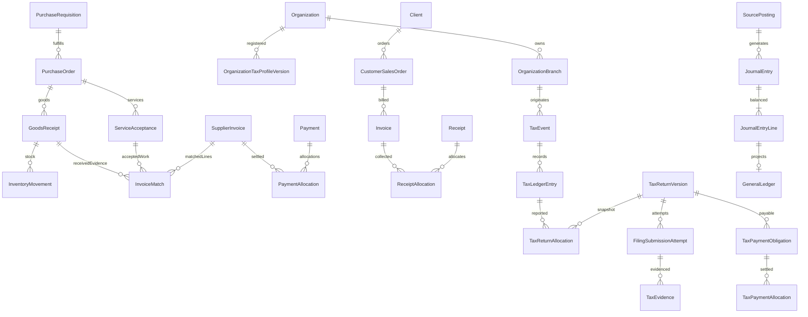

# SmartOP — แบบข้อมูลและจุดเชื่อม ERP / บัญชี / ภาษี

วันที่ 22 พฤศจิกายน 2026 · Logical design สำหรับ migration ในอนาคต ไม่ใช่ Prisma schema ที่ deploy แล้ว

schema ปัจจุบันยังมี 102 models ตาม [data dictionary](SMARTOP_DATABASE_CURRENT.md) ตารางที่ระบุ “เพิ่ม” ต่อไปนี้ยังไม่มี implementation จากงานออกแบบนี้ ก่อนสร้าง migration ต้องตรวจ baseline/ข้อมูลจริง/ชนิด FK และ business-rule sign-off

## 1. Conventions

- Organization เดิมคือนิติบุคคล; Client เดิมคือลูกค้า; Supplier เดิมคือผู้ขาย/ผู้รับจ้าง; Site คือสถานที่ปฏิบัติงาน ไม่สร้าง Customer/Company ซ้ำ
- ทุก aggregate ใหม่มี organizationId, createdAt, createdById และ version เมื่อแก้ได้; immutable facts มี source/version/reversal lineage
- Branch ใช้ composite organizationId/branchId ownership; source lines/balances/tax/journal ไม่รับ organizationId จาก client โดยไม่ตรวจ parent
- IDs ใหม่ใช้ cuid; กำหนดขนาด physical string และชื่อ index/map ให้ผ่าน MySQL byte/index limits โดย FK กับ legacy ต้องเข้ากันตาม migration review
- เงิน Decimal(18,2), extended valuation Decimal(24,6), quantity/unit cost Decimal(18,6), rates Decimal(12,8) เป็นข้อเสนอ; ใส่ currency, rounding version, bounds ตาม use case ไม่ใช้ Float
- date ใช้ business date; timestamp UTC; reporting calendar ใช้ Asia/Bangkok; รูปปีพุทธศักราช/คริสต์ศักราชเปลี่ยนเฉพาะ adapter ตาม format ไม่ปนใน canonical key
- FK ของ posted financial/stock/tax records ใช้ Restrict; deactivate master แทนลบ และเก็บ party/account/tax snapshots ที่จำเป็น
- generic source registry ต้อง validate actual typed source ใน service; string sourceType/sourceId อย่างเดียวไม่พิสูจน์ว่า source มีจริง

## 2. นิติบุคคล สาขา ข้อมูลภาษีและปีบัญชี

| Entity | สถานะ/ฟิลด์หลัก | Key / กฎ |
| --- | --- | --- |
| Organization | เดิม; ขยาย legalName, fiscal settings และ approved ownership data | code unique เดิม; ห้ามผูก source ต่างบริษัท |
| OrganizationBranch | เพิ่ม: organizationId, branchCode, name, address, isHeadOffice, effective dates | unique organization/branchCode; no conflicting active head office/version |
| OrganizationTaxProfileVersion | เพิ่ม: organizationId, VAT status, registration/cancellation dates, evidenceId, approvedBy/At, effectiveFrom/to | version immutable after effective use; nonoverlap approved intervals |
| BranchTaxRegistration | เพิ่ม: branchId, registration reference/address version, filing jurisdiction, effective dates | สืบทอด legal entity; ไม่สร้าง VAT-off override ที่ขัดทะเบียน |
| TaxFilingGroup / Member | เพิ่ม: organizationId, formFamily, approval reference, branch memberships/effective dates | membership ไม่ทับซ้อนใน obligation เดียว; รวมสาขาต้องมี authority/evidence |
| ClientTaxProfileVersion | เพิ่ม: clientId/org, person/entity/residency, TIN type/value, branch, VAT/effective dates | ใช้ Client เดิม; snapshot ตามวันธุรกรรม |
| SupplierTaxProfileVersion | เพิ่ม: supplierId/org, entity/residency/TIN/branch/VAT, treaty evidence | foreign IDs ไม่ถูกแทนด้วยเลขไทยสมมติ; bank verification แยก |
| EmployeeTaxProfileVersion | เพิ่ม: employeeId/org, taxpayer identity, residency, deductions/effective dates/evidence | encrypted personal fields; YTD tax inputs ต้องมี purpose/permission |
| TaxObligationProfile | เพิ่ม: organization/group, formCode, applicability, frequency, channel, reason, effective dates | one reviewed applicable profile per context; PENDING blocks filing |
| FiscalYear | เพิ่ม: organizationId, start/end, calendarCode, reportingPolicyVersion | nonoverlap, fiscal-year code unique per organization |
| AccountingPeriod | เพิ่ม: fiscalYearId, start/end, status, close/reopen evidence | no overlapping posting periods; tax period เป็นอีก entity |

## 3. ผังบัญชี กฎ และ ledger

| Entity | ฟิลด์หลัก | Constraint / command |
| --- | --- | --- |
| ChartOfAccount | organizationId, code, nameTh, accountType, normalSide, parentId?, isPosting, isActive | unique org/code; parent same org, no cycles; only posting accounts in lines |
| AccountMappingVersion | org, purpose/event/tax code, account IDs, effective dates, approval | mapping VAT/WHT/GRNI/AR/AP/Bank/Payroll/Stock แยก ไม่ hardcodeเลขบัญชีใน UI |
| AccountingRuleVersion | org, eventType, version, configuration, effective dates, reviewer/approver | frozen after use; deterministic balanced result from approved source |
| SourcePosting | org, sourceType/id, eventType, sourceVersion, ruleVersion, requestKey/hash, postingAt | unique org/source/event/version; actor/scope validation before replay |
| JournalEntry | org, periodId, refNo, postingDate, sourcePostingId?, status, prepared/reviewed/approved/postedBy, reversalOfId?, reason | one organization/currency per journal initially; preparer != poster; period OPEN |
| JournalEntryLine | journalId, lineNo, accountId, debit, credit, currency, site/project/costCenter?, party refs | unique journal/lineNo; one nonnegative side; account/allocations same org |
| GeneralLedger | unique journalLineId, org/account/period/date, debit/credit, source reference | immutable projection of posted journal lines; never entered independently |
| FinancialStatementMappingVersion | org, reporting framework, account/group-to-line mapping, effective dates | CPA-reviewed version, unmapped accounts block certified reports |
| DocumentNumberSequence | org, branch context?, documentType, fiscal/calendar year, nextValue | unique sequence context; increment atomically; issued/void numbers never reused |

Reversal สร้าง journal/GL ใหม่ที่กลับด้าน original ผู้ทำรายงานต้องรวมทั้ง original และ reversal ที่เคย post แล้ว แม้ original แสดงสถานะ REVERSED; ห้ามกรองทิ้ง original แล้วนับเฉพาะ reversal จนยอดกลับด้านเกินจริง

GL control accounts กระทบ AR/AP/stock/payroll/VAT/WHT subledgers หากมี intercompany ให้แต่ละบริษัทมี balanced journal แยกและ linked intercompany references ไม่ทำ journal ข้ามบริษัทชุดเดียว

## 4. ฝั่งซื้อ/จ้าง และรับตรวจ

| Entity | ของเดิม/ส่วนเพิ่ม | จุดเชื่อม |
| --- | --- | --- |
| PurchaseRequisition / PRItem | เดิม; เพิ่ม org, requestKind, material/service, budget, creator/approval/version | PR ขอซื้อ/จ้าง; linked demand allocations จากใบเบิก/โครงการ |
| PurchaseDemandAllocation | เพิ่ม: prLineId, materialRequisitionLineId?/workOrderId?, allocatedQty | typed demand reference; ไม่สั่งซื้อซ้ำ demand เกิน |
| SupplierContact / SupplierMaterial | เพิ่ม: supplierId, contacts, material/catalog/UOM/leadTime | versioned supplier master; activate/deactivate |
| RFQ / RFQItem | เดิม; เพิ่ม RFQParticipant/request lines | แยก item requirement จาก quotation ของผู้ขาย |
| SupplierQuotation / Line | เพิ่ม: supplier/RFQ, revision, validity, currency, prices/tax/delivery terms | source of selected PO price; attachment/evaluation evidence |
| QuotationEvaluation / Decision | เพิ่ม: RFQ, evaluator, criteria/score, selected quote, reason/approval | anti-self-approval, policy-specific quote count |
| PurchaseOrder / POItem | เดิม; เพิ่ม org, kind, revision, source quote/PR, Decimal qty, creator/approval/sent/acknowledged | retain old fields during staged backfill; change order version ไม่แก้ approved snapshot |
| WorkContract / Milestone | เพิ่มสำหรับงานจ้าง: PO/service lines, scope/BOQ, deliverables, amount, retention, warranty, due dates | goods lines เข้ารับสินค้า; service lines เข้า acceptance |
| InboundDelivery / Line | เพิ่ม: PO line, delivered qty, arrival/custody location, lot/serial?, supplier document | physical received/pending inspection แยกจาก accepted inventory |
| GoodsInspection / InspectionLine | เพิ่ม: inbound line, inspector/committee, accepted/rejected/pending qty, reason/evidence | cumulative quantities ≤ delivered; accepted authorizes GR |
| GoodsReceipt / GoodsReceiptLine | เดิมและ P3; เพิ่ม inspection/evidence links ตาม workflow | inventory posting once; no duplicate on AP invoice approval |
| ServiceAcceptance / Line | เพิ่ม: PO/milestone, work period, completed qty/value, inspector/approver, evidence, deductions | no inventory for service line; allows progress acceptance |
| SupplierReturn / Line | เพิ่ม: accepted GR line, returned qty/cost/tax-credit linkage, shipping evidence | new negative stock source/movement semantics; current internal return service is not supplier return |
| SupplierInvoice / Lines | header เดิม; เพิ่ม lines, taxDoc/source links, org/branch/status/version, verified duplicate keys | source GR/service acceptance matching; no direct edits after post |
| InvoiceMatch / Exception | เพิ่ม: invoice line, PO/receipt/acceptance links, qty/value variance, tolerance, approval | many-to-many partial matching; prevent cumulative overbilling |
| SupplierBillingSubmission / Line | เพิ่ม: supplier, billing period, invoice list, received/evidence/rejected reason | inbound vendor billing แยกจาก outbound customer BillingNote |
| RetentionSchedule / Settlement | เพิ่ม: contract/acceptance/invoice, withheld/released amounts, conditions/evidence | cash retention แยก tax withholding และไม่ทำ AP ลดซ้ำ |

## 5. คลังและต้นทุนที่ขยายจาก P3

| Entity | แผนต่อยอด |
| --- | --- |
| Material / UOM / prices / warehouses | ใช้ 19 P3 models; เพิ่ม location purpose, optional lot/expiry/serial, quality constraints ตามสินค้าที่บริษัทรับรอง |
| StockReservation | เพิ่ม requisition/order line, location/material, reservedQty, status/expiry/version; ไม่ใช่ physical movement |
| StockTransfer dispatch/receipt | เพิ่ม transit workflow/locations and partial receiving; ใช้ current direct transfer เฉพาะ movement ที่เสร็จพร้อมกัน |
| LandedCost / Allocation | เพิ่ม supplier cost evidence, receipt lines, allocation basis, approved value split between remaining stock and already-consumed expense |
| MaterialIssueAcknowledgement | ใช้ MaterialAcknowledgement เดิม เพิ่ม cumulative receive service และ audit; stockไม่ลดอีกครั้ง |
| Asset / Assignment / Maintenance | ใช้ของเดิม; เพิ่ม capitalization, depreciation schedules/journal refs, calibration/warranty และ physical custody ตามชนิดอุปกรณ์ |
| ChemicalSafetyDocument / ItemLot | เพิ่มเมื่อมี requirement: material/document version, batch/expiry, restricted storage/PPE instructions; applicability review ก่อนเปิดใช้ |

Stock balance cache ต้องเทียบ ledger ได้; accounting inventory valuation เทียบ stock value ผ่าน SourcePosting ไม่แก้ stock balance เพื่อให้บัญชีเท่ากัน

## 6. ขาย/คำสั่งซื้อ/วางบิลลูกค้า

| Entity | ของเดิม/ส่วนเพิ่ม | Invariant |
| --- | --- | --- |
| Opportunity/Tender/Quotation/Contract | ใช้เดิม; เพิ่ม approved revision/price schedule/contract rules | ทุก billable rule อ้าง approved contract/version |
| CustomerSalesOrder / Line | เพิ่ม: client PO reference, accepted offer, goods/service lines, terms, delivery/service schedule | ไม่ใช้ PurchaseOrder ผู้ขายแทน customer order |
| ContractServiceSchedule / Rate | เพิ่ม: site, role/headcount/fixed/OT/holiday/other, effective dates | employee labor cost และ customer bill rate เป็นคนละ rule |
| CustomerServiceAcceptance | เพิ่ม: service period, staffing/attendance evidence, client acknowledgement/dispute | prevents billing draft/unapproved operational records |
| BillingCalculation / Line | เพิ่ม: contract/source snapshots, base/OT/deductions/adjustments, reviewer | repeatable computation; signed rule matrix; no blind Excel row import |
| Invoice / InvoiceItem | ใช้เดิม; org/branch/version, approved Decimal lines, servicePeriod/source refs | extend before removing Float/legacy fields; lifecycle and numbering |
| TaxDocument / TaxDocumentLine | เพิ่ม: fiscal tax invoice/credit/debit evidence, snapshots, tax event link | invoice และ tax invoice อาจไม่เกิดวันเดียวกัน; source amount reconciliation |
| BillingNote / BillingNoteInvoice | เพิ่ม outbound billing grouping | unique note/invoice; no second AR event |
| BillingAcknowledgement / CollectionTask | เพิ่ม accepted/scheduled/delivery events and evidence | expected collection != actual receipt |
| CreditNote / DebitNote / Lines | เพิ่ม source invoice/line, reason, amount/tax change, status/version | credit caps and tax/accounting adjustments with source lineage |

## 7. รับจ่าย ธนาคาร และเจ้าหนี้ลูกหนี้

| Entity | ฟิลด์หลัก/สัญญา |
| --- | --- |
| Receipt (เดิม) + ReceiptAllocation | decouple mandatory invoiceId หลัง backfill; allocate gross settlement/cash/WHT portions ตาม approved model; partial/multiple invoices/unallocated receipt |
| AccountsReceivable | optional projection unique invoiceId, opening/debits/credits/allocated/outstanding; recompute/reconcile ไม่เป็น editable ledger อีกชุด |
| PaymentRequest / Approval | invoice/expense/payroll/tax sources, beneficiary snapshot, amount, due date, approved version |
| Payment (เดิม) + PaymentAllocation | one payment many supplier invoices/obligations; partial payment/reversal explicit; no premature PAID flag |
| AccountsPayable | supplier invoice projection reconciled to allocations/credits; linked tax/retention/advance balances |
| BankAccount / BeneficiaryVersion | org, currency, protected bank data, verified change approval; bind payee snapshot to payment approval |
| PaymentBatch / Line / BankAttempt | stable request references, file hash, release actor, transaction-level result; duplicate release protections |
| BankStatement / Line / ReconciliationAllocation | import job/hash, external IDs, booking/value dates, amount, direction; split matching without over-allocation |
| EmployeeAdvance / ExpenseClaim / Settlement | approved purpose, source receipts/tax, cash cleared/uncleared and payroll-offset authorization |
| PettyCashAccount / Voucher | custodian, fund/replenishment, expense/tax evidence, counted balance and review |

Cash ledger เดิมต้อง map เข้าสู่ verified bank/GL events อย่างมี reconciliation; เอกสารภาษีถูกหักไม่ใช่ cash transaction และไม่สร้าง receipt cash เต็มยอดที่ไม่ได้รับจริง

## 8. Tax engine และ filing entities

| Entity | ฟิลด์หลัก | Unique / rule |
| --- | --- | --- |
| TaxRuleVersion | org/jurisdiction, family/income/treatment/payer/payee/residency/threshold/rate, effective dates, legal refs, approval | nonoverlap within rule context; frozen when used |
| TaxPointPolicyVersion | event/transaction context, tax date selection, fiscal/tax period policy, approval | accountingDate/paymentDate/taxPointDate ไม่บังคับเท่ากัน |
| TaxEvent / Component | typed source/event/version, branch, date snapshots, base/rate/tax, input eligibility, rule/profile snapshots | unique source/event/version/component; Decimal; branch same org |
| TaxLedgerEntry | taxEvent/component, book OUTPUT_VAT/INPUT_VAT/WHT_PAYABLE/WHT_RECEIVABLE/CIT/STAMP, signed amounts, period, reversal ref | append-only; no duplicate reporting from same event |
| WithholdingCertificate / Lines | direction issued/received, payer/payee snapshot, income type/base/rate/amount, date/serial, delivery/evidence/replacement | received customer certificate verification and issued supplier certificate distinguishable |
| CorporateTaxComputation / ScheduleLine | fiscalYear, book profit, adjustment/loss/credit lines, estimate/version, reviewers | approved computations reconcile to closed/reviewed GL |
| TaxPeriod | org/group/form, dates, fiscalYear, status, original/effective due dates/rule refs | unique obligation/form/period scope; separate accounting period lock |
| TaxReturnSeries | org/filingGroup/form/period | one canonical series; multiple version/filing types in series |
| TaxReturnVersion / Line | series, version, original/additional kind, predecessor, base/tax/credits/payable snapshots, snapshotHash, prepared/reviewed/approvedBy | immutable after approved/exported unless a new revision; distinguish amendment types by form |
| TaxReturnAllocation | returnVersion, taxLedgerEntry/sourceCorrection, claimed/included amounts, inclusionKind | original inclusion dedupe; amendments retain original/event lineage; never generic unconditional second inclusion |
| TaxValidationResult / Exception | return/snapshot version, rule/error/severity, evidence/reviewer override | critical blocks submit; exception approval invalidated on snapshot change |
| TaxDueDateRule / Exception | form/channel/event rule, effective dates, holiday/extension scope, official evidence | retain original and effective due dates and reviewer |
| FilingExport | returnVersion, adapter/spec version, file object/hash/encoding/count/totals, validation status | export is not submission |
| FilingSubmissionAttempt | returnVersion, connector/capability/env, idempotencyKey, payloadHash, external refs, status, lastCheckedAt | stable request before network; UNKNOWN needs reconcile before retry |
| FilingProviderEvent | attempt, external event/status/raw evidence refs, provider time, received time | dedupe provider event/content hash; validate transition order |
| TaxPaymentObligation | accepted return/version, tax/penalty/surcharge/fine, payin ref, due/expiry, currency | tax vs penalty vs payment accounting mapping distinct |
| TaxPaymentAllocation | obligation, confirmed Payment/bank settlement, amount, evidence, verifier | cannot exceed outstanding without explicit adjustment/refund workflow |
| TaxEvidence | org/branch/context, type, storageKey/hash, source, verification/retention/legal hold | private storage, masked personal fields, download audit |
| TaxConnectorCapability | provider/form/channel/spec/environment, authorization refs, supported commands, certification status | no universal API assumption; unavailable forms use assisted mode |

## 9. Documents / approvals / integration infrastructure

Document เดิมขยาย immutable version/private object key/contentHash/source version, legal classification และ retention; ApprovalPolicy/Step/Decision ใช้ WorkflowApproval เดิมร่วมกับ authority/version/delegation ที่จำเป็น ไม่สร้าง approval engine หลายชุดโดยไม่ต้องการ

EventOutbox เดิมต้องเพิ่ม claim/lease/attempt/nextAttemptAt/deduplication/dead-letter/replay ownership แล้วสร้าง worker ที่ทำงานจริง IntegrationInbox บันทึก provider event hash/signature/result before applying; request ID/hash และ destination identity ป้องกันข้าม environment/company

ImportJob เดิมขยาย ImportRow/Error/Mapping/Confirmation และ transactional commit; raw attachments อยู่ private storage/retention ไม่อยู่ Git public directories หรือ audit payload

## 10. ER ที่เน้นจุดเชื่อม

Diagram เป็น conceptual aggregate relations; implementation รายบรรทัดอาจเป็น bridge ผ่าน InvoiceMatch/SourcePosting ไม่ใช่ FK บน header ตาม diagram ทุกเส้น ตรวจ target Prisma migration อีกครั้งก่อนถือเป็น physical ER

## 11. Command / event contract

| Command / event | สิ่งที่ทำใน transaction | สิ่งที่ทำหลัง commit |
| --- | --- | --- |
| approvePurchaseOrder | authority/SoD/version/budget commitment + approval record + outbox | render/send PO, delivery logging |
| postGoodsReceipt | approved QC/PO limits + existing P3 balance/movement + GR state/audit/outbox | accounting/tax consumers as applicable; no double receipt |
| postServiceAcceptance | approved milestone/evidence + acceptance state/source version/audit/outbox | GRNI/expense accrual accounting ตาม rule |
| postSupplierInvoice | match/duplicate/tax evidence + AP obligation/approved snapshot/tax events/source posting | notify vendor/payment scheduling |
| confirmPayment | verified provider state + allocations/WHT/tax certificates/source posting/audit | document delivery and reconciliation task |
| issueCustomerInvoice | approved billing snapshot + sequence + AR/tax event per tax point + source posting | PDF/e-Tax/provider delivery |
| confirmCustomerReceipt | cash/WHT components + allocation limits + bank/AR/source events | certificate follow-up/reminders |
| postJournal | period/account/SoD/balance checks + journal/GL/source posting | report projection refresh |
| approveTaxReturn | freeze lines/totals/profile/rules/export hash + separate approver + audit | export job; explicit submit grant required |
| submitTaxReturn | persist stable attempt/request/hash/status + outbox | external submission/status polling only by authorized adapter |

หากบัญชีต่าง aggregate ลงหลัง event ให้ consumer idempotent และมี accounting-pending/reconciliation dashboard ไม่แสดงว่า financial posting สำเร็จตั้งแต่ outbox เพียงถูกสร้างแล้ว
