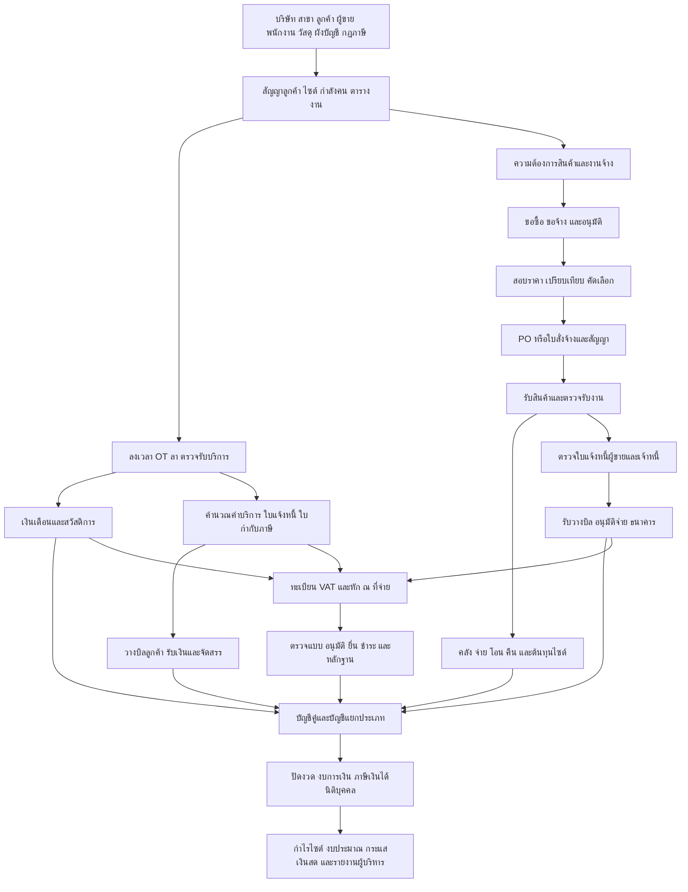

# SmartOP — แบบระบบบริษัทครบวงจร: ปฏิบัติการ คลัง จัดซื้อ การเงิน บัญชี และภาษี

วันที่ 22 พฤศจิกายน 2026 · Design v2 · สถานะ: สเปกเป้าหมายสำหรับพัฒนา ไม่ใช่ระบบที่ deploy แล้ว

คำขอล่าสุดขยายจาก P3 ไปสู่การออกแบบ ERP ทั้งบริษัท รวมบัญชี/ภาษีนำส่งสรรพากร จัดซื้อจัดจ้าง คำสั่งซื้อ PO ตรวจรับ วางบิล และการเงิน เอกสารนี้เป็นจุดเริ่มอ่านร่วมกับ:

- [ผลสแกนช่องว่างจากไฟล์บริษัทและโค้ด](SMARTOP_COMPANY_SYSTEM_GAP_AUDIT.md)
- [ระบบภาษีและการนำส่ง](SMARTOP_TAX_FILING_DESIGN.md)
- [แบบข้อมูลและสัญญาการเชื่อมระบบ](SMARTOP_ERP_INTEGRATION_DATA_MODEL.md)
- [Backlog และเกณฑ์ตรวจรับ](SMARTOP_ERP_DELIVERY_BACKLOG.md)
- [กฎภาษีและแหล่งอ้างอิงทางการ](SMARTOP_TAX_RULES_AND_SOURCES.md)

## 1. ฐานระบบและขอบเขตที่มีจริง

ตรวจฐาน commit `2d19540878ed6ff947ae87ac97e24c481c078467`: Prisma 102 models, API route files 63, ไฟล์ใน src/server/services 13 ไฟล์รวม tests มี Employee/Site/Client, attendance/payroll, purchasing/invoice schemas และ P3 posting services แล้ว แต่ยังไม่มี Journal/GL หรือ tax-filing engine ใน schema ปัจจุบัน หน้าระบบที่อ่านข้อมูลได้ไม่เท่ากับ workflow ครบวงจร

P3 services เดิมรับเข้า/จ่าย/โอน/คืนภายใน/ปรับนับและต้นทุนเฉลี่ย มี tests บน isolated DB แต่ยังไม่มี public write API/หน้าจอครบ และยังไม่เชื่อมบัญชี ภาษี หรือ worker ส่งงานจริง แผนใหม่นี้ต่อยอดของเดิมโดยไม่รื้อ authentication

## 2. แผนภาพทั้งบริษัท



Master data/permission/audit/document numbering/worker/storage เป็นโครงสร้างร่วม ส่วนสรรพากร ประกันสังคม DBD และธนาคารใช้ connector แยกและสถานะยืนยันของตนเอง

## 3. ข้อมูลพื้นฐานที่ต้องมี

| กลุ่ม | รายละเอียด |
| --- | --- |
| บริษัท | Organization เดิมเป็นนิติบุคคล; ชื่อจดทะเบียน เลขผู้เสียภาษี ที่อยู่ ปีบัญชี สกุลเงิน และมาตรฐานรายงานที่ฝ่ายบัญชียืนยัน |
| สาขา | OrganizationBranch, รหัสสาขาทางภาษี, สำนักงานใหญ่/สาขา, ที่อยู่และวันที่มีผล; ไซต์ลูกค้าไม่ใช่สาขาภาษีโดยอัตโนมัติ |
| ทะเบียนภาษี | เลือกจด VAT / ไม่จด VAT / รอยืนยัน พร้อมวันที่เริ่ม-สิ้นสุดและหลักฐานทะเบียน; เปิด obligations ตามข้อเท็จจริง |
| คู่ค้า | Client/Supplier เดิม, บุคคล/นิติบุคคล/ต่างประเทศ, TIN/branch, VAT, ผู้ติดต่อ บัญชีธนาคารที่ผ่านอนุมัติ และเอกสาร |
| บัญชี | ผังบัญชี กลุ่มบัญชี account mappings, cost center/site/project, ปี/งวด และ mapping งบการเงิน |
| สินค้า | SKU/variant, หน่วยนับและ conversion, หมวด, สินค้าสต็อก/ไม่สต็อก/บริการ/สินทรัพย์, ราคามีช่วงเวลา |
| กฎ | ลำดับอนุมัติ วงเงิน ความคลาดเคลื่อนราคา/จำนวน การปัดเศษ ภาษี วันที่มีผล และเจ้าของการอนุมัติกฎ |

สถานะ VAT เป็นข้อมูลทะเบียนของนิติบุคคล สาขาเชื่อมกับทะเบียนบริษัทและรายละเอียดการยื่นที่ได้รับอนุมัติ การเลือก VAT ของบรรทัดเอกสารต้องผ่าน rule applicability และเหตุผลตามธุรกรรมจริง บริษัทไม่จด VAT ยังต้องประเมิน WHT/CIT และภาษีซื้อเป็นต้นทุนตามนโยบายที่ถูกต้อง

## 4. วงจรจัดซื้อจัดจ้าง — Procure to Pay

1. ไซต์/คลัง/โครงการแจ้งความต้องการ หรือระบบเสนอ reorder; ผู้ใช้ทบทวนก่อนสร้าง PR
2. PurchaseRequisition เดิมใช้เป็น PR ขอซื้อ/ขอจ้าง แยกจาก MaterialRequisition ที่เป็นใบเบิกคลัง
3. ตรวจงบประมาณ วัสดุคงเหลือ ความจำเป็น และสายอนุมัติ; emergency purchase มีเหตุผลและอำนาจเฉพาะ
4. RFQ → ใบเสนอราคาผู้ขาย → เปรียบเทียบราคา ภาษี ระยะส่งมอบ คุณภาพ เงื่อนไขชำระ → อนุมัติคัดเลือก
5. สร้าง PurchaseOrder แบบ GOODS/SERVICE/MIXED; service lines เชื่อม scope/BOQ/milestone/สัญญาจ้าง และเก็บ revision
6. ผู้สร้าง PO ไม่เป็น final approver; การเปลี่ยนราคา จำนวน supplier หรือเงื่อนไขสำคัญหลังอนุมัติต้องมี revision/อนุมัติใหม่
7. รับสินค้าจริงเป็น InboundDelivery และตรวจคุณภาพ/จำนวน → GoodsReceipt ที่ยอมรับ → post stock เฉพาะสินค้าสต็อก
8. งานจ้างใช้ ServiceAcceptance ตรวจตามงวด/ผลงาน/ผู้ตรวจรับ; ไม่มีการเพิ่มสต็อกของบรรทัดบริการ
9. SupplierInvoice ตรวจเอกสารภาษีและ three-way match: PO + GR/ServiceAcceptance + Invoice; รองรับรับ/วางบิลบางส่วน
10. รับวางบิลผู้ขาย → PaymentRequest → เสนอจ่าย → อนุมัติ → ส่งธนาคาร → รับผลจริง → allocation เจ้าหนี้/WHT/บัญชี
11. ติดตาม advance, retention, warranty, ข้อพิพาท คืนสินค้า/ลดหนี้ และยอดค้างตามสัญญา

จำนวนใบเสนอราคาขั้นต่ำและ tolerance เป็นนโยบายบริษัทที่ตั้งค่าได้พร้อมผู้อนุมัติ ไม่สมมติว่าทุกกรณีต้องสามรายหรือยอมจ่ายเกิน PO ได้

## 5. วงจรคลัง — Inventory to Cost

- on-hand มาจาก ledger เท่านั้น; available = stock ใน location ที่อนุญาตจ่าย − reservation ที่ active; inbound รอตรวจรับแสดงเป็น custody/pending แยกจาก stock พร้อมใช้
- จองวัสดุหลังอนุมัติใบเบิกโดยไม่ลด physical stock; จ่ายจริงลด stock ตามต้นทุนเฉลี่ยและเชื่อม site/project/cost center
- โอนทันทีใช้ paired movement เดิม; โอนเดินทางต้องเพิ่ม transit location และ dispatch/receive state ให้ยอดที่บริษัทเป็นเจ้าของยังตรวจสอบได้
- คืนจากไซต์อ้าง issue และต้นทุนเดิม; คืนผู้ขายต้องมี SupplierReturn ที่อ้าง GR/AP และ negative inventory movement ชนิดเฉพาะ ไม่ใช้ internal RETURN ที่เป็นบวก
- ตรวจนับแบบ cycle/full count, freeze/count window, blind count ตามสิทธิ์, อนุมัติส่วนต่างและ stale-version checks
- landed cost/freight และภาษีซื้อหักไม่ได้เข้าต้นทุนตาม policy; ส่วนที่ขาย/ใช้ไปแล้วต้องจัดสรรค่าใช้จ่ายแทนแก้ต้นทุน receipt เก่าย้อนหลัง
- lot/expiry/SDS สำหรับสารเคมี และ serial/maintenance สำหรับเครื่องมือเปิดใช้ตามสินค้าที่ต้องติดตาม; ไม่เหมารวมว่าสารทำความสะอาดทุกชนิดเป็นวัตถุอันตรายตามกฎหมาย
- แยกวัสดุสิ้นเปลือง สินทรัพย์ และเครื่องมือยืมคืน พร้อมผู้ถือครองและเอกสารรับของ

## 6. วงจรขายและบริการ — Order to Cash

```text
โอกาสขาย → ใบเสนอราคา → สัญญา/คำสั่งซื้อจากลูกค้า
→ แผนกำลังคน/บริการ/ส่งมอบสินค้า
→ หลักฐานปฏิบัติงานและลูกค้าตรวจรับ
→ คำนวณเรียกเก็บ → ตรวจ/อนุมัติ → Invoice / Tax Invoice ตามเหตุภาษี
→ BillingNote → ลูกค้ารับวางบิล → ติดตามหนี้
→ Receipt → Allocation → เงินเข้าธนาคาร + หนังสือรับรอง WHT ที่ถูกหัก
→ ปิดลูกหนี้/ข้อพิพาท/ลดหนี้ → GL และทะเบียนภาษี
```

แยก CustomerSalesOrder ออกจาก SupplierPurchaseOrder และแยกคำสั่งจัดส่ง/เบิกภายใน รอบตัด attendance/payroll อาจต่างจากรอบ billing ของแต่ละลูกค้า ต้องเก็บ ServicePeriod/BillingProfile และ pricing rule version

คิดค่าบริการ fixed monthly/headcount/OT/holiday/additional service และส่วนลด/ขาดกำลังคนจากหลักฐานที่อนุมัติ แยก OT ที่จ่ายพนักงานออกจาก OT ที่เรียกเก็บลูกค้า; หนึ่งค่าห้ามคัดลอกอีกฝั่งโดยไม่มีสัญญาอ้างอิง

Invoice, TaxInvoice, Receipt และ BillingNote มีความหมายและ lifecycle ต่างกัน รองรับเอกสารรวมเมื่อผ่านกฎและ format ที่อนุมัติแล้ว; tax point ไม่เท่ากับวันที่คำนวณ invoice เสมอไป

## 7. การเงิน — AP / AR / Treasury

| งาน | ข้อกำหนด |
| --- | --- |
| รับวางบิลผู้ขาย | SupplierBillingSubmission/Lines, รอบรับวางบิล เลขอ้างอิง เอกสารขาด การปฏิเสธ และวันกำหนดจ่าย |
| วางบิลลูกค้า | BillingNote/Lines รวม invoice ที่มีสิทธิ์; เก็บ acknowledgement/collection schedule โดยไม่สร้าง AR ซ้ำ |
| การจัดสรร | ReceiptAllocation/PaymentAllocation หลายเอกสาร ชำระบางส่วน เงินยังไม่จัดสรร/เงินเกิน และ reversal แบบมี lineage |
| เสนอจ่าย | PaymentRequest/Batch แยกผู้สร้าง ผู้อนุมัติ และผู้ปล่อยธนาคาร; เก็บบัญชีผู้รับ snapshot ที่ตรวจแล้ว |
| ธนาคาร | BankAccount/Statement/StatementLine, statement import preview, duplicate protection, match แบบ one-to-many/many-to-one |
| หลักฐาน | Payment confirmation/official tax receipt ไม่ถือว่าอัปโหลดสลิปแล้วชำระสำเร็จอัตโนมัติ; ตรวจชื่อบัญชี จำนวน ref และวัน |
| เงินทดรอง/เงินสดย่อย | EmployeeAdvance/ExpenseClaim/PettyCash พร้อมเคลียร์ ยอดคงเหลือ ใบเสร็จ และผู้อนุมัติ |
| ประมาณการ | cash forecast จาก AR/AP/payroll/tax/PO commitment แยก forecast ออกจาก actual |

คำสั่งจ่าย ล้มเหลว โอนสำเร็จบางรายการ ตัดบัญชีแต่ callback หาย และเช็คยังไม่ผ่าน clearing ต้องมีสถานะและกระบวนการ reconcile ไม่สร้าง payment ใหม่ซ้ำเพื่อแก้ timeout

## 8. บัญชีคู่และปิดงวด

ใช้ ChartOfAccount, FiscalYear/AccountingPeriod, JournalEntry/Line, AccountingRule/Version, SourcePosting และ GeneralLedger โดย debit = credit, Decimal, currency สอดคล้อง, source reference และ maker/checker

### ตัวอย่าง posting ที่เสนอสำหรับกรณีฐาน

ตารางนี้เป็น accounting mapping ตัวอย่าง ไม่ใช่ข้อสรุปว่าทุกรายการเกิด VAT/WHT ในวันเดียวกัน ต้องเลือก TaxPointPolicy และประเภทคู่ค้าก่อน

| Event | Debit | Credit |
| --- | --- | --- |
| ขาย/บริการ 10,000 + VAT 700 เมื่อเหตุภาษีเกิดตรงกับเอกสาร | AR 10,700 | Revenue 10,000; Output VAT 700 |
| รับเงินที่ลูกค้าหัก WHT 300 | Bank 10,400; WHT receivable 300 | AR 10,700 |
| ซื้อบริการ 10,000 + ภาษีซื้อใช้สิทธิ์ได้ 700 | Expense 10,000; Input VAT 700 | AP 10,700 |
| จ่ายผู้ขายโดยหัก WHT 300 | AP 10,700 | Bank 10,400; WHT payable 300 |
| นำส่ง WHT | WHT payable 300 | Bank 300 |
| รับวัสดุที่ยังไม่ตั้งเจ้าหนี้ | Inventory ตามต้นทุน | GRNI ตามต้นทุน |
| ตั้งเจ้าหนี้จาก GR ที่รับแล้ว | GRNI และ Input VAT ที่ใช้สิทธิ์ได้ | AP |
| จ่ายวัสดุไปไซต์ | Site/Project Material Cost | Inventory |
| Payroll finalize | Labor Cost และ employer contributions | Payroll/WHT/SSO liabilities และบัญชีหักอื่นที่อนุมัติ |

กรณี VAT ยังไม่ถึง tax point ใช้ suspense mapping ที่ฝ่ายบัญชียืนยันก่อน reclassify; ห้ามลง revenue/expense ซ้ำตอนรับจ่ายหรือวางบิล ภาษีซื้อหักไม่ได้ต้องแยกเป็นต้นทุน/ค่าใช้จ่ายตาม policy

POSTED journal ห้ามแก้/ลบ; correction เป็น reversal และ journal ใหม่ตามงวดที่อนุญาต งวดบัญชีและงวดภาษีล็อกแยกกัน การปิดงวดต้องมี checklist AR/AP, bank, inventory, payroll, VAT/WHT และ suspense/clearing accounts

งบทดลอง GL งบฐานะการเงิน งบกำไรขาดทุน กระแสเงินสด และกำไรไซต์ต้อง trace ถึง source; mapping งบ/นโยบาย TFRS หรือ NPAEs ให้ผู้รับผิดชอบบัญชีบริษัทระบุ

## 9. ภาษีและระบบนำส่งที่ต้องเชื่อม

รายละเอียดอยู่ใน [Tax filing design](SMARTOP_TAX_FILING_DESIGN.md): VAT ซื้อ/ขายและ ภ.พ.30, WHT จ่าย/ถูกหักและ ภ.ง.ด.1/3/53, 50 ทวิ, ต่างประเทศ ภ.พ.36/ภ.ง.ด.54 เมื่อเข้าเงื่อนไข, CIT ภ.ง.ด.50/51, อากรแสตมป์ตามตราสาร และแบบอื่นตาม obligation ที่อนุมัติ

ประกันสังคมและการส่งงบ DBD เป็นงานที่ต้องทำคู่กันแต่เป็นคนละหน่วยงาน แยก connector/calendar/evidence ไม่แสดงว่าส่งสรรพากรแล้วถือว่าจบทุกหน่วยงาน

## 10. State machines และการแยกหน้าที่

| Aggregate | สถานะหลัก |
| --- | --- |
| PR | DRAFT → SUBMITTED → REVIEW → APPROVED → SOURCING → CONVERTED/PARTIALLY_ORDERED → CLOSED; REJECTED/CANCELLED |
| RFQ/Quotation | DRAFT → SENT → QUOTES_RECEIVED → EVALUATED → AWARDED/CLOSED; EXPIRED/CANCELLED |
| PO/Work contract | DRAFT → REVIEW → APPROVED → SENT → ACKNOWLEDGED → PARTIALLY_FULFILLED → FULFILLED → CLOSED; revision/dispute/cancellation |
| Inbound/QC | EXPECTED → ARRIVED → INSPECTING → ACCEPTED/PARTIALLY_ACCEPTED/REJECTED; accepted quantities proceed to GR |
| Service acceptance | DRAFT → SUBMITTED → VERIFIED → APPROVED → POSTED; disputed/rejected with evidence |
| Supplier invoice | DRAFT → VALIDATING → MATCHED/EXCEPTION → APPROVED → POSTED → PARTIALLY_PAID → PAID; credited/disputed |
| Customer invoice | DRAFT → REVIEW → APPROVED → ISSUED → PARTIALLY_PAID → PAID; OVERDUE is dated projection; cancel/credit by policy |
| Payment | DRAFT → SUBMITTED → APPROVED → RELEASED → PROCESSING → CONFIRMED → RECONCILED; FAILED/PARTIAL/UNKNOWN |
| Journal | DRAFT → REVIEW → APPROVED → POSTED; reversal is a new linked journal, original retained |

creator != final approver สำหรับ PR/PO/requisition/adjustment/invoice/payment/payroll; journal preparer != poster; tax preparer != final approver; approval limits/delegation/effective dates ตรวจฝั่ง server และอนุมัติ snapshot version เดียวกับที่ post/export

## 11. หน้าจอและประสบการณ์ผู้ใช้

เมนูไทย: ข้อมูลพื้นฐาน, พนักงานและกำลังคน, โครงการ/ไซต์/สัญญา, ขาย/คำสั่งซื้อ, จัดซื้อจัดจ้าง, คลังสินค้า, วางบิล/รับจ่าย, บัญชี, ภาษีและนำส่ง, รายงาน, ความปลอดภัย/ตั้งค่า

หน้ารายละเอียดใช้ Document Timeline, related documents, approved-version badge, totals, attachments และ permission-aware commands แทนปุ่ม CRUD ทั่วไปกับเอกสาร posted ทุกหน้ามี scoped search/filter/pagination, responsive layout, loading/empty/error และ SweetAlert2 กลาง

ตัวอย่างหน้า “ข้อมูลบริษัทและภาษี”: เลือกบริษัท → สาขา → สถานะทะเบียน VAT → วันที่มีผล/หลักฐาน → ชุด obligation → ผู้ตรวจ/อนุมัติ; หน้าประวัติแสดงค่าที่ใช้กับเอกสารเก่าโดยไม่คำนวณย้อนหลังใหม่

เมนูใหม่เป็นแผนเท่านั้น ไม่เพิ่มลิงก์เข้าหน้าที่ยังไม่มี implementation

## 12. รายงานตรวจรับและความพร้อม

ต้องตรวจ end-to-end อย่างน้อย goods purchase, service procurement, partial receipt/reject/return, WAC/landed cost, supplier billing/payment/WHT, customer billing/partial receipt/WHT credit, VAT return/payment, payroll/tax, bank reconcile และ reversal/closed-period behavior

รับรอง production เมื่อ migrations/baseline ผ่านบน clone และ staging, domain/integration/browser tests ผ่านที่ release commit, ยอดกระทบตรงกับตัวอย่างบริษัท, restore drill ผ่าน, provider credentials/permissions พร้อม และบริษัทลงนาม UAT ไม่ใช้จำนวนหน้า/จำนวน model เป็นตัววัดว่า “ครบระบบ”
