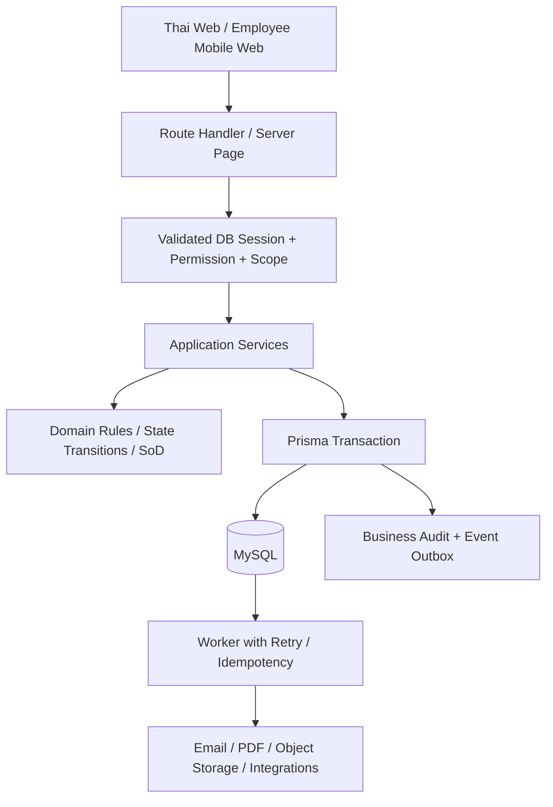
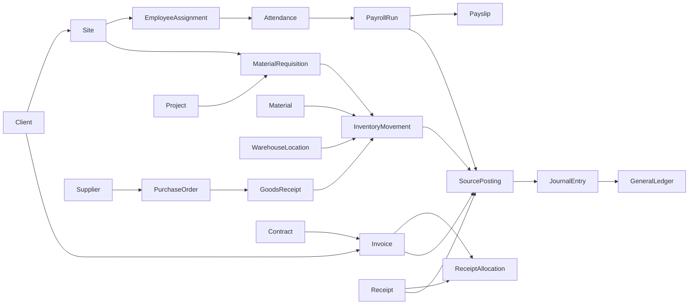

# SmartOP — โครงสร้างโครงการและสถาปัตยกรรมเป้าหมาย

วันที่ 21 พฤศจิกายน 2026 · สถานะ: ข้อเสนอสำหรับพัฒนาต่อจากระบบเดิม

อัปเดตขอบเขต 22 พฤศจิกายน 2026: ผู้ใช้ขยายให้ออกแบบ ERP บัญชี/ภาษีนำส่ง จัดซื้อจัดจ้าง คลัง คำสั่งซื้อ วางบิล และการเงินครบวงจร พร้อมตรวจไฟล์บริษัท เริ่มอ่าน [Integrated ERP Blueprint](SMARTOP_INTEGRATED_ERP_BLUEPRINT.md) และ [Gap audit](SMARTOP_COMPANY_SYSTEM_GAP_AUDIT.md) สำหรับการเชื่อมระบบและ backlog ล่าสุด เอกสารนี้คงเป็น baseline architecture เดิมสำหรับ traceability

เอกสารนี้จัดทำตามคำขอให้ออกแบบโครงสร้างทั้งโครงการ ไม่ใช่ผลรับรอง production และไม่ใช่เอกสาร `SMARTOP_SYSTEM_STANDARD.md` ฉบับเดิมที่ยังไม่ได้รับ หากได้รับมาตรฐานเดิมภายหลัง ให้ตรวจความต่างและบันทึกการตัดสินใจก่อนเปลี่ยน implementation

## 1. หลักฐานและขอบเขตการตรวจ

- ฐานโค้ด: `07a6dff2ec021ea1c98da9819c88b6394b6f9f13` บน branch `feature/production-erp-foundation`; ตรวจ remote HEAD ตรงกันในรอบตรวจนี้
- Next.js App Router, React, TypeScript, Prisma/MySQL; พบ 83 models และ 63 API route files จากการนับไฟล์ปัจจุบัน
- มีทั้ง `src/app/admin` และ route groups เช่น `(admin)`; รักษา URL ที่ใช้งานอยู่ก่อนจัดโครงสร้างภายใน
- มี User/Role/Permission/Assignment/Session, Employee/Site/Client, Attendance/Payroll, Purchasing, Inventory, Invoice/Receipt และ EventOutbox
- Route checker รอบล่าสุดผ่าน 115/115; เป็น static route existence ไม่ใช่ browser/HTTP workflow test
- ตรวจ source และตัวอย่างโครงสร้าง Excel; ไม่ได้ตรวจฐานข้อมูล production, restore, provider จริง หรือ UAT
- รายงานใน docs ที่ลงวันที่กันยายนเป็นข้อมูลย้อนหลัง ไม่ใช้ผล PASS เก่าทดแทนการทดสอบ release ใหม่

## 2. สถาปัตยกรรมที่เสนอ

ใช้ modular monolith ใน repository เดิม แยกโมดูลด้วย application service และกฎธุรกิจ ก่อนพิจารณาแยกบริการเมื่อมีข้อมูลการใช้งานรองรับ

Diagram แสดงเป้าหมาย; worker และ business audit แบบ transaction ยังต้องพัฒนา ตรวจสิทธิ์ก่อน query และ mutation ทุกครั้ง ไม่พึ่งการซ่อนเมนูหรือ edge middleware อย่างเดียว

## 3. โครงสร้างไฟล์

| ตำแหน่ง | หน้าที่และแนวทาง |
| --- | --- |
| `src/app` | URL, layouts, loading/error และ page composition; ไม่คำนวณเงินหรือเปลี่ยนยอดสต็อกตรงนี้ |
| `src/app/api` | validate input, เรียก session/authorization, เรียก service และ serialize output |
| `src/server/services` | application use cases; คง service เดิมและเพิ่มตามโมดูล ไม่ย้ายทุกไฟล์พร้อมกัน |
| `src/server/domain/<module>` | เป้าหมายใหม่สำหรับ pure rules, transition, Decimal calculations และ invariants |
| `src/server/queries/<module>` | เป้าหมายใหม่สำหรับ read queries ที่บังคับ scope, pagination และ field masking |
| `src/server/jobs` | เป้าหมายใหม่สำหรับ outbox/email/PDF/import worker |
| `src/lib` | shared infrastructure เช่น Prisma, crypto, email และ serializer; ไม่เพิ่ม business logic กระจัดกระจาย |
| `src/config/navigation.ts` | navigation registry ที่กรอง permission; แต่ server ต้องตรวจสิทธิ์ซ้ำ |
| `src/components` | shared UI; ใช้ SweetAlert2 ผ่าน `src/lib/swal.ts` |
| `prisma/schema.prisma` และ `prisma/migrations` | relational schema และ migration ที่ version control |
| tests ใกล้ source | Vitest สำหรับ domain/service; test DB แยกสำหรับ transaction/concurrency |
| `tests/e2e` | เป้าหมายใหม่สำหรับ Playwright โดยใช้ฐานข้อมูล test และบัญชีจำกัดสิทธิ์ |
| `docs` | architecture, decisions, phase backlog, release evidence และ runbooks |

ไม่สร้าง generic repository layer ครอบ Prisma ทุก model โดยไม่มีความจำเป็น ใช้ transaction client ที่ส่งเข้า helper ได้เมื่อต้องทำหลายขั้นตอนแบบ atomic

## 4. ขอบเขตโมดูลและเจ้าของข้อมูล

| โมดูล | ของเดิมที่ต่อยอด | เป้าหมายหลัก / สิ่งที่ต้องเพิ่ม |
| --- | --- | --- |
| Identity & Access | User, Role, Permission, UserRoleAssignment, UserSession, PasswordHistory | activation/reset token, policy, scoped guards, session revocation ทุก entry point |
| Organization & HR | Organization, Department, Employee, Client, ClientContact, Site, CostCenter | master lifecycle, aliases, effective-dated assignments, protected fields |
| Workforce | ShiftTemplate, ShiftAssignment, Attendance, Leave, EmployeeDeployment | correction, approvals, cross-midnight shifts, deployment documents |
| Payroll | PayrollPeriod, Component, Policy, Run, Payslip | reviewed formulas, component results, prepare/review/approve/finalize/publish |
| Materials & Inventory | InventoryItem, StockMovement, GoodsReceipt/Item, Asset | category/UOM, SKU variants, price history, warehouse/location/balance, requisition, transfer, adjustment |
| Procurement | Supplier, PurchaseRequisition/PRItem, RFQ/Item, PurchaseOrder/POItem | supplier contacts/catalog, quotations, approval and partial goods receipt |
| Billing & AR | Invoice/InvoiceItem, Receipt | billing profile/note, adjustment/credit, number sequence, receipt allocations, aging, PDF/email evidence |
| AP & Treasury | SupplierInvoice, Payment, CashLedgerEntry | invoice matching, approval, payment allocation, bank reconciliation |
| Accounting | ไม่มี Journal/GL model ใน schema ที่ตรวจ | chart of accounts, periods, balanced journal, posting rules, reversal, source posting registry |
| Supporting operations | Project, Contract, WorkOrder, Fleet, QHSE, Training | complete existing use cases หลัง core workflows; ไม่ถือว่ามี model แล้วแปลว่าพร้อมใช้ |
| Platform | ImportJob, EventOutbox, AuditLog, Notification, Document | durable workers, controlled import, storage, monitoring, backup/restore evidence |

รักษา `Client` เป็น canonical customer และ `PurchaseRequisition` เป็น purchase request ของเดิม ไม่สร้าง Customer/PurchaseRequest ซ้ำโดยไม่มี migration decision แยก `MaterialRequisition` สำหรับเบิกวัสดุออกจาก purchase requisition อย่างชัดเจน

## 5. ความสัมพันธ์ข้อมูลหลัก

เป็น logical design ไม่ใช่ schema ปัจจุบัน ทุก source document ต้องมี FK หรือ validated source registry ที่ตรวจความมีอยู่จริงได้ และแยก organizationId กับ site/project allocation เมื่อธุรกิจรองรับหลายองค์กร

## 6. กฎร่วมที่ต้องบังคับใน server

### Identity / authorization

- คง login/check-in เดิม และ migrate authMethod จาก LOCAL อย่างมี mapping: LOCAL_EMAIL, LOCAL_SITE, SERVICE; ห้ามเปลี่ยนทุกบัญชีเหมือนกัน
- Office ใช้ email ทุก domain ที่ valid แต่ต้องเป็นบัญชีที่ผู้ดูแลสร้างและ active; ไม่เปิดสมัครสาธารณะโดยไม่ได้อนุมัติ
- ใช้ User → Assignment → Role → RolePermission → Permission เป็นแหล่งสิทธิ์หลัก แทน fallback จาก User.role
- ประเมิน permission ภายใน assignment เดียวกับ scope เพื่อกันสิทธิ์จาก role หนึ่งไหลไป scope ของอีก role
- GLOBAL ต้องระบุชัด; ORGANIZATION ต้องเทียบ organizationId; SITE/PROJECT/CLIENT/DEPARTMENT/TEAM ต้องเทียบ resource ownership; OWN ใช้ actor/owner ฝั่ง server
- collection queries ต้องกรอง scope ใน DB ก่อนนับ/paginate; ห้ามดึงทั้งหมดแล้วซ่อนแถวบน UI
- วาง compatibility mapping และทดสอบบัญชีเดิมก่อนถอน User.role fallback; การออกแบบนี้ไม่ใช่อนุญาตให้ถอดทันที
- แยก read/write/submit/review/approve/issue/receive/post/reverse/export และ sensitive-field permission
- API และ server page ต้องตรวจ session ใน DB รวม revoke, expiry, active user, authzVersion; edge JWT เป็นเพียงด่านเบื้องต้น
- mutation แบบ cookie auth ต้องตรวจ CSRF/origin ตามช่องทางและทดสอบ; ไม่ถือว่า SameSite เพียงอย่างเดียวครอบคลุมทุกกรณี

### Password / activation

- Office policy: อย่างน้อย 12 ตัว มี upper/lower/digit/special, อายุ 30 วัน, ห้ามซ้ำ 12 รหัสล่าสุด และ Argon2id
- token activation อายุ 24 ชั่วโมง/reset อายุ 30 นาที เก็บเฉพาะ hash ใช้ครั้งเดียวด้วย conditional consume ใน transaction
- reset/password update ต้องตรวจประวัติ ปรับ expiry และ revoke sessions แบบ atomic; ไม่บันทึกรหัส/token ลง audit
- email link ต้องใช้ configured trusted HTTPS base URL; rate limit และตอบ reset request แบบไม่เปิดเผยว่ามีบัญชีหรือไม่
- นโยบาย employee/service แยกอย่างชัดเจน เพื่อไม่ทำ attendance หรือ machine integration หยุดโดยไม่ตั้งใจ

### Transactions / money / audit

- Monetary values ใช้ Decimal ตั้งแต่ input จน DB; JSON ส่ง decimal string; ไม่แปลง Number เพื่อคำนวณยอด
- กำหนด precision/scale, tax rounding, currency และ quantity UOM ก่อน migration; ข้อเสนอเริ่มต้น amount Decimal(18,2), unit cost/quantity Decimal(18,6) ต้องตรวจ maximum volume
- mutation สำคัญประกอบด้วย validation, permission/scope, SoD, state/version check, write, audit และ outbox ใน transaction เดียว
- ป้องกัน double click/retry ด้วย idempotency key ที่ bind actor/operation/request hash; key เดิม payload ต่างให้ conflict
- use case ที่แข่งขันกันต้อง lock หรือ conditional version update และ retry แบบ bounded; ห้าม read-check-write โดยไม่มี concurrency protection
- posted documents ไม่แก้/ลบ ใช้ reversal/adjustment อ้างอิงต้นฉบับ; FK restrict สำหรับข้อมูลอ้างอิง ไม่ cascade ลบ ledger
- audit ระบุ actor/action/entity/requestId/time และ safe change summary; ป้องกัน secrets/PII; access/export sensitive data ต้องตรวจและ audit
- audit service เดิมอ่าน previous hash และเขียนแยก รวมทั้งใช้ temp id ลง signature ต้องทดสอบ ordering/verification จริงก่อนอ้างว่า tamper-evident; ออกแบบ append sequence ที่ serialize ได้และ sign persisted canonical fields

## 7. P3 inventory design ที่ลงมือได้

เพิ่มแบบ backward-compatible: MaterialCategory, UnitOfMeasure, Material, MaterialPriceHistory, Warehouse, WarehouseLocation, InventoryBalance, InventoryMovement, MaterialRequisition/Line, StockTransfer/Line และ StockAdjustment/Line ขยาย GoodsReceipt/Item เดิมโดยไม่ชน purchasing

- Material.code unique เป็นข้อความ; แยก variant ขนาด/สีและ UOM conversion ที่อนุมัติแล้ว
- Balance unique ต่อ material/location; quantity และ carryingValue เป็น cache ที่ปรับพร้อม ledger ใน transaction และ reconcile ได้
- Movement signed quantity, inventory value delta, unit cost snapshot, location, site/project/costCenter, source document/line, actor, timestamp และ idempotency reference
- receipt: new average = (old value + receipt value) / (old quantity + receipt quantity); issue ใช้ average ก่อนจ่าย; stock ศูนย์ต้องจัดการ rounding residual อย่างมี policy
- return ต้องอ้าง issue เดิมและคืนได้ไม่เกิน outstanding; ใช้ original issue cost ตาม policy ที่อนุมัติ
- transfer มี paired movements มูลค่าเดียวกัน atomic ในระยะแรก; หากมีของระหว่างทางให้เพิ่ม in-transit location และ explicit receive workflow
- negative stock ปิดเป็นค่าเริ่มต้น; issuance ไม่เกินอนุมัติและพร้อมจ่าย; reservation แยกจาก physical on-hand หากต้องการรับประกันของหลังอนุมัติ
- approval ไม่ตัด stock; ISSUE เป็นจุดลด on-hand; RECEIVED ยืนยันผู้รับ ไม่ตัดซ้ำ
- status transition ใช้ conditional update/version; ผู้สร้างห้าม final approve adjustment/requisition; cancel หลังจ่ายแล้วต้องคืน/กลับรายการก่อน
- price history สำหรับราคาอ้างอิงไม่ใช่ inventory valuation; ราคาใหม่ไม่เขียนทับต้นทุน/ยอดย้อนหลัง
- historical consumption จาก Excel ไม่สร้าง physical stock movement โดยอัตโนมัติ; opening stock ต้องตรวจนับและอนุมัติแยก

ลำดับงานย่อย: schema/legacy mapping → valuation engine → ledger concurrency → scoped service/API → requisition approval → transfer/adjustment → Thai UI → preview import → reconciliation/UAT

## 8. Billing / accounting design

- Invoice sequence unique ต่อ organization/type/year; allocate number ด้วย transactional sequence row + unique constraint ห้าม COUNT+1; ยอมรับ gaps พร้อมเหตุผล ห้าม reuse issued number
- Invoice line snapshot ราคา ภาษี คำอธิบายและ service period; approval ก่อน issue; creator != final approver
- Receipt แยกจาก Invoice ผ่าน ReceiptAllocation เพื่อรับหลายใบ/บางส่วน/เงินรับยังไม่จัดสรร; migrate invoiceId เดิมอย่างรักษาประวัติ
- allocation ห้ามเกิน available receipt หรือ invoice outstanding ภายใต้ concurrency; credit/cancel ต้องปรับ AR ตาม state
- aging อิง unpaid balance และ due date ณ as-of date: CURRENT, 1–30, 31–60, 61–90, >90 วัน; due today เป็น CURRENT
- JournalEntry/Line ต้องมี debit/credit อย่างใดอย่างหนึ่งต่อบรรทัด, รวมเท่ากันต่อ currency, source reference, period, approver/poster
- source posting unique ต่อ source/event/version เพื่อกันลงบัญชีซ้ำ; posting + GL + source registry atomic
- posted journal immutable; reversal สร้าง journal ใหม่; closed period ปฏิเสธปกติ และ period reopen ต้องเป็น audited privileged workflow
- AccountingRule version และ effective date ต้องได้รับ review โดยฝ่ายบัญชี; ไม่ใช้สูตร Excel เป็น tax/payroll/accounting policy ที่อนุมัติแล้วโดยอัตโนมัติ

## 9. UI / integrations / operations

- Thai-first, breadcrumb, filter/search/pagination, permission-aware action และ loading/empty/error state; หน้าไม่เสร็จซ่อนจากเมนู production
- ไม่มี mock success สำหรับ email/PDF/backup; delivery status แยก queued/provider-accepted/delivered/failed เท่าที่มีหลักฐาน
- ใช้ EventOutbox เดิมเป็นจุดเริ่มต้นสำหรับ worker; claim/lease, attempt, nextAttemptAt, dead letter และ manual replay แบบไม่ทำธุรกรรมซ้ำ
- PDF เก็บ immutable document version, source snapshot hash และ object storage key; private download ผ่าน authorization/short-lived link
- เก็บเวลาระบบเป็น UTC และแสดง Asia/Bangkok; business dates/payroll cutoff เป็นคนละแนวคิดกับ timestamp
- แยก dev/test/staging/prod ทั้ง DB, credentials, storage และ email recipients; fixtures สังเคราะห์ ไม่ใช้ข้อมูลบริษัทเป็น demo seed
- สำรอง DB และเอกสารนอกเครื่องพร้อม access control และ retention; restore drill วัดจริงก่อนตั้ง production-ready

## 10. เรื่องที่ต้องตัดสินใจร่วมกับบริษัท

| เรื่อง | ข้อเสนอเริ่มต้น | ผู้ยืนยัน |
| --- | --- | --- |
| องค์กร/คลัง/ไซต์ | องค์กรเป็น boundary; หลาย location ต่อ warehouse | Operations + เจ้าของระบบ |
| SKU/UOM variants | หนึ่ง SKU ต่อสินค้าที่เบิก/ตีราคาแยกกัน | Warehouse |
| VAT และ inventory cost | แยก tax-inclusive historical report จาก carrying cost | Finance/Accounting |
| opening balance / return cost | ตรวจนับจริง; return อิง issue เดิม | Warehouse + Accounting |
| approval limits/delegation | ระบุวงเงินและ scope พร้อมช่วงเวลา | ผู้บริหาร + Security |
| payroll/OT/tax | rule matrix ตามไซต์/ช่วงเวลา ก่อน implement สูตร | HR + Finance |
| RPO/RTO/retention | ยังไม่ยืนยัน; เสนอ RPO 24 ชม./RTO 4 ชม. เพื่อเริ่มหารือ ไม่ใช่ SLA | เจ้าของธุรกิจ + Operations |
| email/storage/hosting | ทดสอบ provider และผู้รับผิดชอบค่าใช้จ่ายก่อนเปิดใช้ | เจ้าของระบบ |

ดำเนินงานออกแบบและพัฒนาใน test ได้ระหว่างรอ แต่ไม่ลง production rules หรือ import จริงในเรื่องที่ยังไม่ยืนยัน
