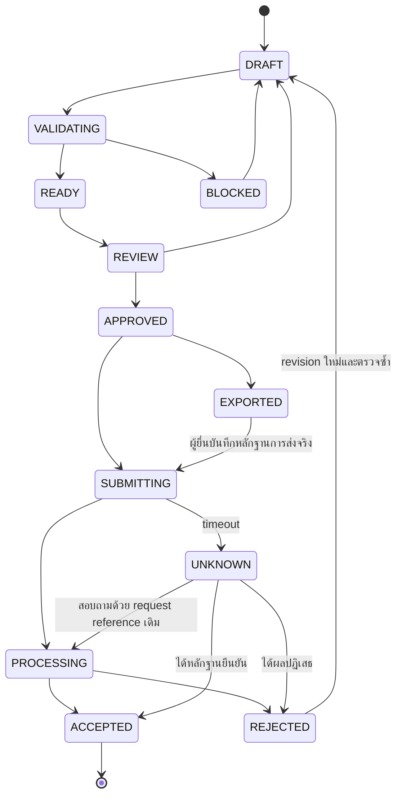

# SmartOP — ออกแบบระบบภาษีและนำส่งสรรพากรครบวงจร

วันที่ 22 พฤศจิกายน 2026 · Design proposal; ยังไม่มีการคำนวณ/ยื่นจริงหรือเชื่อม credentials

## 1. เป้าหมายและการตั้งค่าตามบริษัท

ผู้ใช้แจ้งว่าบริษัทจดภาษี/VAT และต้องการตัวเลือกในข้อมูลพื้นฐาน ออกแบบสถานะ REGISTERED / NOT_REGISTERED / PENDING_VERIFICATION ที่ OrganizationTaxProfileVersion พร้อม effectiveFrom/effectiveTo และ registration evidence สาขาอ้างทะเบียนนิติบุคคลและ branch registration ไม่ให้เปลี่ยนสถานะรายเอกสารโดยขัดกับทะเบียนที่มีผล

| ตั้งค่า | กฎระบบ |
| --- | --- |
| VAT registration | ใช้เวอร์ชันตามวันเหตุภาษีและบริษัท; ตรวจช่วงเวลาทับซ้อน; เปลี่ยนข้อมูลที่มีผลแล้วผ่าน approval |
| Branch | branch code/address/filing jurisdiction ตามทะเบียน; Site ของลูกค้าคนละ entity |
| VAT transaction code | STANDARD / ZERO_RATED / EXEMPT / OUT_OF_SCOPE / NON_VAT_SELLER; แยกความหมายแม้อัตราที่คำนวณเป็นศูนย์ |
| Price mode | VAT_EXCLUSIVE / VAT_INCLUSIVE พร้อม rounding policy/version |
| Input tax | CLAIMABLE / NON_CLAIMABLE / PENDING_EVIDENCE / PARTIAL; ระบุเหตุผลและหลักฐาน |
| WHT | income type, payer/payee type, residency, amount basis/threshold aggregation, statutory/treaty/reduced-rate context, effective dates |
| Corporate income tax | fiscal year, entity regime/eligibility, rate bands, loss/credit schedules และผู้ทบทวน |
| Obligations | form/period/channel/branch-group/filing frequency; applicable/inapplicable/pending reason |

ไม่จด VAT ไม่ได้แปลว่าไม่ต้องประเมิน WHT/CIT และไม่จำเป็นต้องทำให้ภาษีใน supplier invoice หายไป: input tax ที่ใช้สิทธิ์ไม่ได้ต้องลงต้นทุน/ค่าใช้จ่ายตาม policy

## 2. ขอบเขตแบบและผลลัพธ์

รายการต่อไปนี้เป็น form catalog เป้าหมาย เปิดใช้เมื่อเข้าเงื่อนไขบริษัทและได้รับการตรวจ rule version แล้ว [แบบ VAT ทางการ](https://www.rd.go.th/62381.html), [แบบ WHT ทางการ](https://www.rd.go.th/7064.html)

| กลุ่ม | แบบ/งานที่รองรับ | ข้อมูลต้นทาง | สิ่งที่ต้องตรวจรับ |
| --- | --- | --- | --- |
| VAT ปกติ | ภ.พ.30 และรายละเอียดสาขาเมื่อใช้ | TaxInvoice, purchase tax evidence, credit/debit notes, TaxLedgerEntry | ภาษีซื้อ/ขาย, input disallowance, credit/refund/carry-forward, branch reconciliation |
| VAT เงื่อนไขเฉพาะ | ภ.พ.30.2/30.3 และ ภ.พ.36 เมื่อเข้าเงื่อนไข | apportionment / foreign-service/import-service assessment | applicability, supporting evidence, tax point/FX และ current form specification |
| WHT เงินเดือน | ภ.ง.ด.1 และ annual forms ตาม obligation | approved payroll payments + employee tax profile/YTD | per-employee tax calculation, remittance reconcile, annual certificate |
| WHT จ่ายในประเทศ | ภ.ง.ด.3/53 และ annual/other WHT forms เมื่อเข้าเงื่อนไข | payment allocations + classified income + payee profile | tax bases/rate/payer condition, split payments, certificates and duplicates |
| WHT ถูกลูกค้าหัก | ติดตามหนังสือรับรองและเครดิตภาษี | receipt allocation + customer certificate | amount/tax year/identity, pending evidence, no duplicate AR settlement |
| ต่างประเทศ | ภ.ง.ด.54 และประเมิน ภ.พ.36 แยกกัน | foreign payment, contract, residency/treaty/evidence | legal assessment และ form/channel ที่รองรับจริง |
| CIT | ภ.ง.ด.50/51 และ tax computation schedules | closed/reviewed GL, tax adjustments, loss/credit schedules | accounting-to-tax bridge, rate eligibility, approved estimate/annual return |
| Stamp duty | อากรแสตมป์/อ.ส.9 หรือช่องทางที่ตรงตราสาร | work/service contracts and instruments | instrument classification, liable party, value/time/rate and payment evidence |
| อื่นตามกิจการ | ภาษีธุรกิจเฉพาะ/แบบอื่นที่ผู้เชี่ยวชาญระบุ | assessed obligation | ปิดไว้พร้อมเหตุผลหากไม่เข้าเงื่อนไข; ไม่ถือว่าทุกบริษัทต้องยื่น |

50 ทวิเป็น certificate workflow แยกจาก return submission; e-Tax Invoice เป็น document delivery/signing workflow แยกจากการยื่นแบบภาษีประจำงวด

## 3. การคำนวณภาษีต้องแยกจากวันที่บันทึกบัญชี

TaxEvent เก็บ document date, accounting date, payment date, tax-point date, tax-reporting period และ reason ของการเลือกวันที่นั้น ใช้ TaxPointPolicy ที่ review แล้วตามประเภทสินค้า/บริการ/เงินล่วงหน้า/เอกสาร ไม่ใช้ invoice.issueDate เป็นทุกเหตุภาษีโดยอัตโนมัติ

ตัวอย่างคำนวณเพื่อทดสอบ arithmetic เท่านั้น: ฐาน 10,000 อัตรา VAT 7% ได้ VAT 700; gross 10,700 หาก WHT 3% ใช้กับฐานดังกล่าวตาม rule ที่อนุมัติ WHT = 300 และ net paid = 10,400 ห้ามนำ 3% ไปใช้กับทุกค่าบริการหรือทุกคู่ค้าแบบตายตัว

exclusive: tax = round(base × rate); inclusive: base = round(gross ÷ (1+rate)), tax = gross − base ตาม approved rounding level; line/header residual ต้องจัดสรรอย่างตรวจย้อนกลับได้ ไม่ใช้ Float

WHT แยก TAX_DEDUCTED / PAYER_BEAR_ONCE / PAYER_BEAR_CONTINUOUSLY และ gross-up method ตามกฎที่อนุมัติ; VAT base/WHT base อาจต่างกัน เก็บสองฐานแยก ไม่หัก WHT จาก VAT รวมโดยเดา

## 4. ทะเบียนภาษี

| ทะเบียน | รายการและ invariant |
| --- | --- |
| Sales VAT | tax point, document number/version, branch, customer snapshot, tax treatment, base/VAT; credit/debit notes อ้างเอกสารเดิม |
| Purchase VAT | supplier TIN/branch, invoice number/date, posting/evidence/claim period, original VAT, eligible/noneligible portion and reason |
| WHT payable | payer/payee snapshot, payment date, income category, base/rate/amount, form, certificate/delivery, e-WHT reference |
| WHT receivable | customer withholding, tax-year credit, certificate received/verified/adjusted; cash received กับเครดิตหักภาษีแยกกัน |
| CIT | book profit, permanent/timing adjustments, deductible limits, loss carry-forward usage, prepaid/withheld credits and estimate versions |
| Stamp/foreign | instrument/foreign payment assessment, due event, reviewed rule, exchange rate source/version and evidence |

TaxLedgerEntry เป็น append-only facts จาก approved source event หนึ่งครั้งต่อ source/event/version ไม่มีการแก้ยอดแบบที่ยื่นแล้วด้วยการแก้ supplier invoice/receipt เก่า และไม่ผูก VAT claim period กับ GL period แบบบังคับเท่ากัน

## 5. Filing lifecycle และ payment lifecycle แยกกัน

Payment status แยก NOT_REQUIRED / DUE / APPROVED_TO_PAY / PROCESSING / UNKNOWN / PARTIALLY_SETTLED / PAID_CONFIRMED / RECONCILED / FAILED ไม่บังคับว่าทุก return ต้องมี payment หรือว่าทุกช่องทางรองรับแบ่งจ่าย; partial settlement เป็นสถานะ reconciliation ที่ต้องตรวจเงื่อนไข

Complete เมื่อ filing accepted ตามหลักฐาน และ payment reconciled หรือยืนยัน zero liability/not-required/refund-credit case แล้ว หลักฐาน Bank transfer และใบเสร็จ/ผลรับแบบทางการแยกเก็บ ไม่ถือว่า HTTP 200, ไฟล์ export หรือบันทึกสลิปเป็นการยื่นสำเร็จ

## 6. ขั้นตอนรายงวด

1. เปิด TaxPeriod จาก obligation/calendar ที่อนุมัติ สร้างงานและผู้รับผิดชอบ
2. ดึงเฉพาะ posted/eligible tax events; แยกรายการขาดเอกสาร ซ้ำ identity ไม่ผ่าน และ tax treatment ไม่ชัด
3. จัดทำ return snapshot พร้อม row provenance และ source versions; คำนวณ totals/credits/adjustments ตาม rule/form version
4. reconcile source ledger → tax registers → draft return → GL control accounts; discrepancy ต้องแก้หรือมี authorized exception
5. tax preparer ส่ง review; reviewer ตรวจเอกสารและ exception; final approver ต้องคนละคนกับ preparer
6. freeze snapshot/hash; export/submit ต้องเป็น snapshot ที่อนุมัติ ถ้าข้อมูลต้นทางเปลี่ยนให้ revalidate/reapprove revision ใหม่
7. สร้าง filing attempt และ request reference ใน DB ก่อนส่ง network; worker ส่งหลัง commit โดยใช้ approved grant
8. ติดตามผลจริง; timeout เก็บ UNKNOWN และสอบถาม reference เดิมก่อน retry เพื่อกันยื่นซ้ำ
9. อนุมัติคำสั่งจ่ายตามหลักฐาน accepted/payin ที่ถูกต้อง; จ่ายและ reconcile ภาษีแยกจากการยื่น
10. แนบแบบที่รับแล้ว ใบเสร็จอิเล็กทรอนิกส์ และ bank evidence; ปิดงานด้วย reconciliation/ผู้ตรวจ และล็อก snapshot

## 7. ยื่นเพิ่มเติมและแก้ไข

- TaxReturn มี series identity ตาม organization/filing group/form/period และ immutable versions แยก original/additional/amendment/other ตาม form rules
- amended return อ้าง previous accepted return และแสดง original/revised/difference พร้อมเหตุผล; ห้าม copy ยอดทั้งหมดไปนำส่งซ้ำโดยไม่เข้าใจวิธีเพิ่มเติมของแบบนั้น
- source event ไม่รวมซ้ำใน original return สองชุด; additional allocations อ้าง event correction/version และ form-specific inclusion rule
- การยกเลิกหรือขอคืนใช้ workflow ที่ช่องทางนั้นรองรับจริง; ห้ามตั้ง CANCELLED ด้วยปุ่มภายในแล้วถือว่าทางราชการยกเลิกแล้ว
- หากรายการถูกพบหลังปิดงวดบัญชี/ภาษี ให้ exception workflow เลือก reversal/adjustment และงวดเพิ่มเติมที่ผู้รับผิดชอบอนุมัติ โดยเก็บเวลาที่ตรวจพบ

## 8. ปฏิทินและกฎตามช่วงเวลา

TaxDueDateRule แยก form, channel, tax event/period end, fiscal-year case, holiday policy, extension eligibility และ legal source ไม่ hardcode “ทุกแบบวันที่เดียวกัน” และไม่ขยาย online deadline ให้ทุกบริษัทอัตโนมัติ

ฐานกำหนด CIT ของกรมสรรพากรระบุ ภ.ง.ด.51 ภายในสองเดือนหลังหกเดือนแรกของรอบบัญชี และ ภ.ง.ด.50 ภายใน 150 วันหลังสิ้นรอบ ใช้เป็น base rule ที่ต้องประกอบ calendar/extension เฉพาะ release [แหล่งทางการ](https://www.rd.go.th/840.html)

เก็บ dueDateOriginal/dueDateEffective, rule version, holiday/extension reference, timezone Asia/Bangkok และผู้ตรวจ ระบบเตือนก่อนครบกำหนดหลายช่วง; due date ไม่เลื่อนเพราะคิวภายในล่าช้า

## 9. ช่องทางนำส่งและ capability registry

| ช่องทาง | การออกแบบและเกณฑ์เปิดใช้ |
| --- | --- |
| Manual assisted | ระบบเตรียม package/worksheet แล้วผู้ได้รับสิทธิ์ยื่นเอง; capture official acknowledgement/receipt และ verifier แยก |
| Official import file | adapter ต่อ form/schema/channel version; encoding/length/date/branch/checksum/totals ทดสอบกับเครื่องมือทางการเวอร์ชันนั้น |
| RD Open API | เปิดเฉพาะ form/role/environment ที่มีสิทธิ์และ spec ยืนยัน; secret vault, request IDs, auth, async result, polling และ official evidence |
| e-WHT | ผูก bank/provider transaction และผลรับ; กันใบ certificate/return inclusion ซ้ำกับ manual WHT |
| e-Tax Invoice | generate/sign/validate/deliver/store ตาม channel ที่ได้รับสิทธิ์; ไม่ถือ PDF ปกติเป็น e-Tax ที่ผ่านมาตรฐาน |
| e-Stamp | adapter แยกสำหรับตราสารและ provider/channel ที่อนุญาต ไม่ reuse VAT filing API |

กรมสรรพากรมี API spec สำหรับการส่ง สอบถามสถานะ และขอเอกสาร แต่รายการแบบที่รองรับต้องตรวจราย adapter ไม่อนุมานว่าทุกแบบใช้ได้ [API ทางการ](https://efiling.rd.go.th/rd-cms/api), [format กลาง WHT](https://www.rd.go.th/54910.html), [มาตรฐาน e-Tax](https://www.rd.go.th/65244.html)

External calls ไม่อยู่ใน DB transaction; ใช้ durable outbox/lease/backoff/retry budget/dead letter และ provider status reconciliation UNKNOWN ไม่เปลี่ยนเป็น FAILED เพื่อส่งซ้ำทันที Raw encrypted response เก็บใน private evidence storage; logs/หน้าจอไม่เก็บ token/password หรือ personal tax records เต็ม

## 10. หลักฐานและการตรวจสอบ

TaxEvidence เก็บประเภทเอกสาร objectKey/hash, source/provider, receivedAt, verifiedBy/At, related submission/payment, retention policy และ legal hold; read/download/export ต้องมี field-level permission และ audit

Certificate/return/export snapshot ห้ามแก้หลังออกเวอร์ชันนั้น เอกสาร replacement ใช้ version/new number ตาม rule พร้อม linkage และเหตุผล สำหรับค่ากฎใหม่ต้องเก็บ source URL/document checksum, approvedBy, reviewedAt และ expiry/review due ไม่ใช้ rate ปัจจุบันคำนวณเอกสารเก่าใหม่

## 11. เกณฑ์ตรวจรับหลัก

VAT/non-VAT change boundary, zero/exempt/out-of-scope distinction, inclusive rounding, duplicate purchase tax invoice, partial input tax, credit/debit note, cash/accrual tax-point differences, WHT partial payments/gross-up/e-WHT, payroll YTD, foreign payment legal assessment, approved snapshot mutation, amended returns, deadline extensions, submit timeout/duplicate callbacks, tax payment mismatch, unauthorized company/branch and return reopen ต้องมี automated tests และ company UAT

ตัวอย่างกฎและ sources อยู่ใน [ทะเบียนอ้างอิง](SMARTOP_TAX_RULES_AND_SOURCES.md); ยังไม่มีการ implement filing connector, export format หรือกฎเฉพาะบริษัทในงานออกแบบนี้
